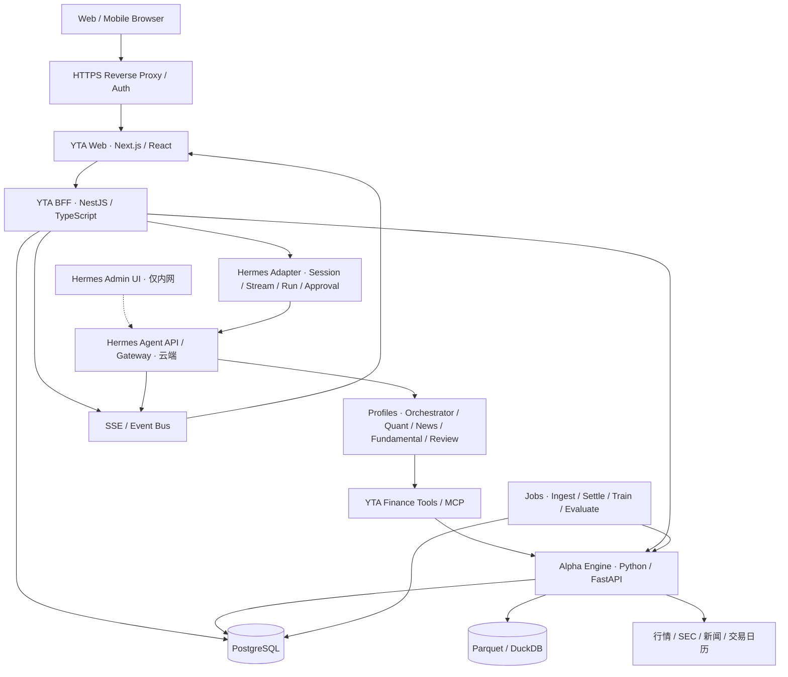
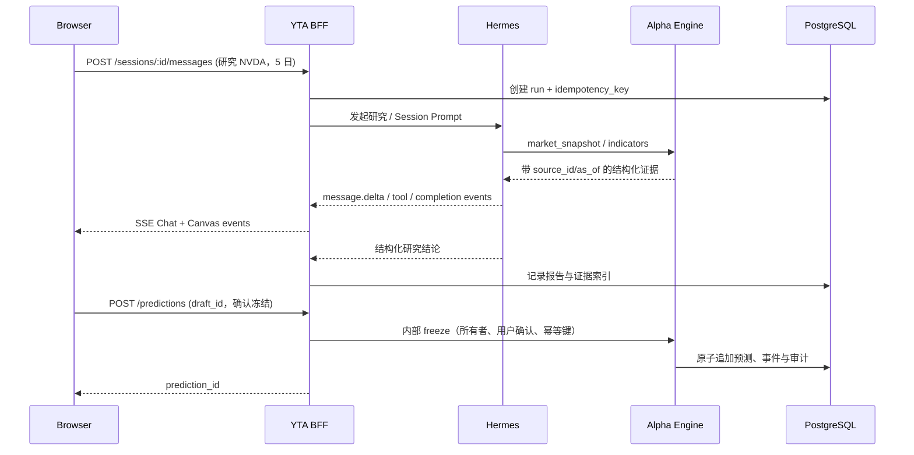
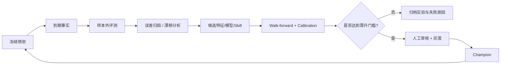

# Youwei Trading Agent（YTA）v4.0 — Hermes Headless 完整技术架构与实施任务书

> **状态**：实施基线（Design Baseline） · **日期**：2026-10-27 · **修订**：范围与协议一致性修订  
> **核心决策**：云端 Hermes Agent 只做 Agent Runtime；用户界面独立开发 YTA Web；Hermes 官方 UI 仅供管理员使用。  
> **目标**：美国股票与美股 ETF 的多 Agent 研究、可解释预测、冻结验证、持续评测和受控自进化。  
> **适用对象**：个人开发者 / 小型工程团队 / AI Coding Agent；任务可直接拆为 GitHub Issues、Linear Tickets 或开发 Sprint。  
> **交付性质**：详细架构、协议与逐项任务规划；**不是已经完成或部署的系统**。

## 0. 阅读顺序与约束

1. 先阅读第 1–5 章，确认产品边界、总体架构、运行时接入方式与核心数据流。
2. 按第 6–12 章实现数据模型、API、Agent、量化模型、前端、安全、部署和测试。
3. 按第 13 章的 **TASK-001～TASK-120** 逐条执行；每项都给出前置依赖、交付件和验收条件。
4. 使用第 14 章的 Sprint 与里程碑推进，按照第 15 章的验收门槛判断是否可上线。
5. 代码实现时以 **锁定的 Hermes Git commit / Release 文档和源码** 为准，避免依赖不稳定的内部模块。
6. 本文中的 `/api/yta/*`、`yta.*`、事件名、数据表、前端组件，除特别注明外，**全部是 YTA 自定义设计，不是 Hermes 官方接口**。

**明确不做**：A 股、港股、自动实盘下单、券商账户托管、保证收益、毫无来源的“AI 预测准确率”。研究结论允许大胆看多或看空，但必须记录来源、时间、模型版本、风险与验证结果。

业务术语见 [GLOSSARY.md](../GLOSSARY.md)。第 1.2 节是发布范围的唯一依据；第 6.2 节是预测与结算协议的唯一依据。任务、里程碑与验收清单必须与两者一致。

### 本次修订摘要（2026-10-27）

- MVP 收敛为 NVDA、日线、单 Profile、5 交易日 baseline，保留真实研究、Canvas、冻结和结算闭环。
- 提前模型登记、行情证据、可复现清单与备份隔离；解除 MVP 对训练、新闻和多 Agent 的依赖。
- 固定盘后收盘到收盘的简单价格收益协议，区分不可变预测、运行状态与版本化结算。
- 保留 TASK-001～117，新增 TASK-118～120 承接 Beta 扩展；修订当时所有任务为 TODO，后续开发状态按实施证据更新。
- Hermes 官方文档已核对，锁定版本和实际能力测试仍待验证；没有新增部署或实现完成声明。

## 1. 产品目标、用户旅程与功能优先级

### 1.1 主要用户旅程

以下 U1–U6 描述完整产品愿景；各发布阶段只验收第 1.2 节对应子集。

- **U1 研究**：输入“研究 NVDA，给出未来 1/3/5/10/20 个交易日的多空情景”，Orchestrator 拆解任务，Quant / Fundamental / News / Bull / Bear 汇总证据，Review 复核，Chat 与 Canvas 同步展示。
- **U2 预测**：点击“冻结预测”，写入不可覆盖的预测快照，明确 `as_of`、数据截点、预测 horizon、方向、收益率、概率/区间、模型版本。
- **U3 复盘**：到期后按交易日历自动匹配实际行情，结算方向正确率、收益误差、概率校准、基线对比。
- **U4 自进化**：发现模型持续失效 → 提交新特征/模型候选 → walk-forward 样本外评测 → 人工批准晋升 → 监控回滚。
- **U5 长期运行**：云服务器每日盘后自动更新数据、生成研究简报、执行到期结算；手机浏览器查看结果。
- **U6 追溯**：点击任何预测，可回看原始行情版本、研究证据、工具日志、模型配置和最终结算。

### 1.2 优先级与发布范围（唯一依据）

| 优先级 | 能力 | 发布阶段 |
|---|---|---|
| P0 | NVDA、日线、单 alpha-orchestrator、5 交易日 baseline；登录、流式 Chat、取消/恢复、真实行情与指标、工具驱动 Canvas、用户确认冻结、结算、历史详情、审计、可复现、staging 隔离、基础备份恢复 | MVP（M0–M3） |
| P1 | 多美股与美股 ETF、自选列表、1/3/5/10/20 horizon、新闻财报、多 Profile 与 Bull/Bear/Review、任务看板、LightGBM、walk-forward、概率校准、评测报告、人工模型晋升、移动 Tab、成本分析 | Beta（M4–M5） |
| P2 | 多数据源切换、市场 regime/行业切片、Skill/Memory 审核进化、多模型成本路由实验 | v1（M6） |

通知渠道、复杂策略组合及进一步移动优化保留为后续候选，不属于当前 120 个任务的交付承诺。首版页面不展示尚未实现的 Beta 功能入口；NVDA 概览不提供添加其他证券或切换 Profile 的操作。

### 1.3 非功能目标（初期目标值，可在压测后调整）

| 指标 | MVP 验收目标 |
|---|---|
| YTA Web 首屏 | 常见网络下 P95 < 3 秒（不含模型响应） |
| 研究会话首个流式事件 | 目标 P95 < 5 秒，需区分模型/网络延迟 |
| 500 根 K 线加载 | P95 < 2 秒（命中缓存） |
| 预测写入 | 幂等；同一请求不会重复冻结 |
| 预测到期结算 | 同一预测可安全重试，结果可追溯 |
| 服务可用性 | 单机 MVP 目标 99%，正式阶段重新定义 |
| 模型研究 | 不发生时间泄漏；评测按时间分割 |
| 数据质量 | 价格记录有供应商、交易日、时区和调整口径 |
| 密钥 | 不出现在浏览器包、日志、数据库明文字段中 |

## 2. 总体技术架构



### 2.1 关键架构决策 ADR

| ADR | 决策 | 原因 | 代价 / 退出策略 |
|---|---|---|---|
| ADR-001 | Hermes Headless，官方 UI 仅管理 | 保留 Agent 能力，去掉投资场景无关组件 | 自研 Web；通过 Adapter 隔离 |
| ADR-002 | Next.js + TS BFF | 前端交互、鉴权、API 聚合与流式事件清晰 | 多一服务；MVP 可合并 Next Route Handler |
| ADR-003 | Python Alpha Engine | pandas/NumPy/LightGBM/回测生态成熟 | 需维护跨语言 API |
| ADR-004 | PostgreSQL + Parquet/DuckDB | 事务与研究大表分层 | 单机部署先轻量，逐步扩展 |
| ADR-005 | 预测 append-only | 防止事后修改预测和评价污染 | 修正采用版本/撤销事件，不做 UPDATE |
| ADR-006 | 模型只负责推理，指标由程序计算 | 可复现、低 Token 成本 | 需维护数据/特征流水线 |
| ADR-007 | SSE 优先，必要时 WS | 浏览器流式 Chat 简单 | 双向审批和恢复需要补偿 API |
| ADR-008 | 首版单租户，接口保留 owner_id | 控制复杂度 | 不假装多租户隔离已完成 |
| ADR-009 | 先纸面研究，不接实盘交易 | 降低风险，聚焦预测质量 | 后续独立评审交易系统 |
| ADR-010 | Hermes 版本锁定 + 契约测试 | 上游 API 可能演进 | 适配层单独升级、回滚 |
| [ADR-011](adr/0011-prediction-domain-authority.md) | Alpha 统一预测事实事务；BFF 负责用户授权 | BFF 与 Jobs 复用同一金融规则 | 增加私网调用；保持唯一事实写入路径 |

### 2.2 推荐技术栈

| 层 | 技术 | 备注 |
|---|---|---|
| Web | Next.js App Router、TypeScript、Tailwind、TanStack Query、Zustand | 状态分离：服务端数据与 UI 临时状态 |
| 图表 | TradingView Lightweight Charts、ECharts | K 线与多窗格指标；遵守各自许可 |
| BFF | NestJS（MVP 亦可 Fastify）+ Zod + OpenAPI | Hermes 不直连公网浏览器 |
| Agent | NousResearch Hermes Agent，锁版本 | Profiles、Skills、Memory、Kanban、工具 |
| Hermes 通信 | HTTP/SSE API 优先；高级交互用 TUI Gateway JSON-RPC over WS | 依据功能矩阵决定 |
| Quant | Python 3.12、FastAPI、pandas、NumPy、scikit-learn、LightGBM | 固定环境锁文件 |
| 数据 | PostgreSQL、Redis（可选）、Parquet、DuckDB | 初期可不用 Redis |
| 任务 | APScheduler/独立 Worker；后期 Celery/Arq | 避免与 Hermes Cron 重复调度同一职责 |
| 运维 | Docker Compose、Caddy/Nginx、GitHub Actions、OpenTelemetry | 单机优先 |
| 测试 | Vitest、Playwright、pytest、Testcontainers | 契约与 E2E 必做 |

### 2.3 资源部署

- **开发**：本地 Next.js/BFF/Python + 云端或测试 Hermes，使用模拟 Provider；无需本地 Hermes Desktop。
- **最小云端 PoC**：2C/4GB 只运行少量并发，数据库与回测尽量错峰；2C/1GB 仅验证容器启动与基础接口。
- **推荐初期云端**：4C/8GB、足够 SSD、每日备份；本地大模型推理另需 GPU/RAM，不应放在小 ECS 上。
- **扩展**：Web/BFF 横向扩容；Hermes Gateway 与后台计算任务独立节点；数据库独立托管。

## 3. 运行时边界与 Hermes 接入

### 3.1 官方接口与接入前置门槛

MVP 选择 HTTP Runs + SSE：`POST /v1/runs`、运行状态查询、事件订阅、停止及 `/v1/capabilities`。TUI Gateway JSON-RPC 留作 Beta 增强，不默认双协议接入；ACP 不在当前 Web 接入范围。

2026-10-27 已核对 [官方 Programmatic Integration](https://hermes-agent.nousresearch.com/docs/developer-guide/programmatic-integration) 和 [API Server](https://hermes-agent.nousresearch.com/docs/user-guide/features/api-server)。官方文档列出上述接口，并说明幂等与恢复行为受执行模式及保留范围约束；这不代表选定版本已验证可用。

| 核验项 | 必须保存的证据 | 当前状态 |
|---|---|---|
| 版本与启动 | commit/tag、镜像摘要、启动命令、认证与持久卷配置 | 本机固定 arm64 镜像、鉴权与持久卷已有证据；正式部署验收待完成 |
| 会话连续性 | 多轮请求、session 映射、进程重启后的恢复记录 | 真实模型同会话及重启后精确回忆通过；独立会话上下文分离通过，完整隔离待验收 |
| Run / SSE / 工具事件 | capabilities、脱敏请求响应、真实工具调用与终态 | 真实模型调用两个 REPLAY 金融工具及 SSE 终态通过；完整部署配置待验收 |
| 停止与断线恢复 | stop 结果、事件游标、丢失窗口处理、历史回放测试 | 文字输出中取消、同会话排队取消/重复停止、游标与重启状态通过；旧 SSE 重启后 404；预置事件的实际 HTTP 截断/游标边界通过；真实模型工具中取消通过，但下游仍可完成，生产恢复处理待验收 |
| 幂等与未知执行 | 同键重试、同键异参、超时、重启、过期记录测试 | 同键、冲突、崩溃 unknown、精确代次确认及终态保留期过期已有证据；新增真实模型请求已接受后响应丢失、客户端超时及 4 个并发同键重试同 Run 证据；完整超时/保留矩阵待验证 |
| Profile 隔离 | 允许的路由、凭证范围、拒绝越权的测试 | HTTP 凭证/Run 归属、模型密钥/鉴权头作用域及真实模型正反例通过；新增无工具 Gateway 两 Profile 并发8 Run 的 SOUL/禁用 Skill 提示隔离证据，重启只读恢复不新增模型请求；完整工具/文件隔离待验证 |

候选源码已固定为 `085f562af53a6fedadac3681e2c498fc71316132`，28 个审查文件的哈希记录于 `infra/hermes/source-lock.json`；[源码核对记录](hermes-integration-research.md) 是静态证据，固定镜像的本机实测另记录于 `infra/hermes/runtime-observation.json` 和 [实施状态](implementation-status.md)。上表反映已取得的局部证据与缺口，不代表整体接入门槛通过；锁文件的总体能力状态仍为 UNVERIFIED。

TASK-007/015 完成这些证据后，TASK-027 才能按锁定协议实现真实 Adapter。必需能力失败阻塞真实接入验收；Mock 可用于开发，不能替代该门槛。若 HTTP 无法满足要求，应先修订接入决策及契约，不能静默换协议。

BFF 持久化请求身份及发送状态。上游接收结果不明时标记 `EXECUTION_UNKNOWN`，先按已知 run/请求身份核对，禁止换键自动重发；无足够证据时保留待核对状态。不能以本地唯一键宣称跨系统全局 exactly-once。

固定候选的终态幂等记录默认保留 24 小时；无网络独立 HTTP 演练已证实，已失败记录超过期限清理后，即使沿用旧键和正文也会创建新 Run。原 Run 当时仍可按 ID 查询。故本地派发记录不能随上游保留期丢弃，未知/过期/404 不能自动转为可重发；原键本身不构成永久防重保证。受控时钟与已失败测试行时间设置的证据见 runtime-observation.json，不代表真实 24 小时耐久运行。

### 3.2 Hermes Adapter 内部接口（YTA 自定义）

```ts
interface HermesAdapter {
  createSession(input: { ownerId: string; profileId: string; model?: string }): Promise<{ sessionId: string }>;
  streamPrompt(input: { sessionId: string; text: string; requestId: string }): AsyncIterable<AgentEvent>;
  getHistory(sessionId: string, cursor?: string): Promise<AgentMessagePage>;
  cancel(sessionId: string, runId?: string): Promise<void>;
  getCapabilities(): Promise<HermesCapabilities>;
  listProfiles(): Promise<AgentProfile[]>;
  getRunEvents(runId: string, cursor?: string): AsyncIterable<AgentEvent>;
  respondToRequest?(input: { requestId: string; choice: unknown }): Promise<void>;
}
```

Adapter 是 YTA 业务接口，不要求与 Hermes 端点一一对应。`createSession()` 建立 YTA 与上游会话身份的映射；`getHistory()` 从 YTA 持久化消息/事件仓库读取；`listProfiles()` 从 YTA 白名单注册表读取。前端只访问 BFF DTO，真实 transport 的参数以 TASK-015 的证据为准。MVP 注册表仅启用 alpha-orchestrator。

冻结确认由 YTA 鉴权 API 承担，不依赖 TUI Gateway 审批。Agent 冻结工具只能提出草稿确认请求；用户确认后由 BFF 执行写入。

### 3.3 Hermes 事件归一化

```json
{
  "event_id": "evt_01J...",
  "schema_version": 1,
  "occurred_at": "2026-10-26T12:00:00Z",
  "session_id": "ses_123",
  "run_id": "run_123",
  "profile_id": "alpha-orchestrator",
  "type": "message.delta",
  "sequence": 12,
  "payload": {"text": "根据财报..."}
}
```

事件类型（YTA 自定义）：`session.created`、`run.started`、`message.delta`、`message.completed`、`tool.started`、`tool.completed`、`agent.delegated`、`approval.requested`、`run.completed`、`run.failed`、`run.canceled`、`run.execution_unknown`、`canvas.command`、`prediction.frozen`。

**流式恢复**：前端传 `Last-Event-ID` / `cursor`；BFF 保存有限时事件窗口并支持补拉历史。事件去重键为 `event_id`，同一 run 内 `sequence` 单调；失败重连不重复执行 prompt。游标超出保留窗口时明确返回 `CURSOR_EXPIRED`，客户端加载持久化消息/状态快照后重新订阅，不把旧 prompt 当成新任务提交。SSE 心跳、断线、取消和超时必须有测试。

### 3.4 多 Profile / Kanban 规则

MVP 仅启用 `alpha-orchestrator`。Beta 通过 TASK-120 扩展 Profiles：`alpha-orchestrator`、`quant-research`、`fundamental-research`、`news-research`、`bull-bear-review`、`prediction-reviewer`。Profile 各自有明确 Skill、工具白名单、模型预算与输出 JSON Schema。

Hermes Kanban 用于跨 Profile 的**持久任务**；短暂并行分析可使用 Subagents。多 Gateway 时，Kanban Dispatcher 必须单所有者，避免重复派发。YTA 自己的 `research_runs` 记录业务执行状态，Kanban 是执行侧状态，二者通过外键映射而不是共用数据库表。

### 3.5 典型研究链路



## 4. 仓库结构与模块职责

```text
youwei-trading-agent/
├── apps/
│   ├── web/                  # Next.js: Overview, Research, Predictions, Agents, Evolution
│   └── bff/                  # NestJS: auth, chat, SSE, Hermes adapter, canvas, orchestration
├── services/
│   ├── alpha-engine/         # FastAPI: data, indicators, features, forecasts, evaluation
│   └── jobs/                 # Ingest, settlement, retrain, daily briefing
├── packages/
│   ├── contracts/            # OpenAPI, Zod, JSON Schema, event schemas
│   ├── ui/                   # Design system / chart components
│   ├── hermes-adapter/       # Hermes HTTP/WS protocol adapter
│   └── config/               # TS configs, lint, shared rules
├── hermes/
│   ├── profiles/             # SOUL.md / profile policies / prompts
│   ├── skills/               # 研究、证据、预测冻结 Skill
│   └── tools/                # YTA Finance Tool/MCP bridge
├── infra/
│   ├── compose/              # dev/staging/prod compose
│   ├── proxy/                # Caddy / Nginx
│   ├── migrations/           # DB schema
│   └── monitoring/           # dashboards / alerts
├── tests/
│   ├── contracts/
│   ├── e2e/
│   └── fixtures/
├── docs/
│   ├── adr/
│   ├── api/
│   ├── runbooks/
│   └── evaluation/
├── .github/workflows/
├── AGENTS.md
├── pnpm-workspace.yaml
├── pyproject.toml
└── README.md
```

### 4.1 模块边界

- `apps/web` 不直接访问 Hermes、行情 Provider、数据库，也不存储 API Key。
- `apps/bff` 负责鉴权、幂等、事件整合、研究会话、权限与业务 API；预测确认授权后调用 Alpha 领域服务，见 ADR-011；**不负责**金融计算或 LightGBM 训练。
- `packages/hermes-adapter` 隐藏 Hermes 协议细节、重连与异常映射。
- `services/alpha-engine` 是唯一指标、预测、回测计算权威，并统一维护草稿/冻结/结算事实事务（ADR-011）；不直接生成“最终用户 Chat 文案”。
- `services/jobs` 只调业务 API/领域服务；禁止绕过业务规则修改已冻结预测。
- `hermes/skills` 描述研究 SOP；不保存不可变事实的唯一副本。
- `infra` 负责版本锁定、私有网络、密钥、监控、备份、回滚。

## 5. 核心页面与交互规范

### 5.1 页面信息架构

下表描述完整产品信息架构。MVP 仅开放 NVDA 概览、研究及预测历史/详情；多证券、自选列表、Profile 选择、Agents 和 Evolution 按第 1.2 节在 Beta 开放。

| Route | 页面 | 主要内容 |
|---|---|---|
| `/` | Overview | Watchlist、今日研究、活跃预测、任务状态、成本 |
| `/research` | Research Workspace | Chat + 动态 Canvas + Profile 切换 |
| `/research/[id]` | Research Detail | 会话回放、证据、工具时间线、研究报告 |
| `/stocks/[symbol]` | Stock Canvas | K 线、技术指标、新闻、财报、预测区间 |
| `/predictions` | Predictions | 冻结预测、状态、筛选、评测指标 |
| `/predictions/[id]` | Prediction Detail | 冻结快照、模型版本、结果、审计 |
| `/agents` | Agent Teams | 研究任务、角色状态、依赖、耗时、Token |
| `/evolution` | Evolution | 基线 vs 候选模型、漂移、晋升与回滚 |
| `/settings` | YTA Preferences | Watchlist、显示设置、通知（不暴露 Hermes 机密） |

### 5.2 Research Workspace

桌面三栏：左侧轻量导航（可折叠）、中间 Chat（宽度约 40%）、右侧 Canvas（约 60%）；右侧支持图表、预测表、财报、新闻时间线、模型评测卡片。手机改为 Chat / Canvas Tab 切换，不强制横向滚动。

**Canvas Command（YTA 自定义）**：

```json
{
  "command_id": "cmd_123",
  "session_id": "ses_123",
  "run_id": "run_123",
  "type": "chart.show",
  "version": 1,
  "payload": {
    "symbol": "NVDA",
    "timeframe": "1D",
    "indicators": ["SMA20", "RSI14", "MACD"],
    "as_of": "2026-10-23T20:00:00Z"
  }
}
```

Command 必须经过 BFF 校验，前端通过 `command_id` 幂等应用。**LLM 不能直接下发任意 JS、HTML、SQL 或 URL**；仅允许预定义 command enum：`chart.show`、`chart.overlay`、`panel.open`、`news.focus`、`prediction.compare`、`report.render`、`canvas.reset`。

### 5.3 数据来源状态

UI 每个行情/预测组件标记 `LIVE` / `DELAYED` / `EOD` / `DEMO` / `STALE` / `UNAVAILABLE`；展示 `as_of`、供应商和调整口径。模型类型与数据性质独立展示：baseline 标“规则基线”，未通过评测的训练模型标“实验模型”，只有训练及评测通过的模型标“已评测模型”。`data_mode=DEMO/REPLAY` 分别标“演示/历史回放”，不能因模型无需训练就把真实数据标 DEMO。MVP baseline 不展示概率或预测区间。

## 6. 数据域与数据库设计

### 6.1 关键实体

| 表 | 核心字段 | 规则 |
|---|---|---|
| `users` | id, email, created_at | 初期单用户，保留 owner_id |
| `watchlists` / `watchlist_items` | owner_id, symbol, sort_order | symbol 标准化，唯一约束 |
| `symbols` | symbol, exchange, asset_type, currency, active | 支持更名/退市历史 |
| `market_bars` | id, symbol, timeframe, ts, OHLCV, adjusted, provider, revision | 每次修订有独立 id；唯一键含供应商与版本 |
| `data_snapshots` | id, provider, as_of, fetched_at, hash, manifest_uri | 可追溯数据集 |
| `research_sessions` | id, owner_id, hermes_session_id, profile_id | 不暴露内部 Hermes ID 到公开 URL |
| `research_runs` | id, session_id, symbol, status, idempotency_key | 状态机与重试 |
| `agent_events` | id, run_id, event_id, sequence, type, payload | 唯一 event_id |
| `evidence_items` | id, run_id, source_type, uri, published_at, retrieved_at, content_hash | 证据与时间可用性 |
| `feature_sets` | id, symbol, as_of, schema_version, dataset_hash | 不可使用未来特征 |
| `model_versions` | id, model_kind, config_uri, sha256, feature_schema, training_cutoff, status | baseline 配置可登记；训练模型状态见 7.3 |
| `predictions` | id, symbol, horizon, as_of, base_session, base_price_ref, target_session, direction, expected_return, model_version, snapshot_hash, protocol_version, data_mode | **append-only**；状态单独保存 |
| `prediction_events` | id, prediction_id, type, occurred_at, payload | 追加事件构成生命周期状态 |
| `prediction_drafts` | id, owner_id, run_id, prediction_payload, payload_hash, expires_at | 服务端生成、确认时重新校验；不是正式预测 |
| `prediction_outcomes` | prediction_id, observed_at, actual_return, settlement_version, data_snapshot_hash, corporate_action_ref, calculation_version, reason | 追加版本；不可评分必须给出原因 |
| `evaluation_runs` | id, cohort, baseline, metrics_json, code_version, dataset_hash | 评测可复现 |
| `evolution_proposals` | id, candidate_model_id, reason, evaluation_id, approval_status | 人工审核晋升 |
| `jobs` | id, kind, due_at, status, attempt, lock_key | 唯一执行与可恢复 |
| `cost_events` | id, run_id, profile_id, model, input_tokens, output_tokens, cost_usd | 模型成本分析 |
| `audit_events` | id, actor, action, resource_id, before_hash, after_hash, occurred_at | 追加审计 |

### 6.2 预测与结算协议（`eod-price-v1`，唯一依据）

#### 时间与可用信息

- MVP 固定 NVDA、日线、`horizon_sessions=5`；Beta 扩展为 1/3/5/10/20，采用同一协议。
- `base_session` 是最近已结束且行情校验通过的交易日。`as_of` 是服务端固定的研究信息截点（UTC），必须不早于基准日收盘及所用数据实际可获知时间；`created_at` 是实际冻结时间。三者不能互相替代。
- 保存 `published_at/available_at/retrieved_at` 与证据。缺少可验证的历史可用时间时，以实际采集时间作为可用时间；不允许把今天采集的数据冒充过去正式研究的输入。
- 正式预测只能在基准日日线就绪后、下一交易日正常开盘前冻结；`as_of <= created_at < expires_at`，`expires_at` 取下一交易日正常开盘。盘中允许阅读历史，禁止冻结该过期草稿。最新已结束交易日数据缺失时不能退回更早基准日冻结。
- `target_session` 是基准日之后第 h 个交易所交易日，不包括基准日；使用证券对应交易所日历及版本，涵盖节假日、半日市、夏令时。到期时间取目标日实际计划收盘时间。
- `data_mode` 为 `LIVE_RESEARCH`、`REPLAY` 或 `DEMO`。LIVE_RESEARCH 表示真实前瞻研究，不表示行情为实时。历史回放使用独立逻辑时钟和数据集，正式服务不接受客户端回拨时钟，REPLAY/DEMO 不进入正式评测。

#### 价格、标签与 baseline

- 统一简单价格收益 `r = target_close_comparable / base_close - 1`，按拆股归一股数口径，不计现金分红再投资；它不是策略收益或实际成交收益。禁止混用含分红复权价格与此口径。
- 冻结原始基准收盘价、行情版本及价格引用；结算把目标价格按基准到目标期间的拆股因子换算为基准股数口径。例：基准价 100，之后 2:1 拆股，目标价 55，则可比目标价为 110，收益为 10%。拆股或特殊分配无法可靠解释时不猜测调整因子。
- 历史特征只使用 as_of 前可获知的行情及公司行动；训练标签使用相同收益公式与方向规则，未来标签只能作为结果，不可作为特征。
- MVP `momentum20-v1`：从截至基准日的 21 个连续有效交易日收盘价取得 20 个拆股可比日收益，`expected_return = 5 × mean(r_daily)`。同时使用 `zero-return-v1`（预测收益恒为 0）作为评测对照。窗口缺失、数据无效或估计收益不在价格收益有效域（不得低于 -1）时拒绝生成，保留原因，不截断伪造结果。
- 方向阈值固定为 0：正为 UP、负为 DOWN、零为 FLAT；预测和实际结果共用此规则。eod-price-v1 以 Decimal 50 位精度计算，收益最终按 ROUND_HALF_EVEN 量化到小数点后 12 位再分类与保存；价格保留供应商原精度。规则和模型配置随版本冻结，UI 显示舍入不参与方向计算。
- baseline 登记配置、实现代码版本和哈希，`training_cutoff=null`。不要求训练，也不输出未经校准的 `probability_up` 或区间。Beta 的概率校准在独立窗口完成。

#### 草稿与冻结

- Alpha 生成并持久化归属明确的草稿、快照与有效期；BFF 负责鉴权、用户确认与调用编排（见 ADR-011）。`POST /predictions` 只接受 `draft_id` 和显式确认；鉴权用户必须拥有该草稿。客户端不能覆盖服务端预测值、模型版本或哈希。
- 冻结前校验窗口、数据质量、所有者和模型/协议版本。Agent 工具只提出确认请求；没有已认证用户的确认不能冻结。
- 事务追加预测及 FROZEN 事件；同一草稿最多对应一条正式预测。相同幂等键及相同内容返回原 ID，同键异参返回 `IDEMPOTENCY_CONFLICT`（409）；已成功请求的精确重试在草稿过期后仍返回原结果。
- 预测记录永远不可 UPDATE/DELETE；更正须在有效窗口内写新预测并引用 `supersedes_prediction_id`。生命周期由独立追加事件和结算记录推导，不在预测行更新 status。MVP 正式统计纳入所有已冻结预测，更正不移除原记录；同时披露更正数量和按基准日分组的样本数，避免把同日相关预测当作独立证据。

#### 结算、修订与评测

- 未到目标收盘返回 `NOT_DUE`，不产生 outcome；到期但无核验行情进入 `WAITING_DATA`。停牌不延长目标日、不沿用前日价、不以复牌价替代目标收盘。
- 经可靠证据确认退市且无有效目标价格、目标日停牌无成交收盘或公司行动无法解释时，追加 `UNSCORABLE` 结果和原因/来源。仅供应商暂时延迟应继续 WAITING_DATA，不擅自宣布不可评分。
- outcome 保存原始基准价格引用、目标行情快照、拆股因子及来源、计算版本、实际收益与方向。冻结的基准价格不被最新历史行情替换。
- 供应商修订通过新 outcome 版本表达；如基准行情修订影响收益，保存该版本使用的修订基准价及与冻结基准的差异。旧 outcome 与冻结记录保持不变。
- 同一预测、输入快照与计算版本的结算重复请求返回同一版本。临时错误记录 SETTLEMENT_FAILED，可重试；重试不得覆盖成功历史。
- 评测固定预测 cohort、data_mode、协议/模型版本、outcome 版本及代码版本。每次生成报告选取截止报告时刻最新的有效 outcome，并保存精确版本映射；旧报告不随修订自动改写。统计方向命中率、MAE、零收益基线对照和样本数；不可评分、待结算及失败数量单列，不静默丢弃，不宣称研究收益是回测收益。

### 6.3 示例 SQL（核心约束示意）

```sql
CREATE TABLE predictions (
  id uuid PRIMARY KEY,
  owner_id uuid NOT NULL REFERENCES users(id),
  draft_id uuid NOT NULL UNIQUE REFERENCES prediction_drafts(id),
  symbol text NOT NULL,
  horizon_sessions smallint NOT NULL CHECK (horizon_sessions IN (1,3,5,10,20)),
  as_of timestamptz NOT NULL,
  created_at timestamptz NOT NULL DEFAULT now(),
  base_session date NOT NULL,
  base_price_ref uuid NOT NULL REFERENCES market_bars(id),
  base_close numeric NOT NULL CHECK (base_close > 0),
  target_session date NOT NULL CHECK (target_session > base_session),
  direction text NOT NULL CHECK (direction IN ('UP','DOWN','FLAT')),
  direction_rule text NOT NULL CHECK (direction_rule = 'sign-zero-v1'),
  expected_return numeric NOT NULL CHECK (expected_return >= -1),
  probability_up numeric CHECK (probability_up BETWEEN 0 AND 1),
  return_basis text NOT NULL CHECK (return_basis = 'split-only-price-return'),
  model_kind text NOT NULL CHECK (model_kind IN ('BASELINE','TRAINED')),
  model_version_id uuid NOT NULL REFERENCES model_versions(id),
  data_snapshot_hash text NOT NULL,
  feature_schema_version text NOT NULL,
  protocol_version text NOT NULL CHECK (protocol_version = 'eod-price-v1'),
  data_mode text NOT NULL CHECK (data_mode IN ('LIVE_RESEARCH','REPLAY','DEMO')),
  git_sha text NOT NULL,
  supersedes_prediction_id uuid REFERENCES predictions(id),
  idempotency_key text NOT NULL,
  request_hash text NOT NULL,
  CHECK (created_at >= as_of),
  CHECK (model_kind <> 'BASELINE' OR probability_up IS NULL),
  UNIQUE(owner_id, idempotency_key)
);
-- MVP 服务仅允许 NVDA / 5 日；数据库枚举为 Beta 保留兼容性。
-- market_bars 的每条修订有独立 id；历史行情引用不可原位覆盖。
-- 迁移还必须提供：草稿与事件表、带唯一版本键的 outcome 表、
-- 阻止事实表 UPDATE/DELETE 的权限/触发器、索引及事务审计。
-- 冻结窗口、用户确认、草稿归属与同键异参由领域服务验证。
```

### 6.4 贯穿示例（合成 REPLAY fixture，不是实际 NVDA 行情）

日历 fixture 显式给出基准交易日 S0，随后五个交易日 S1–S5，中间包含休市日；S5 为目标日，半日市时取其提前收盘时间。时钟位于 S0 日线就绪后、S1 开盘前。输入 21 个收盘价：第 i 个为 `100 / 1.001^(20-i)`（i=0…20），无公司行动；因此 20 个日收益均为 0.001，基准收盘价为 100。

1. 创建 NVDA 会话，market_snapshot/indicators 返回带来源、截点和快照哈希的合成行情，Canvas 显示 REPLAY 标识。
2. momentum20-v1 输出 `5 × 0.001 = 0.005`（0.5%），方向 UP；零收益对照为 0。概率和区间为空。
3. 用户确认草稿，冻结 protocol/model/snapshot/git_sha、S0、价格 100 与目标 S5；重复确认得到同一 prediction_id。
4. S5 收盘前请求返回 NOT_DUE；测试逻辑时钟到达收盘且目标价 102 就绪后，实际收益为 `102 / 100 - 1 = 0.02`。
5. 方向命中；绝对误差 `|0.005 - 0.02| = 0.015`（1.5 个百分点），零收益对照误差 0.02。重复结算返回同一 outcome 版本。
6. 预测详情展示以上证据与审计。此结果仅用于回放测试，不进入 LIVE_RESEARCH 指标。

## 7. BFF / Alpha API 设计

### 7.1 YTA 公共 API（自定义）

| 方法 | 路径 | 说明 |
|---|---|---|
| GET | `/api/yta/v1/me` | 当前用户 |
| GET/POST | `/api/yta/v1/watchlist` | 自选股 |
| GET | `/api/yta/v1/stocks/:symbol/overview` | 最新行情摘要 |
| GET | `/api/yta/v1/stocks/:symbol/bars` | K 线（range、adjustment、provider） |
| GET | `/api/yta/v1/stocks/:symbol/indicators` | RSI、MACD、BOLL 等 |
| POST | `/api/yta/v1/sessions` | 创建 YTA 研究会话 |
| GET | `/api/yta/v1/sessions/:id/messages` | 历史消息分页 |
| POST | `/api/yta/v1/sessions/:id/messages` | 发送消息；返回 run_id |
| GET | `/api/yta/v1/runs/:id/events` | SSE 研究事件流 |
| POST | `/api/yta/v1/runs/:id/cancel` | 中断任务 |
| GET | `/api/yta/v1/runs/:id` | 状态、证据、成本 |
| POST | `/api/yta/v1/predictions` | `{draft_id, confirmed: true}`；鉴权确认服务端草稿，返回 prediction_id（幂等） |
| GET | `/api/yta/v1/predictions` | 列表与筛选 |
| GET | `/api/yta/v1/predictions/:id` | 冻结快照和结算 |
| GET | `/api/yta/v1/evaluations/summary` | 评测概览 |
| GET | `/api/yta/v1/agents/tasks` | YTA 聚合的任务视图 |
| GET | `/api/yta/v1/models` | 版本/状态 |
| POST | `/api/yta/v1/evolution/proposals` | 提交候选晋升 |
| POST | `/api/yta/v1/evolution/proposals/:id/approve` | 人工批准 |
| GET | `/api/yta/v1/health` | 聚合健康状态 |

MVP API 仅接受 NVDA、5 日和启用的单 Profile，其余值返回 `UNSUPPORTED_SCOPE`；Beta 经 TASK-118～120 扩展。Run 详情可返回服务端草稿引用，草稿内容采用第 6.2 节的字段及有效期。

所有 POST 使用 `Idempotency-Key`（研究消息可由客户端生成稳定 request_id）；OpenAPI 约束错误体：

```json
{
  "error": {
    "code": "DATA_NOT_READY",
    "message": "Target session has closed but verified price is not yet available",
    "request_id": "req_123",
    "retryable": true
  }
}
```

### 7.2 Alpha Engine 内部 API

`/internal/v1/market/bars`、`/internal/v1/indicators`、`/internal/v1/filings`、`/internal/v1/news`、`/internal/v1/features/build`、`/internal/v1/predict`、`/internal/v1/evaluate`、`/internal/v1/models/train`、`/internal/v1/models/compare`。只在私网暴露，通过服务身份验证。

### 7.3 关键状态机

- `research_run`：`CREATED → QUEUED → RUNNING → COMPLETED / FAILED / CANCELED / TIMED_OUT`。发送或恢复结果不明进入 `EXECUTION_UNKNOWN`，只能经证据核对转移；确认失败后用户显式重试须有新 attempt_id，并保留前次记录。
- 预测生命周期是 `prediction_events` 与 outcomes 的投影：`FROZEN → WAITING_TARGET → WAITING_DATA → SETTLED / UNSCORABLE`；数据及时到达时可直接 SETTLED。临时处理错误进入 SETTLEMENT_FAILED，重试恢复；不修改 predictions。新修订生成新 outcome 和事件。
- baseline 版本：`REGISTERED → ACTIVE → RETIRED`，不伪装经过训练。训练模型：`DRAFT → TRAINED → EVALUATED → CANDIDATE → CHAMPION → RETIRED`，晋升须人工批准。回滚重新激活历史版本并追加审计。

## 8. 美股数据工程与量化模型

### 8.1 数据源分层

| 数据 | 首选方向 | 必要核验 |
|---|---|---|
| 日线 OHLCV | Finnhub / Massive / 其他合法供应商 | 免费额度、调整价格、许可、延迟 |
| 交易日历 | exchange_calendars / 权威交易所日历 | NYSE/Nasdaq 休市、半日 |
| 财报与披露 | SEC EDGAR API | User-Agent、限流、披露发布时间 |
| 新闻 | 合规新闻 API | 发布时间、去重、正文许可 |
| 社交舆情 | 合规授权 API（后期） | 不假定 X 数据免费 |
| 宏观/利率 | FRED / 其他权威来源 | 发布时间与历史修订 |
| 基准 | SPY、QQQ 等 | 同一时点可交易与调整口径 |

`market_bars` 必须记录 `provider`、`as_of`、`retrieved_at`、`adjusted`、`revision`。财报/新闻只能在 **实际可获知时间** 之后进入特征，防止未来信息泄漏。

### 8.2 技术指标

MVP 指标计算库支持 SMA20/50、EMA12/26、RSI14、MACD(12,26,9)、BOLL(20,2)、ATR14、收益率、成交量变化、历史波动率；所有指标定义窗口、warm-up、NaN、复权规则，并与独立参考实现交叉验证。baseline 仅使用第 6.2 节规定的价格窗口，不因图表指标 warm-up 未完成而引入额外模型特征。

### 8.3 预测目标

标签、时间、收益、方向及 baseline 严格执行第 6.2 节 `eod-price-v1`。TASK-055 只实现 5 日，TASK-119 扩展五 horizon，并验证相同口径。研究价格收益与含费用/滑点的策略回测分别报告。

### 8.4 模型路线

1. MVP：momentum20-v1 与 zero-return-v1，登记配置和代码哈希，冻结真实前瞻预测并结算；历史回放单独评测。
2. Beta：LightGBM 按 horizon 训练；walk-forward 严格按时间分割，标签重叠采用 purge/embargo。Logistic Regression 保留为可选实验，不增加首版要求。
3. Beta：Platt/Isotonic 仅在独立校准窗口拟合；按 horizon 报告 Brier、ECE、可靠性曲线，未经校准不展示概率可靠性承诺。
4. Beta：方向、MAE、分位数覆盖率和样本数；v1 增加行业/regime 切片。缺失或不可评分样本单列。
5. Beta：策略回测另行定义执行时点、费用、滑点、停牌/退市和幸存者偏差，不将收盘到收盘研究标签直接视为可成交收益。
6. Beta：未达到评测门槛不晋升；人工批准候选，保留 baseline / champion 和回滚证据。

### 8.5 自进化闭环



**分开演进三种对象**：① 知识/Skill（证据与研究流程）；② 模型/特征（统计预测能力）；③ Agent 提示词/模型路由（推理质量与成本）。不要因为 Chat 看起来更有说服力，就认定预测能力提升。

## 9. 成本与运行策略

- **计算与 LLM 分离**：指标、特征、回测、结算不调用大模型。
- **模型路由**：Orchestrator / Review 用能力较强模型；News / Fundamental 摘要用便宜模型；Quant 优先程序计算。
- **缓存**：行情以 `(symbol, timeframe, as_of, provider, adjustment)` 为键；新闻以 `source_id + content_hash` 去重；模型提示词缓存遵守 Provider 语义。
- **限额**：每研究任务 `max_tool_calls`、`max_tokens`、`max_cost_usd`、`deadline`、`max_parallel_agents`。
- **成本归因**：记录 `profile_id / run_id / model / input_tokens / output_tokens / cached_tokens / tool_cost`。
- **定时**：美东交易日盘后更新数据，遇夏令时使用 `America/New_York` 时区，不用固定 UTC 小时。
- **降级**：行情失败显示 STALE，不冻结新预测；LLM 不可用时可继续展示历史数据与到期结算。

## 10. 安全、稳定性与可观测性

- BFF 是唯一浏览器 API 出口；Hermes Admin、Hermes TUI WS、Alpha 内部 API、PostgreSQL 不直接暴露公网。
- HTTPS + 登录会话（HttpOnly/Secure/SameSite）+ CSRF 防护 + 限流；CORS 白名单；SSE 连接鉴权。
- 工具采用最小权限：市场数据只读；预测冻结是独立显式工具；模型晋升必须人工审批。
- 防 prompt injection：新闻/网页/SEC 文本视为**不可信外部数据**，不得覆盖系统指令或触发敏感操作。
- 文件与网页抓取防 SSRF；仅允许已批准的 Provider 域名；限制下载大小、超时和重定向。
- Secrets 用容器密钥或环境注入，不提交仓库；日志脱敏；数据许可证核查。
- OTel traces 串联 `request_id → research_run_id → hermes_run_id → tool_call_id → prediction_id`。
- 监控：Agent 错误率、首 token 延迟、SSE 断线率、任务队列、数据陈旧度、结算积压、训练耗时、Token 花费。
- 备份：PG 每日备份 + 恢复演练；Parquet manifest 与模型 artifact 校验；定期演练预测可重现。
- 可靠性：重试指数退避 + jitter、熔断、限流、任务租约、幂等；不允许重试造成重复冻结。
- 管理面隔离：Hermes Dashboard 仅 VPN/SSH tunnel 可达，不能通过公网代理直接暴露管理 API。

## 11. 云端部署拓扑与环境

### 11.1 环境矩阵

| 环境 | Web/BFF | Hermes | Alpha | 数据 | 用途 |
|---|---|---|---|---|---|
| local | 本地 | Mock / 测试实例 | 本地 | 测试 PG | 日常开发 |
| staging | 云端 | 独立 Profile/密钥 | 云端 | 独立测试库 | 集成与回归 |
| production | 云端 | 生产 Hermes | 云端 | PG + 备份 | 持续研究 |

### 11.2 Compose 服务清单

`reverse-proxy`、`yta-web`、`yta-bff`、`hermes-agent`（按官方版本的容器启动方式）、`alpha-engine`、`jobs`、`postgres`、可选 `redis`、`otel-collector`。Hermes 运行镜像/启动命令、数据卷、环境变量要在锁定版本上验证，不将本文示例当成通用官方 Compose。

### 11.3 部署流水线

`git push → lint/typecheck/unit → integration/contract → build immutable image → staging smoke → DB migration check → production deploy → health/readiness → synthetic research → rollback if fail`。

数据库迁移采用 expand/contract，禁止先删字段再升级服务。部署前保存镜像 tag、数据库迁移版本、Hermes commit、模型 champion 版本。

## 12. 开发规范与完成定义

**DoD（每个任务）**：
1. 代码 + 单元/集成测试（适用时）；CI 通过。
2. DTO / OpenAPI / JSON Schema 与实现一致。
3. 失败路径、超时、重试、权限至少覆盖一项负例。
4. 关键路径有日志、trace_id 与错误码。
5. 文档更新、演示步骤、验收证据（截图或测试报告）。
6. 不泄露密钥、不伪造行情或模型成绩。
7. Task 依赖满足，PR 通过 Review；不得仅凭 Agent 自称“已完成”关闭任务。

**优先级含义**：P0 = MVP 必需；P1 = Beta 必需；P2 = v1 增强，以第 1.2 节为准。每个 Task 的完成条件只包含其所属发布阶段；后期扩展以独立任务跟踪。  
**工作量**：S≈0.5–1 天；M≈1–3 天；L≈3–6 天（单人粗估，不含外部接口不确定性）。  
**状态**：按 `TODO → IN_PROGRESS → REVIEW → DONE/BLOCKED` 更新；当前实现与验收证据见 [实施状态](implementation-status.md)。已有代码不代表通过完整 DoD。

## 13. 逐 Task 开发实施清单（可直接导入 Issue 系统）

本章 **每一条 Task 都是独立可验收的工程任务**。每个 Task 应至少产生一条 PR / 一次测试记录 / 一个验收链接；工作量为初估，复杂功能允许进一步拆分子任务。依赖编号均为 `TASK-XXX`，同一阶段可以在依赖满足时并行推进。

**建议 Issue 模板**：

```markdown
## 目标
[复制本任务标题与交付物]

## 前置依赖
[引用 TASK-XXX]

## 实施步骤
1. 定义接口/数据结构与失败路径
2. 编码 + 自动化测试
3. 增加日志、指标、文档
4. staging 验证

## 验收标准
[复制本任务验收条件]

## 证据
- PR：
- 测试报告：
- 截图/日志：
- 部署版本：

## 完成定义
- [ ] CI 通过
- [ ] 失败路径已覆盖
- [ ] API/文档更新
- [ ] Code Review 完成
```

### 13.A 项目初始化与架构治理

本阶段任务数量：**8**。

#### TASK-001 · 确认 YTA v4.0 需求边界与用户故事

- **优先级 / 规模 / 状态**：P0 / S / `TODO`
- **前置依赖**：无
- **所属里程碑**：M0
- **实施步骤**：① 根据“确认 YTA v4.0 需求边界与用户故事”明确输入、输出、权限与边界条件；② 实现并交付 **冻结 PRD、范围清单、验收用例**，覆盖正常路径、失败/超时与幂等（适用时）；③ 通过全新仓库克隆、CI 和文档一致性检查；④ 补齐运行日志、文档、PR 与验收截图。
- **具体交付件**：冻结 PRD、范围清单、验收用例。
- **验收标准**：U1–U6 每个故事有输入/输出/异常案例。
- **交付证据**：关联 PR、测试命令及输出、必要的 UI 截图/运行日志、版本号。

#### TASK-002 · 建立 monorepo 与 pnpm/Python 工作区

- **优先级 / 规模 / 状态**：P0 / M / `IN_PROGRESS`
- **前置依赖**：TASK-001
- **所属里程碑**：M0
- **实施步骤**：① 根据“建立 monorepo 与 pnpm/Python 工作区”明确输入、输出、权限与边界条件；② 实现并交付 **可安装的 apps/packages/services 目录**，覆盖正常路径、失败/超时与幂等（适用时）；③ 通过全新仓库克隆、CI 和文档一致性检查；④ 补齐运行日志、文档、PR 与验收截图。
- **具体交付件**：可安装的 apps/packages/services 目录。
- **验收标准**：全新机器按 README 能安装依赖并运行 hello-world。
- **当前实现证据**：[实施状态](implementation-status.md)；前置集成和完整 DoD 尚待验收。
- **交付证据**：关联 PR、测试命令及输出、必要的 UI 截图/运行日志、版本号。

#### TASK-003 · 定义 ADR、编码规范与 AGENTS.md

- **优先级 / 规模 / 状态**：P0 / S / `TODO`
- **前置依赖**：TASK-002
- **所属里程碑**：M0
- **实施步骤**：① 根据“定义 ADR、编码规范与 AGENTS.md”明确输入、输出、权限与边界条件；② 实现并交付 **ADR-001～010、格式化/命名规范**，覆盖正常路径、失败/超时与幂等（适用时）；③ 通过全新仓库克隆、CI 和文档一致性检查；④ 补齐运行日志、文档、PR 与验收截图。
- **具体交付件**：ADR-001～010、格式化/命名规范。
- **验收标准**：AI Coding Agent 能按模块边界开发且无跨层直接访问。
- **交付证据**：关联 PR、测试命令及输出、必要的 UI 截图/运行日志、版本号。

#### TASK-004 · 建立开发/测试/生产环境变量模板

- **优先级 / 规模 / 状态**：P0 / S / `IN_PROGRESS`
- **前置依赖**：TASK-002
- **所属里程碑**：M0
- **实施步骤**：① 根据“建立开发/测试/生产环境变量模板”明确输入、输出、权限与边界条件；② 实现并交付 **env.example、密钥清单、配置校验**，覆盖正常路径、失败/超时与幂等（适用时）；③ 通过全新仓库克隆、CI 和文档一致性检查；④ 补齐运行日志、文档、PR 与验收截图。
- **具体交付件**：env.example、密钥清单、配置校验。
- **验收标准**：缺失关键配置启动失败且不输出密钥。
- **当前实现证据**：[实施状态](implementation-status.md)；前置集成和完整 DoD 尚待验收。
- **交付证据**：关联 PR、测试命令及输出、必要的 UI 截图/运行日志、版本号。

#### TASK-005 · 建立 GitHub Actions 基础 CI

- **优先级 / 规模 / 状态**：P0 / M / `IN_PROGRESS`
- **前置依赖**：TASK-002、TASK-003
- **所属里程碑**：M0
- **实施步骤**：① 根据“建立 GitHub Actions 基础 CI”明确输入、输出、权限与边界条件；② 实现并交付 **lint/typecheck/pytest/test 工作流**，覆盖正常路径、失败/超时与幂等（适用时）；③ 通过全新仓库克隆、CI 和文档一致性检查；④ 补齐运行日志、文档、PR 与验收截图。
- **具体交付件**：lint/typecheck/pytest/test 工作流。
- **验收标准**：故意引入类型错误时 CI 必须失败。
- **当前实现证据**：[实施状态](implementation-status.md)；前置集成和完整 DoD 尚待验收。
- **交付证据**：关联 PR、测试命令及输出、必要的 UI 截图/运行日志、版本号。

#### TASK-006 · 建立项目看板与依赖管理

- **优先级 / 规模 / 状态**：P0 / S / `TODO`
- **前置依赖**：TASK-001
- **所属里程碑**：M0
- **实施步骤**：① 根据“建立项目看板与依赖管理”明确输入、输出、权限与边界条件；② 实现并交付 **Task ID、Owner、优先级、DoD 标签**，覆盖正常路径、失败/超时与幂等（适用时）；③ 通过全新仓库克隆、CI 和文档一致性检查；④ 补齐运行日志、文档、PR 与验收截图。
- **具体交付件**：Task ID、Owner、优先级、DoD 标签。
- **验收标准**：所有任务可追踪依赖、PR 与验收证据。
- **交付证据**：关联 PR、测试命令及输出、必要的 UI 截图/运行日志、版本号。

#### TASK-007 · 锁定 Hermes 版本与升级策略

- **优先级 / 规模 / 状态**：P0 / M / `IN_PROGRESS`
- **前置依赖**：TASK-001
- **所属里程碑**：M0
- **实施步骤**：① 按第 1.2 节范围和相关协议定义输入、输出与失败路径；② 交付 锁定 commit/tag、镜像摘要、启动配置及回滚记录；③ 验证下列验收条件；④ 保存实现、测试与文档证据。
- **具体交付件**：锁定 commit/tag、镜像摘要、启动配置及回滚记录。
- **验收标准**：保存版本与重建证据；未知版本保持待验证，不虚填通过。
- **当前证据**：候选 SHA、文件哈希与本机 arm64 镜像摘要见 `infra/hermes/source-lock.json`；隔离启动配置、鉴权和空闲重启观察见 `infra/hermes/runtime-observation.json` 及 README。完整运行能力、云端部署及回滚仍待验证。
- **交付证据**：关联 PR、测试命令及输出、必要的 UI 截图/运行日志、版本号。

#### TASK-008 · 编写架构威胁模型与成本预算

- **优先级 / 规模 / 状态**：P1 / M / `IN_PROGRESS`
- **前置依赖**：TASK-001
- **所属里程碑**：M4
- **实施步骤**：① 根据“编写架构威胁模型与成本预算”明确输入、输出、权限与边界条件；② 实现并交付 **数据流威胁、风险登记册、成本上限**，覆盖正常路径、失败/超时与幂等（适用时）；③ 通过全新仓库克隆、CI 和文档一致性检查；④ 补齐运行日志、文档、PR 与验收截图。
- **具体交付件**：数据流威胁、风险登记册、成本上限。
- **验收标准**：列出高风险接口和每月成本预警阈值。
- **当前证据**：[威胁模型与预算](threat-model-and-budget.md)列出信任边界、12项风险、高风险接口及现有限制；只读Decimal预算检查器使用80%/100%阈值，缺失金额保持UNCONFIGURED/INCOMPLETE，不自动授权支出。真实上限、计费/通知、staging及完整DoD待验收。
- **交付证据**：关联 PR、测试命令及输出、必要的 UI 截图/运行日志、版本号。

### 13.B 云基础设施与 Hermes Runtime

本阶段任务数量：**14**。

#### TASK-009 · 规划云资源与域名/访问策略

- **优先级 / 规模 / 状态**：P0 / S / `TODO`
- **前置依赖**：TASK-001
- **所属里程碑**：M0
- **实施步骤**：① 根据“规划云资源与域名/访问策略”明确输入、输出、权限与边界条件；② 实现并交付 **网络拓扑、磁盘/CPU/内存预算**，覆盖正常路径、失败/超时与幂等（适用时）；③ 在云端 staging 环境执行容器重启、异常断连和访问权限验证；④ 补齐运行日志、文档、PR 与验收截图。
- **具体交付件**：网络拓扑、磁盘/CPU/内存预算。
- **验收标准**：管理面仅私网访问，公开入口只有 HTTPS。
- **交付证据**：关联 PR、测试命令及输出、必要的 UI 截图/运行日志、版本号。

#### TASK-010 · 准备 ECS 与 Docker Compose 基础环境

- **优先级 / 规模 / 状态**：P0 / M / `TODO`
- **前置依赖**：TASK-009
- **所属里程碑**：M0
- **实施步骤**：① 根据“准备 ECS 与 Docker Compose 基础环境”明确输入、输出、权限与边界条件；② 实现并交付 **服务器、Docker、非 root 用户、时区配置**，覆盖正常路径、失败/超时与幂等（适用时）；③ 在云端 staging 环境执行容器重启、异常断连和访问权限验证；④ 补齐运行日志、文档、PR 与验收截图。
- **具体交付件**：服务器、Docker、非 root 用户、时区配置。
- **验收标准**：重启机器后容器与数据卷可恢复。
- **交付证据**：关联 PR、测试命令及输出、必要的 UI 截图/运行日志、版本号。

#### TASK-011 · 部署 PostgreSQL 与迁移工具

- **优先级 / 规模 / 状态**：P0 / M / `TODO`
- **前置依赖**：TASK-010
- **所属里程碑**：M0
- **实施步骤**：① 根据“部署 PostgreSQL 与迁移工具”明确输入、输出、权限与边界条件；② 实现并交付 **PG 容器、健康检查、迁移命令**，覆盖正常路径、失败/超时与幂等（适用时）；③ 在云端 staging 环境执行容器重启、异常断连和访问权限验证；④ 补齐运行日志、文档、PR 与验收截图。
- **具体交付件**：PG 容器、健康检查、迁移命令。
- **验收标准**：迁移可重复执行且数据持久化。
- **交付证据**：关联 PR、测试命令及输出、必要的 UI 截图/运行日志、版本号。

#### TASK-012 · 部署 Hermes Agent 并锁镜像/源码版本

- **优先级 / 规模 / 状态**：P0 / L / `TODO`
- **前置依赖**：TASK-007、TASK-010
- **所属里程碑**：M0
- **实施步骤**：① 根据“部署 Hermes Agent 并锁镜像/源码版本”明确输入、输出、权限与边界条件；② 实现并交付 **Hermes Runtime、持久卷、日志**，覆盖正常路径、失败/超时与幂等（适用时）；③ 在云端 staging 环境执行容器重启、异常断连和访问权限验证；④ 补齐运行日志、文档、PR 与验收截图。
- **具体交付件**：Hermes Runtime、持久卷、日志。
- **验收标准**：能在云端成功完成一轮最简单 Agent 请求。
- **交付证据**：关联 PR、测试命令及输出、必要的 UI 截图/运行日志、版本号。

#### TASK-013 · 配置模型 Provider 与调用预算

- **优先级 / 规模 / 状态**：P0 / M / `IN_PROGRESS`
- **前置依赖**：TASK-012
- **所属里程碑**：M0
- **实施步骤**：① 根据“配置模型 Provider 与调用预算”明确输入、输出、权限与边界条件；② 实现并交付 **Provider 凭证、超时、模型路由表**，覆盖正常路径、失败/超时与幂等（适用时）；③ 在云端 staging 环境执行容器重启、异常断连和访问权限验证；④ 补齐运行日志、文档、PR 与验收截图。
- **具体交付件**：Provider 凭证、超时、模型路由表。
- **验收标准**：调用成功；异常和超额时返回可诊断错误。
- **当前证据**：按用户选择导入 pi 默认模型路由，在固定 Hermes 镜像实测真实 Provider 和两个 REPLAY 金融工具，见 runtime-observation.json。凭证私有存储、轮次/超时设置及用量观察已落地；BFF 持久化滚动 24 小时请求配额及超额拒绝已通过实际 PostgreSQL/HTTP 测试。token/费用预算、完整异常路径和 staging 验收仍待完成。
- **交付证据**：关联 PR、测试命令及输出、必要的 UI 截图/运行日志、版本号。

#### TASK-014 · 建立单 Orchestrator Profile 与工具隔离

- **优先级 / 规模 / 状态**：P0 / M / `IN_PROGRESS`
- **前置依赖**：TASK-012、TASK-013
- **所属里程碑**：M0
- **实施步骤**：① 按第 1.2 节范围和相关协议定义输入、输出与失败路径；② 交付 alpha-orchestrator 配置、工具白名单与预算；③ 验证下列验收条件；④ 保存实现、测试与文档证据。
- **具体交付件**：alpha-orchestrator 配置、工具白名单与预算。
- **验收标准**：仅启用一个研究 Profile，禁用管理员及任意系统操作工具。
- **当前证据**：单 Profile 的两个金融工具链及独立多 Profile HTTP 认证/Run 归属矩阵已取得本机实测，见 runtime-observation.json；模型凭证、Skill/文件/全部工具隔离、预算及正式部署仍待验收。
- **交付证据**：关联 PR、测试命令及输出、必要的 UI 截图/运行日志、版本号。

#### TASK-015 · 验证 Hermes HTTP Runs/SSE 接入门槛

- **优先级 / 规模 / 状态**：P0 / L / `IN_PROGRESS`
- **前置依赖**：TASK-012、TASK-013、TASK-014
- **所属里程碑**：M0
- **实施步骤**：① 按第 1.2 节范围和相关协议定义输入、输出与失败路径；② 交付 第 3.1 节完整能力矩阵、脱敏样例及协议测试；③ 验证下列验收条件；④ 保存实现、测试与文档证据。
- **具体交付件**：第 3.1 节完整能力矩阵、脱敏样例及协议测试。
- **验收标准**：真实会话、工具、停止、恢复、幂等与重启逐项有证据；必需项失败阻塞接入。
- **当前证据**：固定镜像的 pi 真实模型、MCP 工具、会话重启、取消与崩溃 unknown、幂等保留期、Profile HTTP/凭证作用域，以及预置事件的 SSE 截断边界证据见 `infra/hermes/runtime-observation.json`。工具中取消已验证下游可继续完成；完整工具/文件隔离、生产丢失窗口处理及前置部署验收尚未完成；总体门槛保持 UNVERIFIED。
- **交付证据**：关联 PR、测试命令及输出、必要的 UI 截图/运行日志、版本号。

#### TASK-016 · 验证 TUI Gateway WS 与会话恢复（可选增强）

- **优先级 / 规模 / 状态**：P1 / L / `TODO`
- **前置依赖**：TASK-015
- **所属里程碑**：M4
- **实施步骤**：① 根据“验证 TUI Gateway WS 与会话恢复（可选增强）”明确输入、输出、权限与边界条件；② 实现并交付 **WS RPC POC、事件与审批能力清单**，覆盖正常路径、失败/超时与幂等（适用时）；③ 在云端 staging 环境执行容器重启、异常断连和访问权限验证；④ 补齐运行日志、文档、PR 与验收截图。
- **具体交付件**：WS RPC POC、事件与审批能力清单。
- **验收标准**：session resume/事件补拉/客户端能力协商可用。
- **交付证据**：关联 PR、测试命令及输出、必要的 UI 截图/运行日志、版本号。

#### TASK-017 · 配置 Hermes Kanban 单 Dispatcher

- **优先级 / 规模 / 状态**：P1 / M / `TODO`
- **前置依赖**：TASK-014
- **所属里程碑**：M4
- **实施步骤**：① 根据“配置 Hermes Kanban 单 Dispatcher”明确输入、输出、权限与边界条件；② 实现并交付 **Kanban board、派发配置、测试任务**，覆盖正常路径、失败/超时与幂等（适用时）；③ 在云端 staging 环境执行容器重启、异常断连和访问权限验证；④ 补齐运行日志、文档、PR 与验收截图。
- **具体交付件**：Kanban board、派发配置、测试任务。
- **验收标准**：重复启动不导致同一任务被派发两次。
- **交付证据**：关联 PR、测试命令及输出、必要的 UI 截图/运行日志、版本号。

#### TASK-018 · 配置 Hermes 管理 UI 私网访问

- **优先级 / 规模 / 状态**：P0 / M / `TODO`
- **前置依赖**：TASK-012
- **所属里程碑**：M0
- **实施步骤**：① 根据“配置 Hermes 管理 UI 私网访问”明确输入、输出、权限与边界条件；② 实现并交付 **SSH tunnel 或 VPN 访问说明**，覆盖正常路径、失败/超时与幂等（适用时）；③ 在云端 staging 环境执行容器重启、异常断连和访问权限验证；④ 补齐运行日志、文档、PR 与验收截图。
- **具体交付件**：SSH tunnel 或 VPN 访问说明。
- **验收标准**：公网扫描无法访问管理 API。
- **交付证据**：关联 PR、测试命令及输出、必要的 UI 截图/运行日志、版本号。

#### TASK-019 · 部署反向代理、HTTPS 与证书更新

- **优先级 / 规模 / 状态**：P0 / M / `TODO`
- **前置依赖**：TASK-010
- **所属里程碑**：M0
- **实施步骤**：① 根据“部署反向代理、HTTPS 与证书更新”明确输入、输出、权限与边界条件；② 实现并交付 **Caddy/Nginx 配置**，覆盖正常路径、失败/超时与幂等（适用时）；③ 在云端 staging 环境执行容器重启、异常断连和访问权限验证；④ 补齐运行日志、文档、PR 与验收截图。
- **具体交付件**：Caddy/Nginx 配置。
- **验收标准**：浏览器 HTTPS 正常且证书续期策略可测试。
- **交付证据**：关联 PR、测试命令及输出、必要的 UI 截图/运行日志、版本号。

#### TASK-020 · 建立基础监控与健康检查

- **优先级 / 规模 / 状态**：P0 / M / `IN_PROGRESS`
- **前置依赖**：TASK-011、TASK-012
- **所属里程碑**：M0
- **实施步骤**：① 根据“建立基础监控与健康检查”明确输入、输出、权限与边界条件；② 实现并交付 **health/readiness、日志轮转、监控**，覆盖正常路径、失败/超时与幂等（适用时）；③ 在云端 staging 环境执行容器重启、异常断连和访问权限验证；④ 补齐运行日志、文档、PR 与验收截图。
- **具体交付件**：health/readiness、日志轮转、监控。
- **验收标准**：Hermes/PG 故障可被探测并报警。
- **当前实现证据**：[实施状态](implementation-status.md)；依赖就绪探针与故障测试已落地，监控部署/告警/日志轮转尚待验收。
- **交付证据**：关联 PR、测试命令及输出、必要的 UI 截图/运行日志、版本号。

#### TASK-021 · 建立每日备份与基础恢复演练

- **优先级 / 规模 / 状态**：P0 / M / `IN_PROGRESS`
- **前置依赖**：TASK-011、TASK-068
- **所属里程碑**：M3
- **实施步骤**：① 按第 1.2 节范围和相关协议定义输入、输出与失败路径；② 交付 PG、行情快照、模型配置备份及恢复说明；③ 验证下列验收条件；④ 保存实现、测试与文档证据。
- **具体交付件**：PG、行情快照、模型配置备份及恢复说明。
- **验收标准**：空白环境恢复历史预测及引用的快照/模型，校验哈希。
- **当前实现证据**：[实施状态](implementation-status.md)；本地空库恢复通过，每日调度与生产灾备尚待部署验收。
- **交付证据**：关联 PR、测试命令及输出、必要的 UI 截图/运行日志、版本号。

#### TASK-022 · 创建 staging 环境及隔离 Provider Key

- **优先级 / 规模 / 状态**：P0 / M / `TODO`
- **前置依赖**：TASK-010、TASK-012
- **所属里程碑**：M0
- **实施步骤**：① 根据“创建 staging 环境及隔离 Provider Key”明确输入、输出、权限与边界条件；② 实现并交付 **staging compose、测试库、密钥**，覆盖正常路径、失败/超时与幂等（适用时）；③ 在云端 staging 环境执行容器重启、异常断连和访问权限验证；④ 补齐运行日志、文档、PR 与验收截图。
- **具体交付件**：staging compose、测试库、密钥。
- **验收标准**：staging 不可修改 production 数据。
- **交付证据**：关联 PR、测试命令及输出、必要的 UI 截图/运行日志、版本号。

### 13.C YTA BFF 与 Hermes Adapter

本阶段任务数量：**16**。

#### TASK-023 · 初始化 NestJS BFF 与模块结构

- **优先级 / 规模 / 状态**：P0 / M / `IN_PROGRESS`
- **前置依赖**：TASK-002、TASK-011
- **所属里程碑**：M0
- **实施步骤**：① 根据“初始化 NestJS BFF 与模块结构”明确输入、输出、权限与边界条件；② 实现并交付 **NestJS 模块、配置与健康 API**，覆盖正常路径、失败/超时与幂等（适用时）；③ 通过 Mock Hermes 和真实 Hermes 两套契约/流式测试；④ 补齐运行日志、文档、PR 与验收截图。
- **具体交付件**：NestJS 模块、配置与健康 API。
- **验收标准**：服务启动、健康探针和 Swagger 正常。
- **当前实现证据**：[实施状态](implementation-status.md)；当前为合成回放实现，真实接入及完整 DoD 尚待验收。
- **交付证据**：关联 PR、测试命令及输出、必要的 UI 截图/运行日志、版本号。

#### TASK-024 · 定义 API 错误模型与请求 ID

- **优先级 / 规模 / 状态**：P0 / S / `IN_PROGRESS`
- **前置依赖**：TASK-023
- **所属里程碑**：M0
- **实施步骤**：① 根据“定义 API 错误模型与请求 ID”明确输入、输出、权限与边界条件；② 实现并交付 **统一错误码、异常过滤器**，覆盖正常路径、失败/超时与幂等（适用时）；③ 通过 Mock Hermes 和真实 Hermes 两套契约/流式测试；④ 补齐运行日志、文档、PR 与验收截图。
- **具体交付件**：统一错误码、异常过滤器。
- **验收标准**：任意 4xx/5xx 有 request_id 与 retryable。
- **当前实现证据**：[实施状态](implementation-status.md)；当前为合成回放实现，真实接入及完整 DoD 尚待验收。
- **交付证据**：关联 PR、测试命令及输出、必要的 UI 截图/运行日志、版本号。

#### TASK-025 · 定义 OpenAPI 与 Zod 共享 Contracts

- **优先级 / 规模 / 状态**：P0 / M / `IN_PROGRESS`
- **前置依赖**：TASK-023
- **所属里程碑**：M0
- **实施步骤**：① 根据“定义 OpenAPI 与 Zod 共享 Contracts”明确输入、输出、权限与边界条件；② 实现并交付 **请求响应 DTO、生成器**，覆盖正常路径、失败/超时与幂等（适用时）；③ 通过 Mock Hermes 和真实 Hermes 两套契约/流式测试；④ 补齐运行日志、文档、PR 与验收截图。
- **具体交付件**：请求响应 DTO、生成器。
- **验收标准**：前后端契约检查通过。
- **当前实现证据**：[实施状态](implementation-status.md)；前置集成和完整 DoD 尚待验收。
- **交付证据**：关联 PR、测试命令及输出、必要的 UI 截图/运行日志、版本号。

#### TASK-026 · 实现登录会话与 API 鉴权

- **优先级 / 规模 / 状态**：P0 / L / `IN_PROGRESS`
- **前置依赖**：TASK-023、TASK-019
- **所属里程碑**：M0
- **实施步骤**：① 根据“实现登录会话与 API 鉴权”明确输入、输出、权限与边界条件；② 实现并交付 **Auth Guard、Session Cookie、CSRF**，覆盖正常路径、失败/超时与幂等（适用时）；③ 通过 Mock Hermes 和真实 Hermes 两套契约/流式测试；④ 补齐运行日志、文档、PR 与验收截图。
- **具体交付件**：Auth Guard、Session Cookie、CSRF。
- **验收标准**：匿名访问受保护 API 返回 401。
- **当前实现证据**：[实施状态](implementation-status.md)；当前为合成回放实现，真实接入及完整 DoD 尚待验收。
- **交付证据**：关联 PR、测试命令及输出、必要的 UI 截图/运行日志、版本号。

#### TASK-027 · 实现 Hermes HTTP Client 与凭证隔离

- **优先级 / 规模 / 状态**：P0 / M / `IN_PROGRESS`
- **前置依赖**：TASK-015、TASK-023
- **所属里程碑**：M0
- **实施步骤**：① 根据“实现 Hermes HTTP Client 与凭证隔离”明确输入、输出、权限与边界条件；② 实现并交付 **Adapter HTTP transport**，覆盖正常路径、失败/超时与幂等（适用时）；③ 通过 Mock Hermes 和真实 Hermes 两套契约/流式测试；④ 补齐运行日志、文档、PR 与验收截图。
- **具体交付件**：Adapter HTTP transport。
- **验收标准**：请求不会将 Hermes Token 返回浏览器。
- **当前实现证据**：私有Hermes客户端已有固定Profile、单次提交、状态/停止及有界SSE读取，真实锁版本无凭证失败运行及游标续读通过；见实施状态。持久化会话/run映射、应用驱动、pi真实模型端到端与完整DoD仍待完成。
- **交付证据**：关联 PR、测试命令及输出、必要的 UI 截图/运行日志、版本号。

#### TASK-028 · 实现 Agent 流式事件转换器

- **优先级 / 规模 / 状态**：P0 / L / `IN_PROGRESS`
- **前置依赖**：TASK-027
- **所属里程碑**：M1
- **实施步骤**：① 根据“实现 Agent 流式事件转换器”明确输入、输出、权限与边界条件；② 实现并交付 **Hermes SSE→YTA AgentEvent**，覆盖正常路径、失败/超时与幂等（适用时）；③ 通过 Mock Hermes 和真实 Hermes 两套契约/流式测试；④ 补齐运行日志、文档、PR 与验收截图。
- **具体交付件**：Hermes SSE→YTA AgentEvent。
- **验收标准**：chunk 拼接正确，tool/error/end 事件有类型。
- **当前实现证据**：[实施状态](implementation-status.md)；当前为合成回放实现，真实接入及完整 DoD 尚待验收。
- **交付证据**：关联 PR、测试命令及输出、必要的 UI 截图/运行日志、版本号。

#### TASK-029 · 实现研究 Session CRUD 与映射表

- **优先级 / 规模 / 状态**：P0 / M / `IN_PROGRESS`
- **前置依赖**：TASK-024、TASK-028
- **所属里程碑**：M1
- **实施步骤**：① 根据“实现研究 Session CRUD 与映射表”明确输入、输出、权限与边界条件；② 实现并交付 **Session Repository、API**，覆盖正常路径、失败/超时与幂等（适用时）；③ 通过 Mock Hermes 和真实 Hermes 两套契约/流式测试；④ 补齐运行日志、文档、PR 与验收截图。
- **具体交付件**：Session Repository、API。
- **验收标准**：YTA session 与 Hermes session 可双向定位。
- **当前实现证据**：[实施状态](implementation-status.md)；当前为合成回放实现，真实接入及完整 DoD 尚待验收。
- **交付证据**：关联 PR、测试命令及输出、必要的 UI 截图/运行日志、版本号。

#### TASK-030 · 实现发送消息、run 创建与幂等

- **优先级 / 规模 / 状态**：P0 / L / `IN_PROGRESS`
- **前置依赖**：TASK-029、TASK-028
- **所属里程碑**：M1
- **实施步骤**：① 根据“实现发送消息、run 创建与幂等”明确输入、输出、权限与边界条件；② 实现并交付 **POST message、run 状态机**，覆盖正常路径、失败/超时与幂等（适用时）；③ 通过 Mock Hermes 和真实 Hermes 两套契约/流式测试；④ 补齐运行日志、文档、PR 与验收截图。
- **具体交付件**：POST message、run 状态机。
- **验收标准**：重复 request_id 不会触发两次 Agent 调用。
- **当前实现证据**：[实施状态](implementation-status.md)；当前为合成回放实现，真实接入及完整 DoD 尚待验收。
- **交付证据**：关联 PR、测试命令及输出、必要的 UI 截图/运行日志、版本号。

#### TASK-031 · 实现 SSE 订阅、心跳和断线恢复

- **优先级 / 规模 / 状态**：P0 / L / `IN_PROGRESS`
- **前置依赖**：TASK-028、TASK-030
- **所属里程碑**：M1
- **实施步骤**：① 根据“实现 SSE 订阅、心跳和断线恢复”明确输入、输出、权限与边界条件；② 实现并交付 **run events API、cursor 存储**，覆盖正常路径、失败/超时与幂等（适用时）；③ 通过 Mock Hermes 和真实 Hermes 两套契约/流式测试；④ 补齐运行日志、文档、PR 与验收截图。
- **具体交付件**：run events API、cursor 存储。
- **验收标准**：断线后补拉无丢失/重复呈现。
- **当前实现证据**：[实施状态](implementation-status.md)；当前为合成回放实现，真实接入及完整 DoD 尚待验收。
- **交付证据**：关联 PR、测试命令及输出、必要的 UI 截图/运行日志、版本号。

#### TASK-032 · 实现中断、超时和失败重试策略

- **优先级 / 规模 / 状态**：P0 / M / `IN_PROGRESS`
- **前置依赖**：TASK-030、TASK-031
- **所属里程碑**：M1
- **实施步骤**：① 根据“实现中断、超时和失败重试策略”明确输入、输出、权限与边界条件；② 实现并交付 **cancel API、超时规则**，覆盖正常路径、失败/超时与幂等（适用时）；③ 通过 Mock Hermes 和真实 Hermes 两套契约/流式测试；④ 补齐运行日志、文档、PR 与验收截图。
- **具体交付件**：cancel API、超时规则。
- **验收标准**：取消后不再持续生成；失败可诊断。
- **当前实现证据**：[实施状态](implementation-status.md)；当前为合成回放实现，真实接入及完整 DoD 尚待验收。
- **交付证据**：关联 PR、测试命令及输出、必要的 UI 截图/运行日志、版本号。

#### TASK-033 · 实现会话历史分页与回放

- **优先级 / 规模 / 状态**：P0 / M / `IN_PROGRESS`
- **前置依赖**：TASK-029
- **所属里程碑**：M1
- **实施步骤**：① 根据“实现会话历史分页与回放”明确输入、输出、权限与边界条件；② 实现并交付 **history API、游标**，覆盖正常路径、失败/超时与幂等（适用时）；③ 通过 Mock Hermes 和真实 Hermes 两套契约/流式测试；④ 补齐运行日志、文档、PR 与验收截图。
- **具体交付件**：history API、游标。
- **验收标准**：多轮对话按稳定顺序可回放。
- **当前实现证据**：[实施状态](implementation-status.md)；当前为合成回放实现，真实接入及完整 DoD 尚待验收。
- **交付证据**：关联 PR、测试命令及输出、必要的 UI 截图/运行日志、版本号。

#### TASK-034 · 实现 Profile 列表与路由白名单

- **优先级 / 规模 / 状态**：P0 / M / `IN_PROGRESS`
- **前置依赖**：TASK-014、TASK-023
- **所属里程碑**：M1
- **实施步骤**：① 根据“实现 Profile 列表与路由白名单”明确输入、输出、权限与边界条件；② 实现并交付 **Profile Registry**，覆盖正常路径、失败/超时与幂等（适用时）；③ 通过 Mock Hermes 和真实 Hermes 两套契约/流式测试；④ 补齐运行日志、文档、PR 与验收截图。
- **具体交付件**：Profile Registry。
- **验收标准**：不能通过前端任意指定管理员 Profile。
- **当前实现证据**：[实施状态](implementation-status.md)；当前为合成回放实现，真实接入及完整 DoD 尚待验收。
- **交付证据**：关联 PR、测试命令及输出、必要的 UI 截图/运行日志、版本号。

#### TASK-035 · 实现 Agent Tool/Approval 事件模型

- **优先级 / 规模 / 状态**：P1 / L / `TODO`
- **前置依赖**：TASK-016、TASK-031
- **所属里程碑**：M4
- **实施步骤**：① 根据“实现 Agent Tool/Approval 事件模型”明确输入、输出、权限与边界条件；② 实现并交付 **审批请求/工具时间线 DTO**，覆盖正常路径、失败/超时与幂等（适用时）；③ 通过 Mock Hermes 和真实 Hermes 两套契约/流式测试；④ 补齐运行日志、文档、PR 与验收截图。
- **具体交付件**：审批请求/工具时间线 DTO。
- **验收标准**：不支持的 server request 明确拒绝不无限等待。
- **交付证据**：关联 PR、测试命令及输出、必要的 UI 截图/运行日志、版本号。

#### TASK-036 · 实现 Kanban 任务聚合适配

- **优先级 / 规模 / 状态**：P1 / L / `TODO`
- **前置依赖**：TASK-017、TASK-023
- **所属里程碑**：M4
- **实施步骤**：① 根据“实现 Kanban 任务聚合适配”明确输入、输出、权限与边界条件；② 实现并交付 **task/status API**，覆盖正常路径、失败/超时与幂等（适用时）；③ 通过 Mock Hermes 和真实 Hermes 两套契约/流式测试；④ 补齐运行日志、文档、PR 与验收截图。
- **具体交付件**：task/status API。
- **验收标准**：看板显示 Hermes 真实任务状态且有同步延迟标识。
- **交付证据**：关联 PR、测试命令及输出、必要的 UI 截图/运行日志、版本号。

#### TASK-037 · 实现 Hermes Adapter Mock 与契约测试

- **优先级 / 规模 / 状态**：P0 / L / `IN_PROGRESS`
- **前置依赖**：TASK-027、TASK-028
- **所属里程碑**：M1
- **实施步骤**：① 根据“实现 Hermes Adapter Mock 与契约测试”明确输入、输出、权限与边界条件；② 实现并交付 **fixtures、fake transport、contract suite**，覆盖正常路径、失败/超时与幂等（适用时）；③ 通过 Mock Hermes 和真实 Hermes 两套契约/流式测试；④ 补齐运行日志、文档、PR 与验收截图。
- **具体交付件**：fixtures、fake transport、contract suite。
- **验收标准**：无 Hermes 连接时仍可运行前端 E2E。
- **当前实现证据**：[实施状态](implementation-status.md)；当前为合成回放实现，真实接入及完整 DoD 尚待验收。
- **交付证据**：关联 PR、测试命令及输出、必要的 UI 截图/运行日志、版本号。

#### TASK-038 · 实现 Token Cost Observer 与预算限制

- **优先级 / 规模 / 状态**：P1 / M / `TODO`
- **前置依赖**：TASK-028、TASK-030
- **所属里程碑**：M4
- **实施步骤**：① 根据“实现 Token Cost Observer 与预算限制”明确输入、输出、权限与边界条件；② 实现并交付 **成本事件、预算 Guard**，覆盖正常路径、失败/超时与幂等（适用时）；③ 通过 Mock Hermes 和真实 Hermes 两套契约/流式测试；④ 补齐运行日志、文档、PR 与验收截图。
- **具体交付件**：成本事件、预算 Guard。
- **验收标准**：可按 run/profile/model 查询费用，超预算中止。
- **交付证据**：关联 PR、测试命令及输出、必要的 UI 截图/运行日志、版本号。

### 13.D 行情、金融数据与存储

本阶段任务数量：**12**。

#### TASK-039 · 确定美股数据供应商与授权边界

- **优先级 / 规模 / 状态**：P0 / M / `IN_PROGRESS`
- **前置依赖**：TASK-001
- **所属里程碑**：M0
- **实施步骤**：① 根据“确定美股数据供应商与授权边界”明确输入、输出、权限与边界条件；② 实现并交付 **Provider 评估、API 配额、使用条款**，覆盖正常路径、失败/超时与幂等（适用时）；③ 使用固定 NVDA 历史数据、供应商错误响应和时区边界 fixture 验证；④ 补齐运行日志、文档、PR 与验收截图。
- **具体交付件**：Provider 评估、API 配额、使用条款。
- **验收标准**：列出行情延迟、调整口径、成本与失败替代。
- **当前证据**：公开官方资料核对见 `market-provider-research.md`；供应商选择、实际账户权益、许可及真实样本仍未核验。
- **交付证据**：关联 PR、测试命令及输出、必要的 UI 截图/运行日志、版本号。

#### TASK-040 · 实现 Symbol Registry 与股票代码校验

- **优先级 / 规模 / 状态**：P0 / M / `IN_PROGRESS`
- **前置依赖**：TASK-011、TASK-039
- **所属里程碑**：M0
- **实施步骤**：① 根据“实现 Symbol Registry 与股票代码校验”明确输入、输出、权限与边界条件；② 实现并交付 **symbols 表、标准化接口**，覆盖正常路径、失败/超时与幂等（适用时）；③ 使用固定 NVDA 历史数据、供应商错误响应和时区边界 fixture 验证；④ 补齐运行日志、文档、PR 与验收截图。
- **具体交付件**：symbols 表、标准化接口。
- **验收标准**：非法代码拒绝，退市/更名有历史字段。
- **当前实现证据**：[实施状态](implementation-status.md)；不可变 symbols 历史、标准化和私有查询已实现；真实证券/供应商历史与完整 DoD 仍待验收。
- **交付证据**：关联 PR、测试命令及输出、必要的 UI 截图/运行日志、版本号。

#### TASK-041 · 实现交易日历与美东时区模块

- **优先级 / 规模 / 状态**：P0 / M / `IN_PROGRESS`
- **前置依赖**：TASK-039
- **所属里程碑**：M0
- **实施步骤**：① 根据“实现交易日历与美东时区模块”明确输入、输出、权限与边界条件；② 实现并交付 **NYSE/Nasdaq 日历、DST 测试**，覆盖正常路径、失败/超时与幂等（适用时）；③ 使用固定 NVDA 历史数据、供应商错误响应和时区边界 fixture 验证；④ 补齐运行日志、文档、PR 与验收截图。
- **具体交付件**：NYSE/Nasdaq 日历、DST 测试。
- **验收标准**：跨节假日的 1/3/5/10/20 交易日正确。
- **当前实现证据**：[实施状态](implementation-status.md)；前置集成和完整 DoD 尚待验收。
- **交付证据**：关联 PR、测试命令及输出、必要的 UI 截图/运行日志、版本号。

#### TASK-042 · 实现历史 OHLCV Provider Adapter

- **优先级 / 规模 / 状态**：P0 / L / `IN_PROGRESS`
- **前置依赖**：TASK-039、TASK-040
- **所属里程碑**：M0
- **实施步骤**：① 根据“实现历史 OHLCV Provider Adapter”明确输入、输出、权限与边界条件；② 实现并交付 **bar ingest、provider abstraction**，覆盖正常路径、失败/超时与幂等（适用时）；③ 使用固定 NVDA 历史数据、供应商错误响应和时区边界 fixture 验证；④ 补齐运行日志、文档、PR 与验收截图。
- **具体交付件**：bar ingest、provider abstraction。
- **验收标准**：可拉取 NVDA 2 年日线且记录 source/as_of。
- **当前证据**：Massive 候选采集、日线/拆股校验及原始证据持久化见实施状态；未选择供应商、未请求真实数据，未生成已核验市场快照或接通 LIVE。
- **交付证据**：关联 PR、测试命令及输出、必要的 UI 截图/运行日志、版本号。

#### TASK-043 · 设计 market_bars 与快照迁移

- **优先级 / 规模 / 状态**：P0 / M / `IN_PROGRESS`
- **前置依赖**：TASK-011、TASK-042
- **所属里程碑**：M0
- **实施步骤**：① 根据“设计 market_bars 与快照迁移”明确输入、输出、权限与边界条件；② 实现并交付 **数据表、唯一键、索引**，覆盖正常路径、失败/超时与幂等（适用时）；③ 使用固定 NVDA 历史数据、供应商错误响应和时区边界 fixture 验证；④ 补齐运行日志、文档、PR 与验收截图。
- **具体交付件**：数据表、唯一键、索引。
- **验收标准**：重复采集不产生不受控重复行。
- **当前证据**：迁移 009/013 与 AcquisitionStore 提供原始证据和不可变候选 market_bars，支持精确数值、来源页关联、原子写入、并发去重、修订追加及旧采集补齐；真实 PostgreSQL 与迁移容器验证见实施状态。日线仍为 UNVERIFIED，合格快照、真实供应商及完整 DoD 未完成。
- **交付证据**：关联 PR、测试命令及输出、必要的 UI 截图/运行日志、版本号。

#### TASK-044 · 实现行情质量校验与修订追踪

- **优先级 / 规模 / 状态**：P0 / L / `IN_PROGRESS`
- **前置依赖**：TASK-042、TASK-043
- **所属里程碑**：M1
- **实施步骤**：① 根据“实现行情质量校验与修订追踪”明确输入、输出、权限与边界条件；② 实现并交付 **OHLC 约束、缺口、异常检测**，覆盖正常路径、失败/超时与幂等（适用时）；③ 使用固定 NVDA 历史数据、供应商错误响应和时区边界 fixture 验证；④ 补齐运行日志、文档、PR 与验收截图。
- **具体交付件**：OHLC 约束、缺口、异常检测。
- **验收标准**：坏数据隔离；修订可追溯。
- **当前证据**：候选采集 OHLC/拆股校验、不可变原始修订证据及交易日质量报告见实施状态；真实样本、完整异常隔离与供应商资格仍待验证。
- **交付证据**：关联 PR、测试命令及输出、必要的 UI 截图/运行日志、版本号。

#### TASK-045 · 实现行情缓存与数据新鲜度 API

- **优先级 / 规模 / 状态**：P0 / M / `IN_PROGRESS`
- **前置依赖**：TASK-042、TASK-044
- **所属里程碑**：M1
- **实施步骤**：① 根据“实现行情缓存与数据新鲜度 API”明确输入、输出、权限与边界条件；② 实现并交付 **缓存键、TTL、stale 状态**，覆盖正常路径、失败/超时与幂等（适用时）；③ 使用固定 NVDA 历史数据、供应商错误响应和时区边界 fixture 验证；④ 补齐运行日志、文档、PR 与验收截图。
- **具体交付件**：缓存键、TTL、stale 状态。
- **验收标准**：数据源失败时显示 STALE 而非伪装 LIVE。
- **当前证据**：Alpha 已实现单快照进程内缓存、模式/来源/日历版本缓存键、单调时钟 TTL 及私有新鲜度 API；失败后的旧快照仅作为 STALE 元数据，研究输入接口拒绝消费。并发、TTL、交易日边界、模式/来源隔离和恢复测试通过；LIVE 刷新拒绝信息截点倒退，保留旧元数据并阻断研究消费，隔离 REPLAY 仍可回拨逻辑时钟。BFF 严格校验和概览页新鲜度展示已接入，自动检查、失败清除、过期/不可用与恢复有浏览器证据；真实供应商/多实例策略及完整 DoD 待验收。
- **交付证据**：关联 PR、测试命令及输出、必要的 UI 截图/运行日志、版本号。

#### TASK-046 · 实现 Parquet 分区与 DuckDB 查询

- **优先级 / 规模 / 状态**：P1 / L / `IN_PROGRESS`
- **前置依赖**：TASK-042、TASK-043
- **所属里程碑**：M4
- **实施步骤**：① 根据“实现 Parquet 分区与 DuckDB 查询”明确输入、输出、权限与边界条件；② 实现并交付 **Parquet manifest、查询工具**，覆盖正常路径、失败/超时与幂等（适用时）；③ 使用固定 NVDA 历史数据、供应商错误响应和时区边界 fixture 验证；④ 补齐运行日志、文档、PR 与验收截图。
- **具体交付件**：Parquet manifest、查询工具。
- **验收标准**：按 symbol/year 查询与 DB 结果一致。
- **当前证据**：已实现按 data_mode/acquisition_hash 固定版本的 symbol/year Parquet 分区、严格 manifest、原始精度字符串、原子发布及显式只读查询 CLI；真实 PostgreSQL 往返、并发、修订/模式隔离、损坏/越界路径和写失败验证见实施状态。归档仍 UNVERIFIED；真实供应商、大规模查询与部署/Review 待验收。
- **交付证据**：关联 PR、测试命令及输出、必要的 UI 截图/运行日志、版本号。

#### TASK-047 · 实现 SEC EDGAR 财报接入

- **优先级 / 规模 / 状态**：P1 / L / `TODO`
- **前置依赖**：TASK-039、TASK-040
- **所属里程碑**：M4
- **实施步骤**：① 根据“实现 SEC EDGAR 财报接入”明确输入、输出、权限与边界条件；② 实现并交付 **filings ingest、发布时间**，覆盖正常路径、失败/超时与幂等（适用时）；③ 使用固定 NVDA 历史数据、供应商错误响应和时区边界 fixture 验证；④ 补齐运行日志、文档、PR 与验收截图。
- **具体交付件**：filings ingest、发布时间。
- **验收标准**：新财报在披露前不可进入特征。
- **交付证据**：关联 PR、测试命令及输出、必要的 UI 截图/运行日志、版本号。

#### TASK-048 · 实现新闻 Provider、去重和时间字段

- **优先级 / 规模 / 状态**：P1 / L / `TODO`
- **前置依赖**：TASK-039、TASK-040
- **所属里程碑**：M4
- **实施步骤**：① 根据“实现新闻 Provider、去重和时间字段”明确输入、输出、权限与边界条件；② 实现并交付 **news ingest、hash、来源**，覆盖正常路径、失败/超时与幂等（适用时）；③ 使用固定 NVDA 历史数据、供应商错误响应和时区边界 fixture 验证；④ 补齐运行日志、文档、PR 与验收截图。
- **具体交付件**：news ingest、hash、来源。
- **验收标准**：同一文章去重，published_at 与 fetched_at 保留。
- **交付证据**：关联 PR、测试命令及输出、必要的 UI 截图/运行日志、版本号。

#### TASK-049 · 实现基础行情证据索引与数据血缘

- **优先级 / 规模 / 状态**：P0 / M / `IN_PROGRESS`
- **前置依赖**：TASK-043
- **所属里程碑**：M1
- **实施步骤**：① 按第 1.2 节范围和相关协议定义输入、输出与失败路径；② 交付 evidence_items、source_id、content_hash、行情证据 API；③ 验证下列验收条件；④ 保存实现、测试与文档证据。
- **具体交付件**：evidence_items、source_id、content_hash、行情证据 API。
- **验收标准**：单 Profile 报告能追溯行情快照；不依赖新闻财报。
- **当前证据**：Alpha 已实现归属与模式隔离的草稿历史行情证据读取接口，从不可变 data_snapshots 重建并校验哈希、结构及信息截点；真实 PostgreSQL 正反例通过。BFF 已提供登录会话归属的证据读取 API 并验证响应结构和模式。报告面板已支持按需读取并校验快照、查看分页日线和拆股，含异常拒绝/手动重试。迁移 014 与 Alpha 同事务写入已建立不可变 evidence_items 索引，并验证并发幂等、冲突、权限及回滚。已有索引读取一致性及逐哈希显式回填/审计已实现并通过真实 PG 验证。历史全量回填验收、候选供应商到快照的完整血缘及真实数据资格仍待完成。
- **交付证据**：关联 PR、测试命令及输出、必要的 UI 截图/运行日志、版本号。

#### TASK-050 · 实现行情 Provider 故障切换与限流

- **优先级 / 规模 / 状态**：P2 / L / `TODO`
- **前置依赖**：TASK-042、TASK-044
- **所属里程碑**：M6
- **实施步骤**：① 根据“实现行情 Provider 故障切换与限流”明确输入、输出、权限与边界条件；② 实现并交付 **provider failover、配额告警**，覆盖正常路径、失败/超时与幂等（适用时）；③ 使用固定 NVDA 历史数据、供应商错误响应和时区边界 fixture 验证；④ 补齐运行日志、文档、PR 与验收截图。
- **具体交付件**：provider failover、配额告警。
- **验收标准**：故障时按规则降级并注明供应商差异。
- **交付证据**：关联 PR、测试命令及输出、必要的 UI 截图/运行日志、版本号。

### 13.E Python Alpha Engine 与预测

本阶段任务数量：**18**。

#### TASK-051 · 初始化 FastAPI 服务、类型与测试环境

- **优先级 / 规模 / 状态**：P0 / M / `IN_PROGRESS`
- **前置依赖**：TASK-002、TASK-011
- **所属里程碑**：M0
- **实施步骤**：① 根据“初始化 FastAPI 服务、类型与测试环境”明确输入、输出、权限与边界条件；② 实现并交付 **Python package、uv/lock、health**，覆盖正常路径、失败/超时与幂等（适用时）；③ 使用固定随机种子、冻结快照、未来数据泄漏检查和 pytest 验证；④ 补齐运行日志、文档、PR 与验收截图。
- **具体交付件**：Python package、uv/lock、health。
- **验收标准**：pytest 与 API 启动成功。
- **当前实现证据**：[实施状态](implementation-status.md)；前置集成和完整 DoD 尚待验收。
- **交付证据**：关联 PR、测试命令及输出、必要的 UI 截图/运行日志、版本号。

#### TASK-052 · 实现 Alpha 内部服务鉴权与 OpenAPI

- **优先级 / 规模 / 状态**：P0 / M / `IN_PROGRESS`
- **前置依赖**：TASK-051
- **所属里程碑**：M0
- **实施步骤**：① 根据“实现 Alpha 内部服务鉴权与 OpenAPI”明确输入、输出、权限与边界条件；② 实现并交付 **service auth、internal DTO**，覆盖正常路径、失败/超时与幂等（适用时）；③ 使用固定随机种子、冻结快照、未来数据泄漏检查和 pytest 验证；④ 补齐运行日志、文档、PR 与验收截图。
- **具体交付件**：service auth、internal DTO。
- **验收标准**：公网无法直接访问 internal API。
- **当前实现证据**：[实施状态](implementation-status.md)；前置集成和完整 DoD 尚待验收。
- **交付证据**：关联 PR、测试命令及输出、必要的 UI 截图/运行日志、版本号。

#### TASK-053 · 实现 SMA/EMA/RSI/MACD/BOLL/ATR

- **优先级 / 规模 / 状态**：P0 / L / `IN_PROGRESS`
- **前置依赖**：TASK-042、TASK-052
- **所属里程碑**：M1
- **实施步骤**：① 根据“实现 SMA/EMA/RSI/MACD/BOLL/ATR”明确输入、输出、权限与边界条件；② 实现并交付 **指标模块与参考测试**，覆盖正常路径、失败/超时与幂等（适用时）；③ 使用固定随机种子、冻结快照、未来数据泄漏检查和 pytest 验证；④ 补齐运行日志、文档、PR 与验收截图。
- **具体交付件**：指标模块与参考测试。
- **验收标准**：固定样本与参考值误差在阈值内。
- **当前实现证据**：[实施状态](implementation-status.md)；前置集成和完整 DoD 尚待验收。
- **交付证据**：关联 PR、测试命令及输出、必要的 UI 截图/运行日志、版本号。

#### TASK-054 · 实现特征构建、warm-up 与缺失策略

- **优先级 / 规模 / 状态**：P0 / L / `IN_PROGRESS`
- **前置依赖**：TASK-053、TASK-041
- **所属里程碑**：M1
- **实施步骤**：① 根据“实现特征构建、warm-up 与缺失策略”明确输入、输出、权限与边界条件；② 实现并交付 **feature pipeline、schema version**，覆盖正常路径、失败/超时与幂等（适用时）；③ 使用固定随机种子、冻结快照、未来数据泄漏检查和 pytest 验证；④ 补齐运行日志、文档、PR 与验收截图。
- **具体交付件**：feature pipeline、schema version。
- **验收标准**：历史窗口不足时明确拒绝或标 NaN。
- **当前实现证据**：[实施状态](implementation-status.md)；新增绑定标签输入快照的15列离线特征与Walk-forward清单，保留null并拒绝时间泄漏/证据不匹配，见实施状态。训练接入、前置集成和完整 DoD 尚待验收。
- **交付证据**：关联 PR、测试命令及输出、必要的 UI 截图/运行日志、版本号。

#### TASK-055 · 实现 MVP 5 交易日标签

- **优先级 / 规模 / 状态**：P0 / M / `IN_PROGRESS`
- **前置依赖**：TASK-041、TASK-054
- **所属里程碑**：M2
- **实施步骤**：① 按第 1.2 节范围和相关协议定义输入、输出与失败路径；② 交付 遵循 eod-price-v1 的 5 日标签与 calendar mapping；③ 验证下列验收条件；④ 保存实现、测试与文档证据。
- **具体交付件**：遵循 eod-price-v1 的 5 日标签与 calendar mapping。
- **验收标准**：基准日不计入 horizon，收益与方向符合 6.2；五 horizon 由 TASK-119 承接。
- **当前实现证据**：[实施状态](implementation-status.md)；前置集成和完整 DoD 尚待验收。
- **交付证据**：关联 PR、测试命令及输出、必要的 UI 截图/运行日志、版本号。

#### TASK-056 · 实现动量 baseline 与零收益对照

- **优先级 / 规模 / 状态**：P0 / M / `IN_PROGRESS`
- **前置依赖**：TASK-055
- **所属里程碑**：M2
- **实施步骤**：① 按第 1.2 节范围和相关协议定义输入、输出与失败路径；② 交付 momentum20-v1、zero-return-v1、固定配置与实验记录；③ 验证下列验收条件；④ 保存实现、测试与文档证据。
- **具体交付件**：momentum20-v1、zero-return-v1、固定配置与实验记录。
- **验收标准**：第 6.4 节数值可复现；不足 21 个有效连续收盘价拒绝，概率和区间为空。
- **当前实现证据**：[实施状态](implementation-status.md)；前置集成和完整 DoD 尚待验收。
- **交付证据**：关联 PR、测试命令及输出、必要的 UI 截图/运行日志、版本号。

#### TASK-057 · 实现 LightGBM 多 horizon 训练

- **优先级 / 规模 / 状态**：P1 / L / `IN_PROGRESS`
- **前置依赖**：TASK-054、TASK-056、TASK-061、TASK-119
- **所属里程碑**：M4
- **实施步骤**：① 按第 1.2 节范围和相关协议定义输入、输出与失败路径；② 交付 五 horizon 训练命令、模型 artifacts 与登记；③ 验证下列验收条件；④ 保存实现、测试与文档证据。
- **具体交付件**：五 horizon 训练命令、模型 artifacts 与登记。
- **验收标准**：五个模型可登记并由预测服务加载推理，扩展模型类型后 baseline 回归通过；特征与标签遵守第 6.2 节，未经 TASK-059 校准不输出概率可靠性声明。
- **当前实现证据**：固定LightGBM4.6.0的CPU实验训练、五跨度独立CLI、JSON制品/哈希校验及重载推理已有本机合成REPLAY证据，见实施状态。实验模型数据库登记及受服务鉴权的Alpha只读实验预测接口已有增量证据；新增原始快照重新训练与全字段精确核对CLI、完整训练输入/结果不可变登记及恢复后重训，差异不授予资格；BFF/用户界面、正式冻结、真实评测与完整DoD尚未完成。
- **交付证据**：关联 PR、测试命令及输出、必要的 UI 截图/运行日志、版本号。

#### TASK-058 · 实现 walk-forward + purge/embargo

- **优先级 / 规模 / 状态**：P1 / L / `IN_PROGRESS`
- **前置依赖**：TASK-056、TASK-057
- **所属里程碑**：M4
- **实施步骤**：① 根据“实现 walk-forward + purge/embargo”明确输入、输出、权限与边界条件；② 实现并交付 **时间切分与实验配置**，覆盖正常路径、失败/超时与幂等（适用时）；③ 使用固定随机种子、冻结快照、未来数据泄漏检查和 pytest 验证；④ 补齐运行日志、文档、PR 与验收截图。
- **具体交付件**：时间切分与实验配置。
- **验收标准**：任意训练样本标签窗口不越过测试起点。
- **当前实现证据**：Alpha 离线扩展窗口切分、标签窗口purge、可用时间过滤、按交易日的折间embargo及版本化清单已实现，见实施状态。训练流水线/真实数据/CI及完整DoD尚未完成。
- **交付证据**：关联 PR、测试命令及输出、必要的 UI 截图/运行日志、版本号。

#### TASK-059 · 实现概率校准与 Brier/ECE 评测

- **优先级 / 规模 / 状态**：P1 / L / `IN_PROGRESS`
- **前置依赖**：TASK-057、TASK-058
- **所属里程碑**：M4
- **实施步骤**：① 根据“实现概率校准与 Brier/ECE 评测”明确输入、输出、权限与边界条件；② 实现并交付 **calibrator、reliability report**，覆盖正常路径、失败/超时与幂等（适用时）；③ 使用固定随机种子、冻结快照、未来数据泄漏检查和 pytest 验证；④ 补齐运行日志、文档、PR 与验收截图。
- **具体交付件**：calibrator、reliability report。
- **验收标准**：校准器只在独立窗口拟合。
- **当前实现证据**：独立预留校准窗口、后续评测/embargo、Decimal单调校准与Brier/ECE报告及CLI已有合成REPLAY证据，见实施状态。校准记录的不可变登记及实际备份恢复重放已有增量证据；显式选校准版本的Alpha实验概率接口已实现并检查报告/登记可用时间；概率报告与显式规则核验的BFF/界面、实际浏览器链路已有证据；真实数据/训练来源资格与完整DoD尚未完成。
- **交付证据**：关联 PR、测试命令及输出、必要的 UI 截图/运行日志、版本号。

#### TASK-060 · 实现 baseline 预测服务与版本引用

- **优先级 / 规模 / 状态**：P0 / L / `IN_PROGRESS`
- **前置依赖**：TASK-055、TASK-056、TASK-061
- **所属里程碑**：M2
- **实施步骤**：① 按第 1.2 节范围和相关协议定义输入、输出与失败路径；② 交付 预测 DTO、服务端草稿与过期窗口；③ 验证下列验收条件；④ 保存实现、测试与文档证据。
- **具体交付件**：预测 DTO、服务端草稿与过期窗口。
- **验收标准**：返回 as_of/base_session/target_session/model_version/snapshot_hash/protocol_version/data_mode，客户端不可改值。
- **当前实现证据**：[实施状态](implementation-status.md)；前置集成和完整 DoD 尚待验收。
- **交付证据**：关联 PR、测试命令及输出、必要的 UI 截图/运行日志、版本号。

#### TASK-061 · 实现通用模型版本登记

- **优先级 / 规模 / 状态**：P0 / M / `IN_PROGRESS`
- **前置依赖**：TASK-011、TASK-025
- **所属里程碑**：M0
- **实施步骤**：① 按第 1.2 节范围和相关协议定义输入、输出与失败路径；② 交付 模型版本表、配置/可选 artifact 路径、SHA 与 model_kind；③ 验证下列验收条件；④ 保存实现、测试与文档证据。
- **具体交付件**：模型版本表、配置/可选 artifact 路径、SHA 与 model_kind。
- **验收标准**：baseline 无需训练即可登记；配置与代码可验证，训练状态与规则基线状态分离。
- **当前实现证据**：[实施状态](implementation-status.md)；新增实验TRAINED模型的内容寻址登记、事务审计、只读校验及数据库制品推理，真实PG并发/权限/回滚及恢复证据见实施状态；线上接入和完整DoD尚待验收。
- **交付证据**：关联 PR、测试命令及输出、必要的 UI 截图/运行日志、版本号。

#### TASK-062 · 实现预测确认冻结事务与 append-only 约束

- **优先级 / 规模 / 状态**：P0 / L / `IN_PROGRESS`
- **前置依赖**：TASK-043、TASK-061、TASK-011、TASK-060
- **所属里程碑**：M2
- **实施步骤**：① 按第 1.2 节范围和相关协议定义输入、输出与失败路径；② 交付 草稿、预测、事件迁移与 freeze API；③ 验证下列验收条件；④ 保存实现、测试与文档证据。
- **具体交付件**：草稿、预测、事件迁移与 freeze API。
- **验收标准**：遵守 6.2：确认、归属、窗口、同键异参、同草稿去重、拒绝 UPDATE/DELETE；状态单独投影。
- **当前实现证据**：[实施状态](implementation-status.md)；前置集成和完整 DoD 尚待验收。
- **交付证据**：关联 PR、测试命令及输出、必要的 UI 截图/运行日志、版本号。

#### TASK-063 · 实现版本化到期结算 Worker

- **优先级 / 规模 / 状态**：P0 / L / `IN_PROGRESS`
- **前置依赖**：TASK-041、TASK-062、TASK-042
- **所属里程碑**：M2
- **实施步骤**：① 按第 1.2 节范围和相关协议定义输入、输出与失败路径；② 交付 结算 job、版本化 outcome、不可评分原因与状态投影；③ 验证下列验收条件；④ 保存实现、测试与文档证据。
- **具体交付件**：结算 job、版本化 outcome、不可评分原因与状态投影。
- **验收标准**：覆盖 NOT_DUE、WAITING_DATA、拆股、停牌、退市、修订和重试；不更新冻结行。
- **当前实现证据**：[实施状态](implementation-status.md)；新增Jobs停派配置与SIGTERM/SIGINT批次间停止，已开始结算保留提交/核对，未派发任务无attempt；真实PG/子进程/容器证据见实施状态。前置集成和完整 DoD 尚待验收。
- **交付证据**：关联 PR、测试命令及输出、必要的 UI 截图/运行日志、版本号。

#### TASK-064 · 实现预测误差与方向统计

- **优先级 / 规模 / 状态**：P0 / M / `IN_PROGRESS`
- **前置依赖**：TASK-063
- **所属里程碑**：M2
- **实施步骤**：① 按第 1.2 节范围和相关协议定义输入、输出与失败路径；② 交付 固定 cohort/outcome 版本的命中率、MAE 与零收益对照；③ 验证下列验收条件；④ 保存实现、测试与文档证据。
- **具体交付件**：固定 cohort/outcome 版本的命中率、MAE 与零收益对照。
- **验收标准**：正式与回放分离；不可评分/待处理数量可见；第 6.4 节结果一致。
- **当前实现证据**：[实施状态](implementation-status.md)；前置集成和完整 DoD 尚待验收。
- **交付证据**：关联 PR、测试命令及输出、必要的 UI 截图/运行日志、版本号。

#### TASK-065 · 实现模型回测、费用与滑点模型

- **优先级 / 规模 / 状态**：P1 / L / `IN_PROGRESS`
- **前置依赖**：TASK-059、TASK-064
- **所属里程碑**：M4
- **实施步骤**：① 根据“实现模型回测、费用与滑点模型”明确输入、输出、权限与边界条件；② 实现并交付 **backtest engine、报告**，覆盖正常路径、失败/超时与幂等（适用时）；③ 使用固定随机种子、冻结快照、未来数据泄漏检查和 pytest 验证；④ 补齐运行日志、文档、PR 与验收截图。
- **具体交付件**：backtest engine、报告。
- **验收标准**：收益包含费用、执行时间和基准对比。
- **当前实现证据**：[独立回测执行口径](backtest-execution-protocol.md)及实施状态：已实现显式双边费用/滑点、次日开盘代理、同窗口基准及固定观察快照的单资金槽报告、登记模型原生推理重放、不可变报告登记及严格Alpha私有创建/读取接口、BFF登录限定固定详情和筛选分页目录、桌面/手机回测页面，重叠和证据不足逐条保留；一般组合资金分配、事件处置、完整训练来源资格、用户生成流程与完整DoD未完成。
- **交付证据**：关联 PR、测试命令及输出、必要的 UI 截图/运行日志、版本号。

#### TASK-066 · 实现市场 regime 与行业切片评测

- **优先级 / 规模 / 状态**：P2 / L / `TODO`
- **前置依赖**：TASK-064、TASK-065
- **所属里程碑**：M6
- **实施步骤**：① 根据“实现市场 regime 与行业切片评测”明确输入、输出、权限与边界条件；② 实现并交付 **slice report、漂移特征**，覆盖正常路径、失败/超时与幂等（适用时）；③ 使用固定随机种子、冻结快照、未来数据泄漏检查和 pytest 验证；④ 补齐运行日志、文档、PR 与验收截图。
- **具体交付件**：slice report、漂移特征。
- **验收标准**：能识别整体指标掩盖的弱势子群。
- **交付证据**：关联 PR、测试命令及输出、必要的 UI 截图/运行日志、版本号。

#### TASK-067 · 实现候选模型提案、审批与回滚

- **优先级 / 规模 / 状态**：P1 / L / `IN_PROGRESS`
- **前置依赖**：TASK-059、TASK-060、TASK-064
- **所属里程碑**：M4
- **实施步骤**：① 根据“实现候选模型提案、审批与回滚”明确输入、输出、权限与边界条件；② 实现并交付 **promotion workflow**，覆盖正常路径、失败/超时与幂等（适用时）；③ 使用固定随机种子、冻结快照、未来数据泄漏检查和 pytest 验证；④ 补齐运行日志、文档、PR 与验收截图。
- **具体交付件**：promotion workflow。
- **验收标准**：未审批候选不能成为 champion。
- **当前实现证据**：[实施状态](implementation-status.md)；已实现不可变候选提案、固定报告引用、幂等/审计事务和恢复重放。已接入会话/CSRF与提案表单/详情、同键恢复；已有价格/概率显式规则及组合核验、审核人权限、新旧审核链和表单证据。资格未取得时批准请求保留BLOCKED，拒绝可关闭提案；正式资格、实际批准、冠军切换/回滚及完整DoD尚未完成。
- **交付证据**：关联 PR、测试命令及输出、必要的 UI 截图/运行日志、版本号。

#### TASK-068 · 实现数据、模型与代码可复现清单

- **优先级 / 规模 / 状态**：P0 / M / `IN_PROGRESS`
- **前置依赖**：TASK-060、TASK-061、TASK-063
- **所属里程碑**：M2
- **实施步骤**：① 按第 1.2 节范围和相关协议定义输入、输出与失败路径；② 交付 行情快照 manifest、协议/特征版本、配置 hash、git SHA；③ 验证下列验收条件；④ 保存实现、测试与文档证据。
- **具体交付件**：行情快照 manifest、协议/特征版本、配置 hash、git SHA。
- **验收标准**：选一条 baseline 历史预测重放特征与结算，不要求 LightGBM 或 Parquet。
- **当前实现证据**：[实施状态](implementation-status.md)；前置集成和完整 DoD 尚待验收。
- **交付证据**：关联 PR、测试命令及输出、必要的 UI 截图/运行日志、版本号。

### 13.F 独立 YTA Web 与 Research Canvas

本阶段任务数量：**18**。

#### TASK-069 · 初始化 Next.js、Tailwind 与设计系统

- **优先级 / 规模 / 状态**：P0 / M / `IN_PROGRESS`
- **前置依赖**：TASK-002、TASK-025
- **所属里程碑**：M0
- **实施步骤**：① 根据“初始化 Next.js、Tailwind 与设计系统”明确输入、输出、权限与边界条件；② 实现并交付 **Web app、tokens、layout**，覆盖正常路径、失败/超时与幂等（适用时）；③ 使用 Playwright 完成桌面/手机交互与错误态验证；④ 补齐运行日志、文档、PR 与验收截图。
- **具体交付件**：Web app、tokens、layout。
- **验收标准**：响应式 shell 与构建通过。
- **当前实现证据**：[实施状态](implementation-status.md)；当前为合成回放实现，真实接入及完整 DoD 尚待验收。
- **交付证据**：关联 PR、测试命令及输出、必要的 UI 截图/运行日志、版本号。

#### TASK-070 · 实现登录态、导航与页面保护

- **优先级 / 规模 / 状态**：P0 / M / `IN_PROGRESS`
- **前置依赖**：TASK-026、TASK-069
- **所属里程碑**：M1
- **实施步骤**：① 根据“实现登录态、导航与页面保护”明确输入、输出、权限与边界条件；② 实现并交付 **Auth UI、route guard**，覆盖正常路径、失败/超时与幂等（适用时）；③ 使用 Playwright 完成桌面/手机交互与错误态验证；④ 补齐运行日志、文档、PR 与验收截图。
- **具体交付件**：Auth UI、route guard。
- **验收标准**：未登录不能进入研究页。
- **当前实现证据**：[实施状态](implementation-status.md)；当前为合成回放实现，真实接入及完整 DoD 尚待验收。
- **交付证据**：关联 PR、测试命令及输出、必要的 UI 截图/运行日志、版本号。

#### TASK-071 · 实现 NVDA Overview 页面

- **优先级 / 规模 / 状态**：P0 / M / `IN_PROGRESS`
- **前置依赖**：TASK-040、TASK-045、TASK-069
- **所属里程碑**：M1
- **实施步骤**：① 按第 1.2 节范围和相关协议定义输入、输出与失败路径；② 交付 固定 NVDA 概览与真实数据状态组件；③ 验证下列验收条件；④ 保存实现、测试与文档证据。
- **具体交付件**：固定 NVDA 概览与真实数据状态组件。
- **验收标准**：显示来源/时间/调整口径，不提供添加其他证券；扩展由 TASK-118 承接。
- **当前实现证据**：[实施状态](implementation-status.md)；当前为合成回放实现，真实接入及完整 DoD 尚待验收。
- **交付证据**：关联 PR、测试命令及输出、必要的 UI 截图/运行日志、版本号。

#### TASK-072 · 实现 Research Chat 消息列表与输入

- **优先级 / 规模 / 状态**：P0 / L / `IN_PROGRESS`
- **前置依赖**：TASK-029、TASK-069
- **所属里程碑**：M1
- **实施步骤**：① 根据“实现 Research Chat 消息列表与输入”明确输入、输出、权限与边界条件；② 实现并交付 **Chat UI、消息组件**，覆盖正常路径、失败/超时与幂等（适用时）；③ 使用 Playwright 完成桌面/手机交互与错误态验证；④ 补齐运行日志、文档、PR 与验收截图。
- **具体交付件**：Chat UI、消息组件。
- **验收标准**：用户/Agent/tool/错误消息渲染正确。
- **当前实现证据**：[实施状态](implementation-status.md)；当前为合成回放实现，真实接入及完整 DoD 尚待验收。
- **交付证据**：关联 PR、测试命令及输出、必要的 UI 截图/运行日志、版本号。

#### TASK-073 · 实现 Chat SSE 流式输出与停止按钮

- **优先级 / 规模 / 状态**：P0 / L / `IN_PROGRESS`
- **前置依赖**：TASK-072、TASK-031、TASK-032
- **所属里程碑**：M1
- **实施步骤**：① 按第 1.2 节范围和相关协议定义输入、输出与失败路径；② 交付 stream hook、cancel UI 与断线恢复；③ 验证下列验收条件；④ 保存实现、测试与文档证据。
- **具体交付件**：stream hook、cancel UI 与断线恢复。
- **验收标准**：流式显示、取消和重连均通过；重连不重复执行 prompt。
- **当前实现证据**：[实施状态](implementation-status.md)；当前为合成回放实现，真实接入及完整 DoD 尚待验收。
- **交付证据**：关联 PR、测试命令及输出、必要的 UI 截图/运行日志、版本号。

#### TASK-074 · 实现单 Profile 会话列表与回放

- **优先级 / 规模 / 状态**：P0 / M / `IN_PROGRESS`
- **前置依赖**：TASK-034、TASK-033、TASK-073
- **所属里程碑**：M1
- **实施步骤**：① 按第 1.2 节范围和相关协议定义输入、输出与失败路径；② 交付 会话侧栏、历史回放与固定 Profile 标识；③ 验证下列验收条件；④ 保存实现、测试与文档证据。
- **具体交付件**：会话侧栏、历史回放与固定 Profile 标识。
- **验收标准**：会话历史可恢复且不混用；多 Profile 选择由 TASK-120 承接。
- **当前实现证据**：[实施状态](implementation-status.md)；当前为合成回放实现，真实接入及完整 DoD 尚待验收。
- **交付证据**：关联 PR、测试命令及输出、必要的 UI 截图/运行日志、版本号。

#### TASK-075 · 实现 K 线图、成交量与时间范围

- **优先级 / 规模 / 状态**：P0 / L / `IN_PROGRESS`
- **前置依赖**：TASK-042、TASK-045、TASK-069
- **所属里程碑**：M1
- **实施步骤**：① 根据“实现 K 线图、成交量与时间范围”明确输入、输出、权限与边界条件；② 实现并交付 **Candlestick chart、数据适配**，覆盖正常路径、失败/超时与幂等（适用时）；③ 使用 Playwright 完成桌面/手机交互与错误态验证；④ 补齐运行日志、文档、PR 与验收截图。
- **具体交付件**：Candlestick chart、数据适配。
- **验收标准**：500 根日线流畅展示且标数据来源。
- **当前实现证据**：[实施状态](implementation-status.md)；当前为合成回放实现，真实接入及完整 DoD 尚待验收。
- **交付证据**：关联 PR、测试命令及输出、必要的 UI 截图/运行日志、版本号。

#### TASK-076 · 实现 SMA/BOLL/RSI/MACD 多窗格

- **优先级 / 规模 / 状态**：P0 / L / `IN_PROGRESS`
- **前置依赖**：TASK-075、TASK-053
- **所属里程碑**：M1
- **实施步骤**：① 根据“实现 SMA/BOLL/RSI/MACD 多窗格”明确输入、输出、权限与边界条件；② 实现并交付 **指标图层、交互开关**，覆盖正常路径、失败/超时与幂等（适用时）；③ 使用 Playwright 完成桌面/手机交互与错误态验证；④ 补齐运行日志、文档、PR 与验收截图。
- **具体交付件**：指标图层、交互开关。
- **验收标准**：指标与后端计算一致，坐标轴不混淆。
- **当前实现证据**：[实施状态](implementation-status.md)；当前为合成回放实现，真实接入及完整 DoD 尚待验收。
- **交付证据**：关联 PR、测试命令及输出、必要的 UI 截图/运行日志、版本号。

#### TASK-077 · 实现 Canvas Command 协议与 reducer

- **优先级 / 规模 / 状态**：P0 / L / `IN_PROGRESS`
- **前置依赖**：TASK-025、TASK-075、TASK-076
- **所属里程碑**：M1
- **实施步骤**：① 根据“实现 Canvas Command 协议与 reducer”明确输入、输出、权限与边界条件；② 实现并交付 **schema、command dispatcher**，覆盖正常路径、失败/超时与幂等（适用时）；③ 使用 Playwright 完成桌面/手机交互与错误态验证；④ 补齐运行日志、文档、PR 与验收截图。
- **具体交付件**：schema、command dispatcher。
- **验收标准**：非法 command 被拒绝，重复 command 不重复应用。
- **当前实现证据**：[实施状态](implementation-status.md)；当前为合成回放实现，真实接入及完整 DoD 尚待验收。
- **交付证据**：关联 PR、测试命令及输出、必要的 UI 截图/运行日志、版本号。

#### TASK-078 · 实现 Chat → Canvas 联动

- **优先级 / 规模 / 状态**：P0 / L / `IN_PROGRESS`
- **前置依赖**：TASK-077、TASK-073、TASK-028
- **所属里程碑**：M1
- **实施步骤**：① 根据“实现 Chat → Canvas 联动”明确输入、输出、权限与边界条件；② 实现并交付 **session canvas event bridge**，覆盖正常路径、失败/超时与幂等（适用时）；③ 使用 Playwright 完成桌面/手机交互与错误态验证；④ 补齐运行日志、文档、PR 与验收截图。
- **具体交付件**：session canvas event bridge。
- **验收标准**：Agent 调用工具后自动切换 NVDA 图表。
- **当前实现证据**：[实施状态](implementation-status.md)；当前为合成回放实现，真实接入及完整 DoD 尚待验收。
- **交付证据**：关联 PR、测试命令及输出、必要的 UI 截图/运行日志、版本号。

#### TASK-079 · 实现财报、新闻与扩展证据侧栏

- **优先级 / 规模 / 状态**：P1 / L / `TODO`
- **前置依赖**：TASK-047、TASK-048、TASK-049、TASK-077
- **所属里程碑**：M4
- **实施步骤**：① 按第 1.2 节范围和相关协议定义输入、输出与失败路径；② 交付 新闻/财报 timeline、证据接入与来源链接；③ 验证下列验收条件；④ 保存实现、测试与文档证据。
- **具体交付件**：新闻/财报 timeline、证据接入与来源链接。
- **验收标准**：新证据沿用基础血缘规则，每项显示发布时间和来源。
- **交付证据**：关联 PR、测试命令及输出、必要的 UI 截图/运行日志、版本号。

#### TASK-080 · 实现 baseline 预测卡片与冻结确认

- **优先级 / 规模 / 状态**：P0 / L / `IN_PROGRESS`
- **前置依赖**：TASK-060、TASK-062、TASK-077
- **所属里程碑**：M2
- **实施步骤**：① 按第 1.2 节范围和相关协议定义输入、输出与失败路径；② 交付 草稿卡片、用户确认、过期提示与冻结结果；③ 验证下列验收条件；④ 保存实现、测试与文档证据。
- **具体交付件**：草稿卡片、用户确认、过期提示与冻结结果。
- **验收标准**：baseline/实验模型/DEMO/REPLAY 正确区分；无概率伪装；冻结后 ID 可追溯。
- **当前实现证据**：[实施状态](implementation-status.md)；当前为合成回放实现，真实接入及完整 DoD 尚待验收。
- **交付证据**：关联 PR、测试命令及输出、必要的 UI 截图/运行日志、版本号。

#### TASK-081 · 实现 Predictions 列表、筛选与详情

- **优先级 / 规模 / 状态**：P0 / L / `IN_PROGRESS`
- **前置依赖**：TASK-062、TASK-063、TASK-080
- **所属里程碑**：M2
- **实施步骤**：① 根据“实现 Predictions 列表、筛选与详情”明确输入、输出、权限与边界条件；② 实现并交付 **history table、detail view**，覆盖正常路径、失败/超时与幂等（适用时）；③ 使用 Playwright 完成桌面/手机交互与错误态验证；④ 补齐运行日志、文档、PR 与验收截图。
- **具体交付件**：history table、detail view。
- **验收标准**：冻结与结算记录可按 symbol/horizon 查询。
- **当前实现证据**：[实施状态](implementation-status.md)；当前为合成回放实现，真实接入及完整 DoD 尚待验收。
- **交付证据**：关联 PR、测试命令及输出、必要的 UI 截图/运行日志、版本号。

#### TASK-082 · 实现 Agent Teams 任务看板与时间线

- **优先级 / 规模 / 状态**：P1 / L / `TODO`
- **前置依赖**：TASK-036、TASK-035、TASK-069
- **所属里程碑**：M4
- **实施步骤**：① 根据“实现 Agent Teams 任务看板与时间线”明确输入、输出、权限与边界条件；② 实现并交付 **Kanban UI、worker timeline**，覆盖正常路径、失败/超时与幂等（适用时）；③ 使用 Playwright 完成桌面/手机交互与错误态验证；④ 补齐运行日志、文档、PR 与验收截图。
- **具体交付件**：Kanban UI、worker timeline。
- **验收标准**：任务状态来自 Hermes 映射且可查看失败。
- **交付证据**：关联 PR、测试命令及输出、必要的 UI 截图/运行日志、版本号。

#### TASK-083 · 实现 Evolution 页面与模型比较

- **优先级 / 规模 / 状态**：P1 / L / `IN_PROGRESS`
- **前置依赖**：TASK-067、TASK-064、TASK-069
- **所属里程碑**：M4
- **实施步骤**：① 根据“实现 Evolution 页面与模型比较”明确输入、输出、权限与边界条件；② 实现并交付 **metrics、model compare UI**，覆盖正常路径、失败/超时与幂等（适用时）；③ 使用 Playwright 完成桌面/手机交互与错误态验证；④ 补齐运行日志、文档、PR 与验收截图。
- **具体交付件**：metrics、model compare UI。
- **验收标准**：候选/冠军评测分布和晋升状态可见。
- **当前实现证据**：[实施状态](implementation-status.md)；已交付受服务端开关控制的实验模型目录、报告列表/详情和跨模型同样本比较、跨度筛选、分页及桌面/手机错误态验证。候选/冠军评测分布、晋升审批、真实数据与完整DoD仍待完成。
- **交付证据**：关联 PR、测试命令及输出、必要的 UI 截图/运行日志、版本号。

#### TASK-084 · 实现移动端 Chat/Canvas Tab 模式

- **优先级 / 规模 / 状态**：P1 / M / `IN_PROGRESS`
- **前置依赖**：TASK-073、TASK-076、TASK-079
- **所属里程碑**：M4
- **实施步骤**：① 根据“实现移动端 Chat/Canvas Tab 模式”明确输入、输出、权限与边界条件；② 实现并交付 **responsive layout**，覆盖正常路径、失败/超时与幂等（适用时）；③ 使用 Playwright 完成桌面/手机交互与错误态验证；④ 补齐运行日志、文档、PR 与验收截图。
- **具体交付件**：responsive layout。
- **验收标准**：375px 宽度可完整完成研究操作。
- **当前实现证据**：[实施状态](implementation-status.md)；当前为合成回放实现，真实接入及完整 DoD 尚待验收。
- **交付证据**：关联 PR、测试命令及输出、必要的 UI 截图/运行日志、版本号。

#### TASK-085 · 实现空态、加载态、错误态与可访问性

- **优先级 / 规模 / 状态**：P0 / M / `IN_PROGRESS`
- **前置依赖**：TASK-069、TASK-073、TASK-076
- **所属里程碑**：M1
- **实施步骤**：① 根据“实现空态、加载态、错误态与可访问性”明确输入、输出、权限与边界条件；② 实现并交付 **error boundary、skeleton、ARIA**，覆盖正常路径、失败/超时与幂等（适用时）；③ 使用 Playwright 完成桌面/手机交互与错误态验证；④ 补齐运行日志、文档、PR 与验收截图。
- **具体交付件**：error boundary、skeleton、ARIA。
- **验收标准**：断网/无数据/权限不足都不显示误导内容。
- **当前实现证据**：[实施状态](implementation-status.md)；当前为合成回放实现，真实接入及完整 DoD 尚待验收。
- **交付证据**：关联 PR、测试命令及输出、必要的 UI 截图/运行日志、版本号。

#### TASK-086 · 实现 MVP 闭环演示与截图基线

- **优先级 / 规模 / 状态**：P0 / M / `IN_PROGRESS`
- **前置依赖**：TASK-078、TASK-081、TASK-088、TASK-090、TASK-091
- **所属里程碑**：M2
- **实施步骤**：① 按第 1.2 节范围和相关协议定义输入、输出与失败路径；② 交付 Playwright NVDA 单 Profile 演示与视觉快照；③ 验证下列验收条件；④ 保存实现、测试与文档证据。
- **具体交付件**：Playwright NVDA 单 Profile 演示与视觉快照。
- **验收标准**：提问、真实工具、Canvas、确认冻结、回放结算、详情完整；无新闻或看板依赖。
- **当前实现证据**：[实施状态](implementation-status.md)；当前为合成回放实现，真实接入及完整 DoD 尚待验收。
- **交付证据**：关联 PR、测试命令及输出、必要的 UI 截图/运行日志、版本号。

### 13.G Hermes Agent 工具与研究工作流

本阶段任务数量：**10**。

#### TASK-087 · 设计单 Profile 研究输出契约与 SOP

- **优先级 / 规模 / 状态**：P0 / M / `IN_PROGRESS`
- **前置依赖**：TASK-014、TASK-025
- **所属里程碑**：M1
- **实施步骤**：① 按第 1.2 节范围和相关协议定义输入、输出与失败路径；② 交付 Orchestrator 输出 schema、证据引用与工具策略；③ 验证下列验收条件；④ 保存实现、测试与文档证据。
- **具体交付件**：Orchestrator 输出 schema、证据引用与工具策略。
- **验收标准**：输出有 evidence/as_of/风险和服务端草稿引用；不依赖训练模型。
- **当前证据**：research-report-v1 严格 schema、BFF 可信上下文引用校验及 alpha-orchestrator SOP 已实现，覆盖伪造证据/草稿、模式/时间、微秒未来泄漏和失败分支；REPLAY 成功流程已采集 Alpha 证据、校验报告并随 message.completed 保存，Run 历史可恢复。工作台已有可展开的来源/风险面板，桌面/手机与异常报告拒绝通过浏览器测试。pi 配置的真实 deepseek-v4-pro 已在服务端预先收集上下文下完成两个报告样本，通过实际 BFF 引用校验及篡改反例；随后修正事实归属指引，两个新真实模型样本通过相同校验，人工检查未再出现将行情/指标值误指向草稿的问题；少量技术术语和泛化提示仍待改善。真实 Driver、广泛模型遵循性、文字质量与完整 DoD 待验收。
- **交付证据**：关联 PR、测试命令及输出、必要的 UI 截图/运行日志、版本号。

#### TASK-088 · 实现 market_snapshot / indicators 工具

- **优先级 / 规模 / 状态**：P0 / L / `IN_PROGRESS`
- **前置依赖**：TASK-054、TASK-045、TASK-049、TASK-087
- **所属里程碑**：M1
- **实施步骤**：① 按第 1.2 节范围和相关协议定义输入、输出与失败路径；② 交付 真实行情与指标的 Hermes 工具包装；③ 验证下列验收条件；④ 保存实现、测试与文档证据。
- **具体交付件**：真实行情与指标的 Hermes 工具包装。
- **验收标准**：返回 source/as_of/snapshot_hash；失败如实返回，外部文本不改变工具权限。
- **当前实现证据**：[实施状态](implementation-status.md)；当前为合成回放实现，真实接入及完整 DoD 尚待验收。
- **交付证据**：关联 PR、测试命令及输出、必要的 UI 截图/运行日志、版本号。

#### TASK-089 · 实现 filing/news 工具

- **优先级 / 规模 / 状态**：P1 / L / `TODO`
- **前置依赖**：TASK-048、TASK-049、TASK-087
- **所属里程碑**：M4
- **实施步骤**：① 根据“实现 filing/news 工具”明确输入、输出、权限与边界条件；② 实现并交付 **新闻与财报工具**，覆盖正常路径、失败/超时与幂等（适用时）；③ 使用真实 Tool 调用记录、模拟故障和越权指令测试；④ 补齐运行日志、文档、PR 与验收截图。
- **具体交付件**：新闻与财报工具。
- **验收标准**：工具错误不被 Agent 编造为成功。
- **交付证据**：关联 PR、测试命令及输出、必要的 UI 截图/运行日志、版本号。

#### TASK-090 · 实现 canvas_command 工具与校验

- **优先级 / 规模 / 状态**：P0 / M / `IN_PROGRESS`
- **前置依赖**：TASK-078、TASK-087
- **所属里程碑**：M1
- **实施步骤**：① 根据“实现 canvas_command 工具与校验”明确输入、输出、权限与边界条件；② 实现并交付 **Agent→Canvas command**，覆盖正常路径、失败/超时与幂等（适用时）；③ 使用真实 Tool 调用记录、模拟故障和越权指令测试；④ 补齐运行日志、文档、PR 与验收截图。
- **具体交付件**：Agent→Canvas command。
- **验收标准**：Agent 可打开图表但不能执行任意代码。
- **当前实现证据**：[实施状态](implementation-status.md)；当前为合成回放实现，真实接入及完整 DoD 尚待验收。
- **交付证据**：关联 PR、测试命令及输出、必要的 UI 截图/运行日志、版本号。

#### TASK-091 · 实现预测草稿确认请求工具

- **优先级 / 规模 / 状态**：P0 / M / `IN_PROGRESS`
- **前置依赖**：TASK-062、TASK-087
- **所属里程碑**：M2
- **实施步骤**：① 按第 1.2 节范围和相关协议定义输入、输出与失败路径；② 交付 freeze_prediction 工具与 BFF 确认关联；③ 验证下列验收条件；④ 保存实现、测试与文档证据。
- **具体交付件**：freeze_prediction 工具与 BFF 确认关联。
- **验收标准**：工具只提出待确认草稿；无用户鉴权确认不能写入正式预测。
- **当前实现证据**：[实施状态](implementation-status.md)；当前为合成回放实现，真实接入及完整 DoD 尚待验收。
- **交付证据**：关联 PR、测试命令及输出、必要的 UI 截图/运行日志、版本号。

#### TASK-092 · 实现多 Profile 研究任务模板

- **优先级 / 规模 / 状态**：P1 / L / `TODO`
- **前置依赖**：TASK-017、TASK-087、TASK-120
- **所属里程碑**：M4
- **实施步骤**：① 按第 1.2 节范围和相关协议定义输入、输出与失败路径；② 交付 fan-out/fan-in Kanban workflow；③ 验证下列验收条件；④ 保存实现、测试与文档证据。
- **具体交付件**：fan-out/fan-in Kanban workflow。
- **验收标准**：Quant/News/Fundamental/Review 可分工并汇总证据。
- **交付证据**：关联 PR、测试命令及输出、必要的 UI 截图/运行日志、版本号。

#### TASK-093 · 实现 Bull/Bear 与 Review 反证环节

- **优先级 / 规模 / 状态**：P1 / L / `TODO`
- **前置依赖**：TASK-092、TASK-089
- **所属里程碑**：M4
- **实施步骤**：① 根据“实现 Bull/Bear 与 Review 反证环节”明确输入、输出、权限与边界条件；② 实现并交付 **反证报告、结论冲突处理**，覆盖正常路径、失败/超时与幂等（适用时）；③ 使用真实 Tool 调用记录、模拟故障和越权指令测试；④ 补齐运行日志、文档、PR 与验收截图。
- **具体交付件**：反证报告、结论冲突处理。
- **验收标准**：最终报告明确分歧与未验证假设。
- **交付证据**：关联 PR、测试命令及输出、必要的 UI 截图/运行日志、版本号。

#### TASK-094 · 实现研究报告版本与证据索引

- **优先级 / 规模 / 状态**：P1 / M / `TODO`
- **前置依赖**：TASK-049、TASK-093
- **所属里程碑**：M4
- **实施步骤**：① 按第 1.2 节范围和相关协议定义输入、输出与失败路径；② 交付 report JSON、报告版本与证据引用；③ 验证下列验收条件；④ 保存实现、测试与文档证据。
- **具体交付件**：report JSON、报告版本与证据引用。
- **验收标准**：历史报告可回放且证据不可静默替换，不依赖多数据源切换。
- **交付证据**：关联 PR、测试命令及输出、必要的 UI 截图/运行日志、版本号。

#### TASK-095 · 实现任务预算、超时与降级策略

- **优先级 / 规模 / 状态**：P1 / M / `TODO`
- **前置依赖**：TASK-038、TASK-092
- **所属里程碑**：M4
- **实施步骤**：① 根据“实现任务预算、超时与降级策略”明确输入、输出、权限与边界条件；② 实现并交付 **per-profile policy、fallback**，覆盖正常路径、失败/超时与幂等（适用时）；③ 使用真实 Tool 调用记录、模拟故障和越权指令测试；④ 补齐运行日志、文档、PR 与验收截图。
- **具体交付件**：per-profile policy、fallback。
- **验收标准**：单次任务超额停止并记录原因。
- **交付证据**：关联 PR、测试命令及输出、必要的 UI 截图/运行日志、版本号。

#### TASK-096 · 实现提示词注入与恶意网页测试集

- **优先级 / 规模 / 状态**：P1 / M / `TODO`
- **前置依赖**：TASK-088、TASK-089
- **所属里程碑**：M4
- **实施步骤**：① 根据“实现提示词注入与恶意网页测试集”明确输入、输出、权限与边界条件；② 实现并交付 **adversarial fixtures**，覆盖正常路径、失败/超时与幂等（适用时）；③ 使用真实 Tool 调用记录、模拟故障和越权指令测试；④ 补齐运行日志、文档、PR 与验收截图。
- **具体交付件**：adversarial fixtures。
- **验收标准**：外部新闻不能诱导执行任意系统命令。
- **交付证据**：关联 PR、测试命令及输出、必要的 UI 截图/运行日志、版本号。

### 13.H 自进化、评测与观测

本阶段任务数量：**9**。

#### TASK-097 · 建立 MVP 基线评测样本与报告

- **优先级 / 规模 / 状态**：P0 / L / `IN_PROGRESS`
- **前置依赖**：TASK-056、TASK-064、TASK-068
- **所属里程碑**：M2
- **实施步骤**：① 按第 1.2 节范围和相关协议定义输入、输出与失败路径；② 交付 版本固定的 baseline 报告及回放样本；③ 验证下列验收条件；④ 保存实现、测试与文档证据。
- **具体交付件**：版本固定的 baseline 报告及回放样本。
- **验收标准**：可复现动量与零收益对照，正式/回放分离，样本不足如实展示。
- **当前实现证据**：[实施状态](implementation-status.md)；前置集成和完整 DoD 尚待验收。
- **交付证据**：关联 PR、测试命令及输出、必要的 UI 截图/运行日志、版本号。

#### TASK-098 · 建立预测自动到期评测仪表板

- **优先级 / 规模 / 状态**：P1 / M / `TODO`
- **前置依赖**：TASK-064、TASK-083
- **所属里程碑**：M5
- **实施步骤**：① 根据“建立预测自动到期评测仪表板”明确输入、输出、权限与边界条件；② 实现并交付 **daily metrics、evaluation UI**，覆盖正常路径、失败/超时与幂等（适用时）；③ 使用样本外评测数据与历史模型版本做回归对比；④ 补齐运行日志、文档、PR 与验收截图。
- **具体交付件**：daily metrics、evaluation UI。
- **验收标准**：每天新增到期预测可自动反映。
- **交付证据**：关联 PR、测试命令及输出、必要的 UI 截图/运行日志、版本号。

#### TASK-099 · 建立模型候选实验流水线

- **优先级 / 规模 / 状态**：P1 / L / `TODO`
- **前置依赖**：TASK-059、TASK-067、TASK-097
- **所属里程碑**：M5
- **实施步骤**：① 根据“建立模型候选实验流水线”明确输入、输出、权限与边界条件；② 实现并交付 **experiment runner、artifact metadata**，覆盖正常路径、失败/超时与幂等（适用时）；③ 使用样本外评测数据与历史模型版本做回归对比；④ 补齐运行日志、文档、PR 与验收截图。
- **具体交付件**：experiment runner、artifact metadata。
- **验收标准**：候选不覆盖冠军，失败保留日志。
- **交付证据**：关联 PR、测试命令及输出、必要的 UI 截图/运行日志、版本号。

#### TASK-100 · 建立晋升门槛与人工审批流程

- **优先级 / 规模 / 状态**：P1 / M / `TODO`
- **前置依赖**：TASK-067、TASK-099
- **所属里程碑**：M5
- **实施步骤**：① 根据“建立晋升门槛与人工审批流程”明确输入、输出、权限与边界条件；② 实现并交付 **approval policy、promotion audit**，覆盖正常路径、失败/超时与幂等（适用时）；③ 使用样本外评测数据与历史模型版本做回归对比；④ 补齐运行日志、文档、PR 与验收截图。
- **具体交付件**：approval policy、promotion audit。
- **验收标准**：未通过门槛不可晋升，回滚可演练。
- **交付证据**：关联 PR、测试命令及输出、必要的 UI 截图/运行日志、版本号。

#### TASK-101 · 建立特征漂移、数据质量与模型退化告警

- **优先级 / 规模 / 状态**：P1 / L / `TODO`
- **前置依赖**：TASK-044、TASK-098、TASK-099
- **所属里程碑**：M5
- **实施步骤**：① 根据“建立特征漂移、数据质量与模型退化告警”明确输入、输出、权限与边界条件；② 实现并交付 **drift monitor、alerts**，覆盖正常路径、失败/超时与幂等（适用时）；③ 使用样本外评测数据与历史模型版本做回归对比；④ 补齐运行日志、文档、PR 与验收截图。
- **具体交付件**：drift monitor、alerts。
- **验收标准**：异常分布和性能下降产生可诊断告警。
- **交付证据**：关联 PR、测试命令及输出、必要的 UI 截图/运行日志、版本号。

#### TASK-102 · 建立 Agent 研究质量评测集

- **优先级 / 规模 / 状态**：P1 / L / `TODO`
- **前置依赖**：TASK-094、TASK-097
- **所属里程碑**：M5
- **实施步骤**：① 根据“建立 Agent 研究质量评测集”明确输入、输出、权限与边界条件；② 实现并交付 **evidence completeness、hallucination rubric**，覆盖正常路径、失败/超时与幂等（适用时）；③ 使用样本外评测数据与历史模型版本做回归对比；④ 补齐运行日志、文档、PR 与验收截图。
- **具体交付件**：evidence completeness、hallucination rubric。
- **验收标准**：研究质量与价格预测准确率分别评分。
- **交付证据**：关联 PR、测试命令及输出、必要的 UI 截图/运行日志、版本号。

#### TASK-103 · 建立 Skill/Memory 提案与人工审核

- **优先级 / 规模 / 状态**：P2 / L / `TODO`
- **前置依赖**：TASK-102、TASK-093
- **所属里程碑**：M6
- **实施步骤**：① 根据“建立 Skill/Memory 提案与人工审核”明确输入、输出、权限与边界条件；② 实现并交付 **knowledge evolution workflow**，覆盖正常路径、失败/超时与幂等（适用时）；③ 使用样本外评测数据与历史模型版本做回归对比；④ 补齐运行日志、文档、PR 与验收截图。
- **具体交付件**：knowledge evolution workflow。
- **验收标准**：低质量结论不能自动进入权威知识库。
- **交付证据**：关联 PR、测试命令及输出、必要的 UI 截图/运行日志、版本号。

#### TASK-104 · 实现 Token / Tool / 数据费用归因看板

- **优先级 / 规模 / 状态**：P1 / M / `TODO`
- **前置依赖**：TASK-038、TASK-095
- **所属里程碑**：M5
- **实施步骤**：① 根据“实现 Token / Tool / 数据费用归因看板”明确输入、输出、权限与边界条件；② 实现并交付 **cost dashboard**，覆盖正常路径、失败/超时与幂等（适用时）；③ 使用样本外评测数据与历史模型版本做回归对比；④ 补齐运行日志、文档、PR 与验收截图。
- **具体交付件**：cost dashboard。
- **验收标准**：按 Profile/股票/研究任务统计成本。
- **交付证据**：关联 PR、测试命令及输出、必要的 UI 截图/运行日志、版本号。

#### TASK-105 · 建立多模型路由与成本实验

- **优先级 / 规模 / 状态**：P2 / L / `TODO`
- **前置依赖**：TASK-104、TASK-038
- **所属里程碑**：M6
- **实施步骤**：① 根据“建立多模型路由与成本实验”明确输入、输出、权限与边界条件；② 实现并交付 **routing policy、A/B results**，覆盖正常路径、失败/超时与幂等（适用时）；③ 使用样本外评测数据与历史模型版本做回归对比；④ 补齐运行日志、文档、PR 与验收截图。
- **具体交付件**：routing policy、A/B results。
- **验收标准**：低成本模型替代有质量与成本对照。
- **交付证据**：关联 PR、测试命令及输出、必要的 UI 截图/运行日志、版本号。

### 13.I 测试、上线与运营

本阶段任务数量：**12**。

#### TASK-106 · 建立 Alpha Engine 单元与性质测试

- **优先级 / 规模 / 状态**：P0 / L / `IN_PROGRESS`
- **前置依赖**：TASK-054、TASK-056、TASK-062、TASK-063
- **所属里程碑**：M2
- **实施步骤**：① 根据“建立 Alpha Engine 单元与性质测试”明确输入、输出、权限与边界条件；② 实现并交付 **pytest、边界测试**，覆盖正常路径、失败/超时与幂等（适用时）；③ 在 CI/staging 运行自动化回归并保存可复核的执行证据；④ 补齐运行日志、文档、PR 与验收截图。
- **具体交付件**：pytest、边界测试。
- **验收标准**：交易日、NaN、幂等、未到期等关键用例通过。
- **当前实现证据**：[实施状态](implementation-status.md)；前置集成和完整 DoD 尚待验收。
- **交付证据**：关联 PR、测试命令及输出、必要的 UI 截图/运行日志、版本号。

#### TASK-107 · 建立 BFF↔Hermes 契约测试

- **优先级 / 规模 / 状态**：P0 / L / `TODO`
- **前置依赖**：TASK-015、TASK-037、TASK-028
- **所属里程碑**：M1
- **实施步骤**：① 根据“建立 BFF↔Hermes 契约测试”明确输入、输出、权限与边界条件；② 实现并交付 **recorded fixtures、contract tests**，覆盖正常路径、失败/超时与幂等（适用时）；③ 在 CI/staging 运行自动化回归并保存可复核的执行证据；④ 补齐运行日志、文档、PR 与验收截图。
- **具体交付件**：recorded fixtures、contract tests。
- **验收标准**：Hermes 版本升级后接口不兼容会阻断 CI。
- **交付证据**：关联 PR、测试命令及输出、必要的 UI 截图/运行日志、版本号。

#### TASK-108 · 建立数据源故障/限流集成测试

- **优先级 / 规模 / 状态**：P0 / M / `IN_PROGRESS`
- **前置依赖**：TASK-042、TASK-045、TASK-044
- **所属里程碑**：M1
- **实施步骤**：① 根据“建立数据源故障/限流集成测试”明确输入、输出、权限与边界条件；② 实现并交付 **provider chaos tests**，覆盖正常路径、失败/超时与幂等（适用时）；③ 在 CI/staging 运行自动化回归并保存可复核的执行证据；④ 补齐运行日志、文档、PR 与验收截图。
- **具体交付件**：provider chaos tests。
- **验收标准**：429/timeout/stale 正确降级。
- **当前证据**：本机真实 HTTP socket 故障测试覆盖 401/403/429/500、拒绝重定向、截断响应、采集总时限、拆股页失败和缓存 STALE/恢复；验证请求次数、错误脱敏、精确小数及 UNVERIFIED 状态。纳入默认 pytest/CI 测试发现；远端 CI/staging、真实供应商及完整 DoD 尚待验收。详见实施状态。
- **交付证据**：关联 PR、测试命令及输出、必要的 UI 截图/运行日志、版本号。

#### TASK-109 · 建立 E2E 研究闭环测试

- **优先级 / 规模 / 状态**：P0 / L / `IN_PROGRESS`
- **前置依赖**：TASK-086、TASK-106、TASK-107、TASK-108
- **所属里程碑**：M2
- **实施步骤**：① 根据“建立 E2E 研究闭环测试”明确输入、输出、权限与边界条件；② 实现并交付 **Playwright E2E**，覆盖正常路径、失败/超时与幂等（适用时）；③ 在 CI/staging 运行自动化回归并保存可复核的执行证据；④ 补齐运行日志、文档、PR 与验收截图。
- **具体交付件**：Playwright E2E。
- **验收标准**：创建会话→行情→指标→冻结→模拟结算完整通过。
- **当前实现证据**：[实施状态](implementation-status.md)；当前为合成回放实现，真实接入及完整 DoD 尚待验收。
- **交付证据**：关联 PR、测试命令及输出、必要的 UI 截图/运行日志、版本号。

#### TASK-110 · 建立安全测试与权限检查

- **优先级 / 规模 / 状态**：P0 / L / `IN_PROGRESS`
- **前置依赖**：TASK-026、TASK-053、TASK-090
- **所属里程碑**：M1
- **实施步骤**：① 根据“建立安全测试与权限检查”明确输入、输出、权限与边界条件；② 实现并交付 **Auth/SSRF/CSRF/secret scans**，覆盖正常路径、失败/超时与幂等（适用时）；③ 在 CI/staging 运行自动化回归并保存可复核的执行证据；④ 补齐运行日志、文档、PR 与验收截图。
- **具体交付件**：Auth/SSRF/CSRF/secret scans。
- **验收标准**：匿名、越权、恶意工具参数均拒绝。
- **当前实现证据**：[实施状态](implementation-status.md)；本机身份、CSRF、所有权、数据模式和传输边界测试已实现，真实集成、安全扫描及 CI/staging 验收未完成。
- **交付证据**：关联 PR、测试命令及输出、必要的 UI 截图/运行日志、版本号。

#### TASK-111 · 建立性能与成本压测

- **优先级 / 规模 / 状态**：P1 / M / `TODO`
- **前置依赖**：TASK-109、TASK-038
- **所属里程碑**：M5
- **实施步骤**：① 根据“建立性能与成本压测”明确输入、输出、权限与边界条件；② 实现并交付 **load test、成本报告**，覆盖正常路径、失败/超时与幂等（适用时）；③ 在 CI/staging 运行自动化回归并保存可复核的执行证据；④ 补齐运行日志、文档、PR 与验收截图。
- **具体交付件**：load test、成本报告。
- **验收标准**：并发/延迟/预算有基线与瓶颈记录。
- **交付证据**：关联 PR、测试命令及输出、必要的 UI 截图/运行日志、版本号。

#### TASK-112 · 建立部署流水线与 staging 发布

- **优先级 / 规模 / 状态**：P0 / L / `IN_PROGRESS`
- **前置依赖**：TASK-005、TASK-020、TASK-022、TASK-109、TASK-110
- **所属里程碑**：M3
- **实施步骤**：① 按第 1.2 节范围和相关协议定义输入、输出与失败路径；② 交付 CI/CD、真实 smoke、失败回滚及迁移检查；③ 验证下列验收条件；④ 保存实现、测试与文档证据。
- **具体交付件**：CI/CD、真实 smoke、失败回滚及迁移检查。
- **验收标准**：失败部署可回退；不依赖 Beta 完整成本压测。
- **当前证据**：本地 CI 配置、容器/迁移验证及 release_inventory.py 输入清单已实现；清单只验证已记录输入一致性，不是发布许可。新增BFF服务端写入入口暂停策略及HTTP/PG/浏览器验证，未停止已接收Run或Jobs，部署排空仍待验收。云端 staging、真实 smoke、回滚与远端 CI/Review 仍待验收。
- **交付证据**：关联 PR、测试命令及输出、必要的 UI 截图/运行日志、版本号。

#### TASK-113 · 建立备份恢复与灾难恢复 Runbook

- **优先级 / 规模 / 状态**：P1 / M / `IN_PROGRESS`
- **前置依赖**：TASK-021、TASK-112
- **所属里程碑**：M5
- **实施步骤**：① 根据“建立备份恢复与灾难恢复 Runbook”明确输入、输出、权限与边界条件；② 实现并交付 **restore drills、RTO/RPO**，覆盖正常路径、失败/超时与幂等（适用时）；③ 在 CI/staging 运行自动化回归并保存可复核的执行证据；④ 补齐运行日志、文档、PR 与验收截图。
- **具体交付件**：restore drills、RTO/RPO。
- **验收标准**：恢复数据与模型 Artifact hash 一致。
- **当前证据**：[恢复Runbook](recovery-runbook.md)及独立本机演练已实现，真实PG恢复核对baseline配置哈希、归属证据、重建Parquet的manifest/文件哈希及按年查询；区分本机分阶段耗时和未验证的服务RTO/RPO。异地/Hermes/训练制品、staging切换和完整DoD仍待验收。
- **交付证据**：关联 PR、测试命令及输出、必要的 UI 截图/运行日志、版本号。

#### TASK-114 · 建立日志、指标、链路追踪与告警

- **优先级 / 规模 / 状态**：P0 / L / `IN_PROGRESS`
- **前置依赖**：TASK-020、TASK-031、TASK-063
- **所属里程碑**：M3
- **实施步骤**：① 根据“建立日志、指标、链路追踪与告警”明确输入、输出、权限与边界条件；② 实现并交付 **OTel、告警规则**，覆盖正常路径、失败/超时与幂等（适用时）；③ 在 CI/staging 运行自动化回归并保存可复核的执行证据；④ 补齐运行日志、文档、PR 与验收截图。
- **具体交付件**：OTel、告警规则。
- **验收标准**：研究失败可从 request_id 定位具体工具。
- **当前实现证据**：[实施状态](implementation-status.md)；请求/上游/研究关联日志、可选 BFF→Alpha OTel 与本地采集端故障回归已实现；工具级追踪、集中告警及部署仍待验收。
- **交付证据**：关联 PR、测试命令及输出、必要的 UI 截图/运行日志、版本号。

#### TASK-115 · 进行 MVP 验收与缺陷收敛

- **优先级 / 规模 / 状态**：P0 / L / `TODO`
- **前置依赖**：TASK-109、TASK-110、TASK-112、TASK-114、TASK-021、TASK-068、TASK-097
- **所属里程碑**：M3
- **实施步骤**：① 按第 1.2 节范围和相关协议定义输入、输出与失败路径；② 交付 MVP 验收报告、基础性能/成本记录及风险清单；③ 验证下列验收条件；④ 保存实现、测试与文档证据。
- **具体交付件**：MVP 验收报告、基础性能/成本记录及风险清单。
- **验收标准**：除本验收任务外的全部 P0 已完成，第 15.1 节全部通过；基础延迟与预算有记录，完整压测由 TASK-111 承接。
- **交付证据**：关联 PR、测试命令及输出、必要的 UI 截图/运行日志、版本号。

#### TASK-116 · 执行 Beta 多股票、多 Profile 与训练模型验收

- **优先级 / 规模 / 状态**：P1 / L / `TODO`
- **前置依赖**：TASK-057、TASK-059、TASK-092、TASK-098、TASK-100、TASK-115、TASK-118、TASK-119、TASK-120
- **所属里程碑**：M5
- **实施步骤**：① 按第 1.2 节范围和相关协议定义输入、输出与失败路径；② 交付 Beta report、范围扩展与模型评测证据；③ 验证下列验收条件；④ 保存实现、测试与文档证据。
- **具体交付件**：Beta report、范围扩展与模型评测证据。
- **验收标准**：除本任务及发布后执行的 TASK-117 外全部 P1 已完成，第 15.2 节全部通过；五 horizon 的真实样本外结果可追溯。
- **交付证据**：关联 PR、测试命令及输出、必要的 UI 截图/运行日志、版本号。

#### TASK-117 · 上线后 2 周监控与成本复盘

- **优先级 / 规模 / 状态**：P1 / M / `TODO`
- **前置依赖**：TASK-115、TASK-116
- **所属里程碑**：M5
- **实施步骤**：① 根据“上线后 2 周监控与成本复盘”明确输入、输出、权限与边界条件；② 实现并交付 **运营日报、费用复盘**，覆盖正常路径、失败/超时与幂等（适用时）；③ 在 CI/staging 运行自动化回归并保存可复核的执行证据；④ 补齐运行日志、文档、PR 与验收截图。
- **具体交付件**：运营日报、费用复盘。
- **验收标准**：无无主任务/积压预测/未告警故障。
- **交付证据**：关联 PR、测试命令及输出、必要的 UI 截图/运行日志、版本号。

### 13.J Beta 范围扩展

本阶段任务数量：**3**。

#### TASK-118 · 扩展多美股与 ETF 及自选列表

- **优先级 / 规模 / 状态**：P1 / L / `TODO`
- **前置依赖**：TASK-040、TASK-042、TASK-045、TASK-071、TASK-081
- **所属里程碑**：M4
- **实施步骤**：① 扩展第 1.2 节 Beta 范围；② 实现 支持证券清单、watchlist CRUD、行情与预测校验；③ 回归 MVP 与新增范围；④ 保存验收证据。
- **具体交付件**：支持证券清单、watchlist CRUD、行情与预测校验。
- **验收标准**：不同证券使用各自日历与价格口径；不支持证券明确拒绝。
- **交付证据**：关联 PR、测试输出、必要截图、部署版本。

#### TASK-119 · 扩展完整五 horizon 标签、预测与结算

- **优先级 / 规模 / 状态**：P1 / L / `IN_PROGRESS`
- **前置依赖**：TASK-055、TASK-060、TASK-063、TASK-081
- **所属里程碑**：M4
- **实施步骤**：① 扩展第 1.2 节 Beta 范围；② 实现 1/3/5/10/20 标签、预测服务和界面；③ 回归 MVP 与新增范围；④ 保存验收证据。
- **具体交付件**：1/3/5/10/20 标签、预测服务和界面。
- **验收标准**：跨节假日目标日与收益一致；horizon 不混淆，遵守 6.2。
- **当前实现证据**：Alpha 离线标签支持 1/3/5/10/20 交易日，复用结算 Decimal 公式并保留两份快照/信息时间；27项专项及完整真实PG回归见实施状态。预测/冻结服务、Jobs与界面仍为MVP五日范围，Beta全链路与完整DoD未完成。
- **交付证据**：关联 PR、测试输出、必要截图、部署版本。

#### TASK-120 · 扩展多 Profile 配置、注册与选择

- **优先级 / 规模 / 状态**：P1 / L / `TODO`
- **前置依赖**：TASK-014、TASK-034、TASK-074、TASK-087
- **所属里程碑**：M4
- **实施步骤**：① 扩展第 1.2 节 Beta 范围；② 实现 研究角色配置、白名单、Profile picker 与会话隔离；③ 回归 MVP 与新增范围；④ 保存验收证据。
- **具体交付件**：研究角色配置、白名单、Profile picker 与会话隔离。
- **验收标准**：Quant/News/Fundamental/Review 可选择且会话隔离；管理员角色不可选。
- **交付证据**：关联 PR、测试输出、必要截图、部署版本。

## 14. 推荐开发顺序、Sprint 与里程碑

按依赖推进，不承诺未经工作量校验的固定周数。下表编号均为 TASK 编号，每项只归属一个里程碑；同阶段按前置依赖拓扑顺序执行。P0 的所有传递依赖必须为 P0，依赖所属里程碑不得晚于当前任务。

| 里程碑 | 任务编号 | 退出标准 |
|---|---|---|
| M0 架构与接入前置门槛 | 001、002、003、004、005、006、007、009、010、011、012、013、014、015、018、019、020、022、023、024、025、026、027、039、040、041、042、043、051、052、061、069 | 工作区、契约、PG/Web/BFF/Alpha、数据源资格和 Hermes 版本/能力验证 |
| M1 Chat 与真实行情 | 028、029、030、031、032、033、034、037、044、045、049、053、054、070、071、072、073、074、075、076、077、078、085、087、088、090、107、108、110 | 单 Profile、指标、行情证据、真实工具驱动 Canvas 和恢复/取消 |
| M2 冻结预测闭环 | 055、056、060、062、063、064、068、080、081、086、091、097、106、109 | baseline、服务端草稿、冻结、版本化结算、历史详情、可复现及 E2E |
| M3 MVP 发布 | 021、112、114、115 | staging、部署回滚、安全、备份恢复、基础性能成本与全部 MVP Gate |
| M4 Beta 功能扩展 | 008、016、017、035、036、038、046、047、048、057、058、059、065、067、079、082、083、084、089、092、093、094、095、096、118、119、120 | 多证券、五 horizon、多 Profile、新闻财报、训练与模型比较 |
| M5 Beta 验收与运行复盘 | 098、099、100、101、102、104、111、113、116、117 | 校准评测、人工晋升、告警、成本压测、恢复演练与两周复盘 |
| M6 v1 增强 | 050、066、103、105 | 数据源切换、regime/行业切片、知识进化、成本路由实验 |

M0–M3 构成 MVP；M4–M5 构成 Beta；M6 对应 v1。里程碑包含其之前全部任务的交付成果，不以编号顺序代替依赖顺序。协议验证与 Mock 开发可以独立推进，真实集成仍须满足 TASK-015。基础备份可在 PG 就绪后开始准备，TASK-021 的完整恢复演练在 M3 使用已实现的冻结记录完成。TASK-116 是 Beta 发布门槛；发布后的 TASK-117 完成后，M5 才整体结束。

### 14.1 第一个垂直切片（最优先）

仅 NVDA、日线、alpha-orchestrator、5 交易日 baseline。创建会话 → 真实行情工具 → K 线与 RSI/MACD → 服务端预测草稿 → 用户确认冻结 → 到期结算 → 历史详情追溯。回放测试按第 6.4 节进行，不混入正式评测。

先通过重复冻结/结算、过期、断线恢复与不可覆盖测试，再开展 TASK-118～120 及其他 Beta 功能。工程可按 Web/BFF、Alpha/Data、Hermes、Infra/QA 分工，但每条工作流仍遵守任务依赖与同一协议。

## 15. MVP / Beta / v1 验收清单

### 15.1 MVP Release Gate（全部必须通过）

- [ ] 第 3.1 节 Hermes 锁定版本能力矩阵有真实证据，未知执行状态不触发盲目重发。
- [ ] Hermes 管理面、Alpha 内部 API、数据库不公开；登录、鉴权、CSRF 与密钥隔离通过。
- [ ] 仅启用 NVDA、日线、单 Profile、5 日；不支持的范围明确拒绝。
- [ ] Chat 可流式输出、取消、重连和恢复历史；恢复不重复执行 prompt。
- [ ] 真实行情与指标标来源、时点和调整口径；RSI/MACD 参考测试通过，错误数据拒绝。
- [ ] Agent 通过真实工具触发 Canvas，命令经 schema 校验和幂等处理。
- [ ] 第 6.2 节的时间、收益、baseline、草稿确认与冻结规则全部落实；模型版本和证据可追溯。
- [ ] 数据库拒绝修改冻结预测；状态与 outcome 独立记录；同键异参、同草稿重复确认正确处理。
- [ ] 结算覆盖未到期、延迟、拆股、停牌、退市、失败重试和修订；原结果保留。
- [ ] 历史详情与基线报告展示误差、方向、来源、审计、不可评分及未结算数量；无未经校准的概率。
- [ ] DEMO、REPLAY 与 LIVE_RESEARCH 独立；第 6.4 节 fixture 数值与流程通过。
- [ ] CI、契约、E2E、安全测试、staging 隔离、部署回滚、健康探针和基础备份恢复通过。
- [ ] 冻结预测的数据/模型/代码可复现；基础延迟、成本预算、陈旧数据、失败任务和结算积压有记录。

### 15.2 Beta Gate

- [ ] TASK-118～120 完成：支持范围明确的美股/ETF、自选列表、五 horizon、多 Profile 配置及隔离。
- [ ] 新闻、财报与多 Profile（含 Fundamental、Bull/Bear、Review）研究有证据和任务跟踪。
- [ ] LightGBM 与 baseline 在相同口径下完成时间外测试，purge/embargo、校准窗口与样本数可核对。
- [ ] 模型比较、候选审批、晋升、灰度和回滚有证据；未通过评测不可晋升。
- [ ] 模型/特征/数据及实验可复现；训练模型不混同规则 baseline。
- [ ] 移动端 Chat/Canvas Tab、完整成本压测、告警与恢复演练完成；发布后 TASK-117 连续监控两周并完成复盘，作为 M5 结束条件。

### 15.3 v1 Gate

- [ ] TASK-050：多数据源切换明确来源差异，不改变历史冻结口径。
- [ ] TASK-066：行业/regime 切片报告展示样本数和弱势子群。
- [ ] TASK-103：Skill/Memory 提案经过质量评测和人工审核。
- [ ] TASK-105：成本路由实验提供相同研究质量口径下的质量与成本对照。

### 15.4 协议回归场景

| 场景组 | 必须验证 |
|---|---|
| 时间 | 周末/节假日、半日市、DST、基准日不计数、下一开盘前后边界、缺失最新日线、历史回放隔离 |
| 数据与预测 | 21 个连续收盘价不足、坏数据、拆股、含分红口径误用、as_of 后才可获知的信息、baseline 无概率 |
| 冻结 | 未确认、跨用户草稿、客户端改值、草稿过期、同键同参、同键异参、并发同草稿、UPDATE/DELETE 拒绝 |
| 结算 | NOT_DUE、WAITING_DATA、停牌不顺延、退市无目标价、不可解释公司行动、重复结算、临时失败、行情更正追加版本 |
| 评测 | 第 6.4 节数值、模型/协议/cohort/outcome 固定版本、不可评分数量、回放不混入正式统计 |
| Hermes | SSE 心跳与重连、取消、工具异常、进程重启、请求执行未知、事件窗口过期后历史回放 |

## 16. 风险清单与应对

| 风险 | 影响 | 缓解策略 | 验证任务 |
|---|---|---|---|
| Hermes API 升级 | Chat 断连、审批失效 | 版本锁定 + Adapter + Contract Test | 007,015,107 |
| 云端小规格资源不足 | 任务 OOM / 卡顿 | 4C/8GB 起步、并发限额、错峰训练 | 009,020,111 |
| 美股行情延迟或调整口径混乱 | 错误预测/结算 | Provider 元数据、修订、质量检测 | 039–045 |
| 未来信息泄漏 | 虚高预测准确率 | as_of 截断、walk-forward、purge | 041,055,058 |
| 过度拟合与幸存者偏差 | 实盘外推失败 | 强基线、样本外、退市数据与成本 | 057–066 |
| LLM Token 超支 | 月费用失控 | 预算、缓存、轻量模型路由 | 013,038,095,104 |
| Agent 幻觉/注入 | 错误结论或越权工具 | 结构化证据、Review、最小权限 | 087–096 |
| Hermes Kanban 重复派发 | 重复研究与成本 | 单 Dispatcher + 业务幂等 | 017,030 |
| 预测结果被改写 | 评测失真 | append-only + 审计 + DB 权限 | 062–064 |
| 管理 UI 暴露公网 | 密钥/任务泄露 | VPN/SSH、私网、鉴权 | 018–019,110 |
| Chat/Canvas 状态漂移 | 展示不一致 | 事件 ID、版本、快照、重放 | 031,077–078 |
| 模型自动晋升失败 | 质量下降 | 人工审核、冠军/候选对照、回滚 | 067,100 |

## 17. 对 AI Coding Agent 的实施指令（可直接放入 AGENTS.md）

```markdown
# YTA Engineering Rules

1. 先阅读第 1.2 节发布范围、第 6.2 节协议、GLOSSARY.md 和当前 Task，确认依赖与所属里程碑已满足。
2. Hermes 是独立开源运行时；禁止直接修改其核心源码作为默认集成方案。
3. apps/web 只能访问 apps/bff；不得在浏览器暴露模型、行情和 Hermes 凭证。
4. 业务 API 与事件协议必须先定义 Contracts，再实现前后端。
5. 所有金融数据必须携带 provider/as_of/retrieved_at/adjustment。
6. 预测是 append-only；状态写入独立事件，结算更正追加版本；禁止覆盖冻结事实。
7. 交易日 horizon 使用交易所日历，不得以自然日简单替代。
8. 训练/校准/测试严格按时间分离；报告必须包含 baseline。
9. 模型晋升需要评测证据和人工审批，不能仅凭 Agent 自评。
10. 每个 Task 至少提交测试、失败路径、日志和文档。
11. DEMO/REPLAY 与 LIVE_RESEARCH 分离；真实 baseline 不因无需训练而标为 DEMO，Mock 不能替代 Hermes 真实验收。
12. 每次改动更新对应 Task 状态、PR 链接与验收证据。
```

## 18. 官方资料与技术参考（核对入口）

- Hermes GitHub：<https://github.com/NousResearch/hermes-agent>
- Hermes Programmatic Integration：<https://hermes-agent.nousresearch.com/docs/developer-guide/programmatic-integration>
- Hermes Kanban：<https://hermes-agent.nousresearch.com/docs/user-guide/features/kanban>
- Hermes Multi-profile Gateways：<https://hermes-agent.nousresearch.com/docs/user-guide/multi-profile-gateways>
- Hermes API Server：从 Programmatic Integration 的 API Server 链接进入，按所锁版本核对。
- SEC Developer Resources：<https://www.sec.gov/developer>
- TradingView Lightweight Charts：<https://tradingview.github.io/lightweight-charts/>
- Next.js：<https://nextjs.org/docs>
- FastAPI：<https://fastapi.tiangolo.com/>
- LightGBM：<https://lightgbm.readthedocs.io/>
- scikit-learn Calibration：<https://scikit-learn.org/stable/modules/calibration.html>

**结论**：YTA 的核心不是“把 Hermes UI 改成股票软件”，而是以 Hermes 作为可替换的 Headless Agent Runtime，让 YTA 自己掌控金融数据、研究体验、预测事实、评测和进化过程。先跑通可验证的垂直切片，再扩展多 Agent 与自进化。

