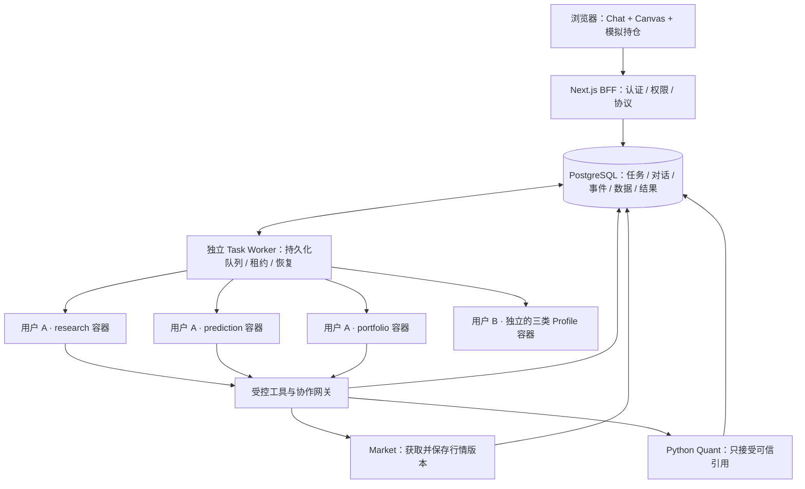
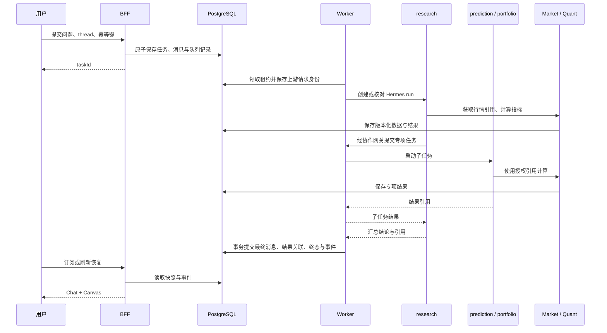
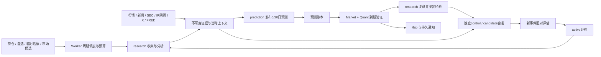

# Hermes Alpha Lab — 多 Profile 系统架构

> 版本：v1.2 · 2026-11-12。状态：首版已有部署记录；持续研究与预测闭环已在代码中实现并开展本地验证，新来源和新版生产运行时尚待单独验收。
> 面向多用户的美股研究与模拟分析工作台，不包含真实下单。

本文是架构依据；接口见 [API 契约](./api-contract.md)，事件见 [Canvas 协议](./canvas-protocol.md)，术语见 [领域词汇](../GLOSSARY.md)。[v1.0 手绘图](./architecture-handdrawn.png)仅为历史参考，其单 Profile 和阶段划分不再适用。

## 1. 用户体验与职责

用户在统一聊天入口提出问题，research 规划研究，按需调用 prediction、portfolio，汇总有来源的结论；右侧 Canvas 展示服务端保存的真实数据。普通问答不必启动专项任务。

| 模块 | 职责 | 边界 |
|---|---|---|
| Next.js / assistant-ui | 聊天、进度、结果、持仓表单 | 浏览器只访问 BFF |
| Next.js BFF | 会话认证、权限、配额、持久化提交、SSE、Canvas 校验 | 不进行模型推理和财务计算 |
| Task Worker | 调用 Hermes、管理父子任务、收集事件、恢复与归档 | 确定性执行机制，不是额外 Agent |
| research | 理解问题、获取证据、分派任务、汇总回答 | 不生成可信价格或计算收益 |
| prediction | 发布 5/20 日前瞻预测、运行隔离经验试验，保留旧统计基线 | 收益、评分和到期判定由 Market / Quant 完成 |
| portfolio | 分析已保存的模拟持仓 | 不修改持仓、不连接券商 |
| Market / Quant | 获取行情、计算指标、预测及组合统计 | 从可信数据引用读取输入 |

## 2. 总体架构

### 用户隔离与部署

- research、prediction、portfolio 是角色模板，实际 Profile 按用户、执行上下文与角色创建；个人与群上下文分开，独立 home、记忆、Skills 状态、session、凭证和容器。容器按需启动，持久卷保留；同一 Profile 只允许一个实例和一个活动执行，其他任务排队。
- 不挂载其他用户目录、宿主机凭证或 Docker socket。禁用不必要的终端、任意文件和网络工具；允许的工具通过网关访问。行情供应商密钥留在 Market 服务，数据库凭证不交给模型。
- 容器身份绑定 user/profile；可信执行器在运行开始前绑定 task/session。工具网关从服务端身份与活动执行映射获取授权上下文，模型参数不能选择 userId、任意 Profile 地址或上游凭证。
- 所有业务资源默认用户私有，跨用户查询统一返回 404。即使公开行情允许内部复用，用户研究引用和报告仍单独授权。角色隔离不能替代用户隔离。
- BFF、Worker、工具服务与 Hermes 使用私有网络，公网只开放 Web HTTPS。会话 Cookie 使用 HttpOnly、Secure、SameSite；写接口验证 Origin/CSRF。
- MVP 使用 PostgreSQL 队列和独立常驻 Worker，不依赖 Next.js 请求结束后的后台代码，也不要求引入 Redis。Worker 池必须允许父任务等待时专项任务继续运行。

## 3. 自动协作与上下文

research 通过项目自定义工具 `submit_specialist`、`get_specialist_result` 分派任务。Worker 校验角色、权限、请求键和预算，再调用目标 Profile 的 Runs API。它不是 Hermes 原生跨 Profile 编排的承诺。

首版仅允许 research 向 prediction、portfolio 单层分派，每个父任务每角色最多一个专项子任务。专项 Profile 不能继续分派。提交返回子任务 ID；查询使用有界等待，超时返回 pending，不重复提交。所有子任务继承父任务截止时间和用户身份，结果以引用回传。

用户可有多个 thread。应用数据库保存用户可见消息、任务关系和结果引用；Hermes 保存各 Profile 的执行上下文。映射为 `(userId, threadId, role) → hermesSessionId`，不跨 Profile 共用 session。后台研究与双臂试验使用单独 thread，不把系统提示写成用户聊天消息。专项任务使用服务端构建的最小上下文包，包括问题、股票、时间范围及授权数据/持仓引用，不复制其他角色的私人记忆。

普通问答和研究统一走 `/api/research` 与 Runs API，取消独立的 Chat Completions 执行路径。同一 thread 串行处理用户回合，追问携带已确认的研究上下文；“把它改成一年”能解析到前一轮股票。歧义或缺少持仓时返回澄清问题，用户下一条消息启动新任务，不臆造输入。

assistant-ui 使用 LocalRuntime + ChatModelAdapter，由历史适配器从 BFF 恢复消息；适配器累积 delta 后向 LocalRuntime 提交完整内容。渲染层用 `useSmoothText` 把到达的增量逐字展开（首屏历史直接整段显示，不重放；最终回答替换前缀不一致时直接吸附），因此即使服务端按批送达，读者看到的也是连续生成的文本。Zustand 只保存页面/Canvas 状态。首版关闭消息编辑、分支和重新生成；显式“重新分析”是新任务。只有 research 的最终回答写入主对话，专项进度显示为任务状态。

## 4. 可信数据与首版能力

Market 先保存带版本的原始行情和元信息，再返回 datasetRef。Quant 只接收引用及白名单参数，自行读取输入；拒绝将模型提供的价格序列作为事实。结果不可覆盖，保存输入版本、参数、代码版本、来源及计算时间。研究解释与数值事实分开保存。

价格口径、交易所时区、交易日、数据截止时间必须明确。收益使用一致口径的收盘价；预测默认拆股调整、不含分红的价格收益。指标缺失返回 null，不能用零或前值悄悄补齐。金额与价格在线上传十进制字符串，财务计算使用 Decimal；统计计算的数值转换与精度记录在 Quant 版本中。

| 角色 | 首版交付 | 验收要求 |
|---|---|---|
| research | OHLCV、MA20、RSI14、证据摘要 | 真实来源；MA 为收盘价简单均值，RSI 使用 Wilder 平滑；取足预热数据后裁剪显示区间 |
| prediction | 20 日平均日收益预测下一交易日收益 | 最近 60 个已完成目标日逐点评估，每点仅使用此前 20 个收益；至少 81 个连续有效交易日收盘价；对照零收益预测，报告 MAE/RMSE |
| portfolio | 模拟持仓市值、权重、集中度 | 用户表单提交美股代码、非负数量及美元现金；报告总市值、最大权重及权重平方和；不接券商 |

上述一日预测保留每个预测起点、输入截止时间、预测值和已观测结果，不允许根据测试期挑选窗口；历史评估标记为回溯评估，不能冒充事前发布记录。该旧计算始终标为“探索性统计基线”，与第 9 节的前瞻预测账本分开。严格 point-in-time 回测还需供应商历史版本支持，未验证前不能声称已消除所有历史修订偏差。

组合行情使用同一已结束交易日的未调整收盘价与该日持仓快照，显示 asOf。数量和现金只能由认证用户保存为新版本，模型仅可读取。价格缺失、过期或日期不一致时返回部分明细与原因，总估值和权重为 null；零资产组合权重为 null。

## 5. 完整执行与恢复

BFF 在发送上游前持久化请求；重复提交返回同一任务。Worker 租约带 generation，旧持有者不能覆盖新持有者状态。上游创建响应丢失时沿用原请求身份核对，未知执行不换键重跑。详细边界见 API 契约。

浏览器断开不取消任务。Worker 持续收集并归档事件；重启后扫描非终态任务，核对上游和工具账本。上游事件已经过期时，以持久化工具结果及可查询的最终回答恢复；无法证实完整结果则标记 interrupted/unknown，不能伪报完成。工具执行也按稳定 operation key 去重。

取消传播到子任务和 Quant 作业；父任务关闭前必须确认全部执行退出。关键子任务失败时保留部分结果，但父任务不标 completed。超时触发停止流程而非立即假定工作消失。

## 6. 实施阶段与验收

| 阶段 | 交付 | 验收 |
|---|---|---|
| M1 | 登录、工作台、统一 thread | 两用户资源隔离，刷新恢复对话 |
| M2 | 用户 × 三角色运行环境、工具网关 | 记忆/目录/工具权限隔离；无越权调用 |
| M3 | 任务 Worker、幂等、状态机 | 响应丢失和重启不重复执行；取消覆盖子任务 |
| M4 | Market / Quant 数据链 | 引用可追溯，伪造价格输入被拒绝 |
| M5 | 三角色自动协作 | 研究、基线预测、手工模拟组合都实际跑通 |
| M6 | Canvas 验证与存储 | 五类首版组件、安全引用、基础布局保存 |
| M7 | 事件归档与恢复 | 关闭浏览器后完成，再进入可恢复全文和画布 |
| M8 | 失败路径、限额、审计 | 缺失数据不造图；未知状态可见；部分结果不冒充成功 |

阶段 2：策略收益回测与 backtest_result、SEC 深度分析、报告版本对比、高级布局编辑。阶段 3：高级模型训练、walk-forward 研究、概率校准、组合优化、共享工作台。基础任务历史、画布保存、审计属于首版，不重复列为后续能力。

## 7. 建议目录与设计决策

应用实现时使用 apps/web（Web/BFF）、apps/worker（独立执行器）、packages/hermes-adapter、packages/canvas-protocol、services/quant、services/market，以及 hermes/templates 下的三个角色模板。运行实例和敏感配置不入仓库。

| 决策 | 选择与原因 | 代价/重评条件 |
|---|---|---|
| D1 | LocalRuntime 管理聊天，Zustand 管理画布 | 高级分支需求出现后重新评估 |
| D2 | BFF 与持久化 Worker 分离 | 增加一个常驻进程，换取无人在线时可靠归档 |
| D3 | 用户 × 角色独立 Profile/容器 | 增加运行资源；规模扩大后评估等价隔离方案 |
| D4 | research 单层自动分派 | 避免递归成本和循环依赖；复杂协作后再扩展 |
| D5 | 所有用户输入统一进入应用任务 | 普通聊天也经过队列，换取一致恢复和权限 |
| D6 | Quant 只接收可信数据引用 | 需要保存输入版本，防止模型污染数值事实 |
| D7 | PostgreSQL 保存任务、事件和结果 | 规模证明需要后才增加其他队列或对象存储 |

## 8. 实现门槛、证据与参考

首版 M1–M8 已实现并完成目标环境验收，证据见 [实施状态](./implementation-status.md)。后续部署仍必须选定行情供应商及授权、固定 Hermes 版本/镜像摘要，并记录认证、会话、幂等、工具身份传递、事件、取消及恢复的真实集成证据。缺少关键能力时阻止对应路径启用，不静默切换协议或使用演示行情。

验收必须覆盖：跨用户引用和记忆；伪造输入；相同键重复提交与冲突；创建响应丢失；Worker/Hermes 重启；停止竞态；子任务失败；断线超过事件保留期；过期画布更新；NVDA 追问“一年”；预测样本不足；持仓缺价和零资产。

- [Hermes Profiles](https://hermes-agent.nousresearch.com/docs/user-guide/profiles)
- [Hermes API Server](https://hermes-agent.nousresearch.com/docs/user-guide/features/api-server)
- [Hermes MCP](https://hermes-agent.nousresearch.com/docs/user-guide/features/mcp)
- [Hermes 上游源码补丁清单](./hermes-upstream-patches.md)（本项目对锁定上游的实际修改、事件契约与升级规则）
- [assistant-ui LocalRuntime](https://www.assistant-ui.com/docs/runtimes/custom/local-runtime)
- [Lightweight Charts](https://tradingview.github.io/lightweight-charts/docs)

官方资料核对日期：2026-11-06；这些链接描述上游当前能力，不是本项目锁定版本的验证记录。Lightweight Charts 仅在客户端绘图，公开页面按其 NOTICE 和文档要求保留 TradingView 署名与链接。

## 9. 持续研究、前瞻预测与经验试验（迁移 029–031）

这次扩展复用 PostgreSQL、Task Worker、三个 Hermes Profile 和现有 Market / Quant。持续研究池属于个人上下文，群研究不读取或修改这份个人预测/经验账本。确定性的调度、到期结算和经验评分由服务器执行；Hermes 负责证据解释、提出判断和复盘归因。网页 `/lab` 提供研究池、预测记录、经验试验和研究设置；既有聊天及 Canvas 继续使用。

### 研究池与后台工作

持仓取每个组合最新快照中的正数量股票，自选沿用 `watchlist`。优先级依次为持仓、自选、临时观察、市场候选；交互研究优先于后台阶段。建立个人交互股票上下文会加入或延长临时观察，期限为纽约当前日期之后的第 20 个交易日；已有持仓/自选不降级。临时和市场候选过期后停止例行采集，既有预测仍正常结算。用户恢复临时/候选观察会重新计算期限；移除股票不删除历史证据或改写持仓。

调度使用 XNYS 日历及纽约开收盘时间，处理假日、夏令时和提前收盘。盘前 30 分钟检查持仓与自选；最新交易日收盘后 20 分钟检查研究池、扫描市场。默认每天最多深研 30 个不同股票，其中新增市场候选最多 10 个；同股不同阶段和两个期限不重复占股票名额。预算不足保存 `deferred`，重复的未开始股票刷新合并进原工作；后续按层级、上次研究时间和排队时间续跑。关闭持续研究停止新增周期研究，已发布预测的结算仍由 Worker 执行。

后台工作分为 `collect → analyze → publish`，另有 review/trial 阶段，阶段结果写入 checkpoint；每段模型任务预算为 120 秒，释放槽位须等待真实终态，不承诺抢占正在运行的 Agent。Worker 入口默认 `RESEARCH_SINGLE_ROOT=1`；同一根任务的子任务仍可推进。未知执行保留 blocked/unknown，不创建替代运行。默认上海时间 08:00 生成摘要，网页通知先保存，飞书投递走既有 outbox 和绑定身份。

市场扫描保存实际 active/tradable 美股目录、ETF 基准、缺失记录与 feed。排名使用绝对相对收益、20 日均量之比和已获取新闻数量的等权百分位；新闻不可用时明确缺项，使用其余因素。默认八个高分候选加两个可复现探索候选，向调度器提供后续候选以补足去重后的名额。扫描不是历史股票范围重建，证券类型过滤依赖资产目录名称；新闻来源不是所有公司公告的完备索引。失败扫描保留不可变 attempt，五分钟后可追加重试，同日已有成功结果复用。

### 证据、上下文与冷启动

来源适配器覆盖 Alpaca 日线/新闻，SEC 公司身份、申报、标准财务 facts 与部分申报原文，Brave 搜索与公开网页正文，X recent，以及 FRED/ALFRED vintage。公司 IR、股东大会问答和讨论页面通过网页入口读取；脚本渲染评论、付费全文和音视频转录未实现。配置要求见 README，缺配置和请求失败是显式来源状态。

`research_evidence` 按来源标识和内容版本保存，分别记录 `published_at` 与 `observed_at`；无法核实公开时间时保留 null。转发链接可关联原文，来源事件的稳定 `eventKey` 不因同一文档改版而改变。每轮网络采集共享 22 秒截止时间，取消后保留已经完成的内容和每个来源状态。

`research_contexts` 保存不可变的 as-of 快照，包含当时已获取证据、个人上下文中已保存的行情引用、用户持仓、既有预测、公司/SIC 同业关系及适用经验。价格数据的创建时间与行情截止时间均不得晚于快照。新股票即时建立资料；可检索同业或同类事件方法，但显示自身积累状态，不把同业样本计作该股成绩。主预测上下文只含 active 经验；research 协调者可读取影子候选的版本、范围和适用条件以选择试验，普通 prediction 的上下文不包含这些候选字段。候选规则正文仅进入对应的独立试验臂。

### 预测与复盘账本

prediction 通过 `publish_forecast` 发布不可变声明：股票、5/20 个交易日期限、预期收益、上涨概率、80% 收益区间、论点、失效条件和证据/行情/经验版本引用。服务器记录发布时间与模型/方法/运行时身份，按发布后首个未开盘交易日确定起点；盘前发布可以从当日开盘开始。收益为该起点开盘到含起点的第 5/20 日收盘，采用同次拆股调整行情，不含分红。

到期后等待 20 分钟，Quant 计算绝对误差、平方误差、方向、Brier、区间覆盖和区间评分，同时保存零收益基线和相对 SPY 的实际超额收益。缺结算数据时记录原因并待后续补齐。判断变化用 `supersedesForecastId` 追加版本，原记录继续结算；汇总主成绩只计原始预测期，避免通过改判重复累计样本。同一事件的预测到期后，可以为新目标期发布新的原始预测并单独计分；未到期改判仍须显式引用原版本。旧 `quant_calculate(kind=prediction)` 仍是首版的一日回溯基线，不进入这份前瞻成绩。

research 可对已结算的成功或失败预测保存复盘，并区分证据支持的解释、假设和无法归因的部分。新经验保存适用范围、事件类型、期限与失效条件，默认进入 shadow；原预测、评分、复盘和经验版本均保留。

### 独立双臂经验试验

试验必须来自经验创建后公开的新事件。同一经验版本、股票和事件只建立一次试验，同事件修订不增加样本。control 与 candidate 分别绑定独立 thread/session，使用同一冻结证据、行情、现行 active 经验及预测日程；candidate 额外读取候选规则。两臂不能查询对方输出，也不能临时拉取新证据。两臂分布都须在预定开盘前保存，超时未齐不纳入有效样本。

按模型、运行时、方法和现行经验版本分组，取时间顺序上首个满足要求的完整新样本批次：至少 30 个不同的“股票 × 事件”样本，行业/通用经验还需至少 5 家公司，公司经验不受公司数要求。候选平均 Brier 至少改善 0.01，且 MAE 与区间评分均不劣化超过 5%，才晋升 active。后续未重复使用的新批次不达标则退回 shadow；这些是已实现的工程阈值，不是统计显著性结论。retired 是保留状态，当前没有人工退休工具。

### 部署与验证边界

029 保存预测/复盘/双臂试验，030 保存来源证据、上下文、覆盖设置和扫描，031 保存调度、deferred 积压与通知。既有运行角色须通过更新后的增量授权入口取得新表权限；Worker 现在可追加后台证据、结算结果和试验记录，不能沿用首版仅调度权限。新增工具目录须执行 `pnpm hermes:catalog` 后随 Hermes 运行时更新。

Quant 由 Web、Tools 或 Worker 启动真实 Python 进程；生产部署须保留 `services/quant` 和已安装依赖的 Python 环境，必要时显式设置 `QUANT_PROJECT_ROOT` / `QUANT_PYTHON`。本次 PostgreSQL、Python、受控工具与供应商 fixture 验证不等于新增来源的真实账户联调，也不等于新版 Hermes 镜像或生产服务已切换；这两类验收须单独记录。
