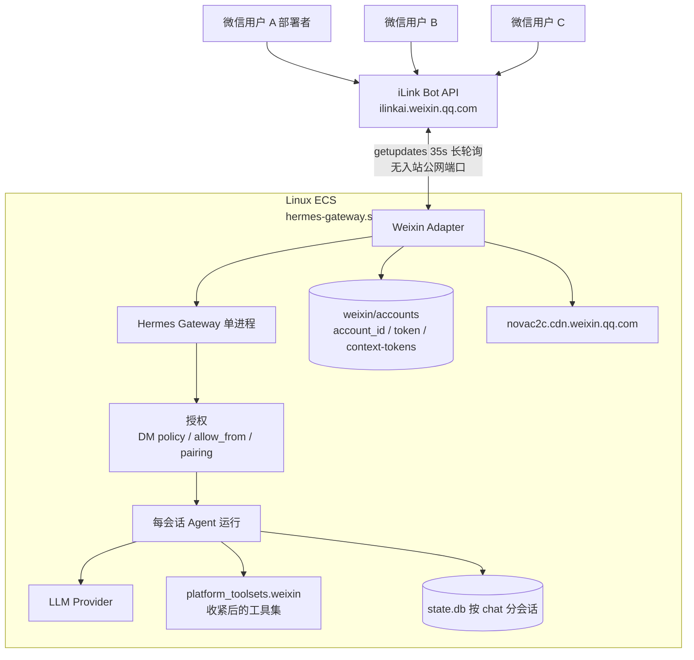

# Hermes × 微信 iLink Bot 多用户部署方案（v1.0 修订版）

> 版本：v1.0 修订 · 2026-11-10。状态：**待验证**，非已执行报告。
> 修订依据：Hermes 官方文档全文 `https://hermes-agent.nousresearch.com/llms-full.txt`（含
> `docs/user-guide/messaging/weixin`、`docs/user-guide/security`、`docs/user-guide/sessions`、
> `docs/user-guide/features/memory`、`docs/user-guide/features/cron`、`docs/user-guide/profiles`、
> `docs/user-guide/multi-profile-gateways`、`docs/features/tools`），以及本机对目标服务器的实际探测。

本文是"一台 Hermes 主机 + 一个 iLink Bot 身份 + 多个微信用户私聊"的部署设计。它取代原稿的可疑处，
并把"工程假设"与"文档确认"分开标注。

---

## 0. 与 v1.0 原稿的差异（先看这一节）

| # | 原稿说法 | 实际（文档/现场） | 结论 |
|---|---|---|---|
| 1 | `WEIXIN_DM_POLICY=pairing` 作为初期方案 | Weixin 的 `dm_policy` 取值含 `pairing`，但 `hermes pairing approve <platform>` 的示例只有 telegram 等；且多数内置聊天平台设置 `allowlist_suppresses_pairing`——一旦配了 `WEIXIN_ALLOWED_USERS`，未知发送者被静默忽略而不是发配对码 | pairing 只能作为一次性探测手段，不能作为准入机制 |
| 2 | 白名单是"最终固定"形态 | `WEIXIN_ALLOWED_USERS` 是**入站过滤器**，不是邀请机制；未知用户必须先能私聊到 Bot 才能在日志里拿到 ID | 可达性验证（T02/T03）必须排在白名单之前 |
| 3 | 只关 `agent.disabled_toolsets` 或只关记忆 | 记忆有三层开关：`memory.memory_enabled`、`memory.user_profile_enabled`、`agent.disabled_toolsets: [memory, session_search]`；`platform_toolsets.weixin` 已被 `hermes tools` 写入时优先级高于全局 | 三层都要显式写入，不能只改一处 |
| 4 | 未提及 `hermes gateway install --system` | 存在 `sudo hermes gateway install --system`（开机 system 服务，`User=` 以调用者身份运行），对 ECS 比 user + linger 更稳 | P2 用 `--system` |
| 5 | 未提及 cron / 主动推送限制 | 网关的 cron 用 `WEIXIN_HOME_CHANNEL` 投递；对未先给 Bot 发消息的用户，iLink 返回 `ret=-2 prepare failed` / `session not ready` | MVP 明确"无主动推送" |
| 6 | 未提及多 Profile 与单网关多路复用 | 现代 Hermes 默认 `gateway.multiplex_profiles: true`：**一台主机只有一个网关进程**，服务 `profiles/` 下所有 profile；命名 profile 不再默认拥有独立网关（需 `gateway.standalone: true` 或 `--force`） | MVP 只用 default profile；隔离方案必须按多路复用现实重新设计 |
| 7 | 未提及每个 profile 的 token 锁 | 同一 bot token 被两个网关使用时第二个启动失败；`bot_users`/`allowlist_suppresses_pairing` 等平台属性 | 改名/迁移时必须先停旧网关 |
| 8 | 未提及媒体依赖 CDN | 媒体走 AES-128-ECB 加密 CDN（`novac2c.cdn.weixin.qq.com`），需 `cryptography` | 现场必须验证对该 CDN 的出站连通性 |
| 9 | 建议 2 核/4 GB 起步 | `aliyun-akshare` 实测 2 vCPU / **1.6 GB**、Ubuntu 22.04、根盘 40 G 已用 4.6 G，且已跑 nginx + docker | 该机器可用但内存偏紧，见 §3 |

结论：原稿的**安全哲学正确**（先可达性、再隔离、白名单是过滤器），但**技术细节有若干会被现场打脸的假设**。
下文按修订后的形态重写。

---

## 1. 范围

### 1.1 MVP 必须有
1. 一个 iLink Bot 身份经**一次**扫码绑定到 Hermes（`hermes gateway setup`）。
2. 部署者 A 与至少两位不同微信账号的测试者 B、C 分别私聊 Bot 并各自得到回复。
3. B、C 的会话上下文互不串线（含 `/new`、重启后）。
4. 拒绝路径明确：白名单外消息不触发模型与工具。
5. 主机重启后网关自动恢复，凭据与 `state.db` 持久化。
6. 失败可定位：分清"扫码/Token / 网络 / iLink 可达性 / 授权 / 模型 / 会话隔离 / 记忆"七类。

### 1.2 MVP 不做
- 个人微信账号模拟登录、Hook、逆向、给个人好友/群主动群发。
- 承诺普通微信群可用：iLink Bot（`...@im.bot`）身份通常收不到普通微信群事件。
- 承诺微信有 Bot 搜索入口/永久二维码/任意用户可添加。
- 终端、任意文件写、浏览器自动化、生产 MCP。
- 主动推送 / 定时任务投递给非活跃会话（依赖 context token）。
- 多租户 SaaS、计费。

---

## 2. 架构（按单进程多路复用重画）



关键事实（文档确认）：
- 传输是 HTTP **长轮询**（`getupdates`，35 s 超时），不是 WebSocket，不需要公网 webhook。
- 每个平台适配器把消息路由到**按 chat 建立的 session store**，再交给 agent。
- 网关是**单一后台进程**，同时管会话、cron 和所有已配置平台。
- 媒体经 AES-128-ECB 加密 CDN，收发都自动加解密（需 `cryptography`）。
- 同一 bot token 只能有一个轮询者（token lock），第二个实例启动即失败。
- context token 按 `account+peer` 持久化到 `~/.hermes/weixin/accounts/<account_id>.context-tokens.json`，
  支撑重启后的回复连续性；但**对方长期不发消息则 token 过期**，主动发送会退回 `session not ready`。

**会话隔离 ≠ 用户隔离。** 分 chat 会话解决的是"上下文串线"，不解决 Profile / Memory / Skills / MCP 凭据共享。
后者必须由配置显式关掉（§7）。

---

## 3. 部署主机（现场探测结果）

本机 `~/.ssh/config` 中有三台：
- `aliyun-akshare` = `8.159.158.155`（root，22）：**在线**。Ubuntu 22.04.5，2 vCPU，内存 **1608 MB**（已用 418 MB，可用约 997 MB），
  根盘 40 G（已用 4.6 G），系统 Python 3.10.12，**无** node，**无** hermes，Docker 与 nginx 在跑，80/443 已由 nginx 占用（域名 `market/dash/trading.youwei-agent.com`），
  出站 `https://ilinkai.weixin.qq.com` 返回 `HTTP/1.1 405`（连接与 TLS 正常）。
- `sg-prod` = `ubuntu-s-2vcpu-2gb-sgp1`（root，22）：**在线**。内存 7941 MB（4 vCPU），根盘 154 G 用 28 G，Docker 在跑（`alpha-lab-postgres` Up 2 天 + 六个 `alpha-*` 容器 Exited），**无** hermes。
- `23.254.219.102`：**SSH 连接超时**，不可用。

评估：
- `aliyun-akshare`：国内访问 iLink 与微信用户都在境内，**时延/可达性最优**，是 P0 验证的首选；
  但 1.6 GB 内存要同时跑 nginx + docker + Hermes 网关 + 工具依赖，属于**紧但不必然失败**（Hermes 本身是 Python 进程，
  真正的内存杀手是浏览器和本地模型）。P0 阶段够用；若开浏览器工具或并发 >3，应换 4 GB。
- `sg-prod`：内存充裕（7.9 GB），但机器在新加坡，到 iLink 与微信客户端均为出境链路，且上面已有 alpha-lab 的容器与 PG。
  **不要**把微信网关放在有生产数据的机器上（工具面即便收紧，同机文件与 docker socket 仍是风险面）。
- 公网域名入口（`trading.youwei-agent.com` → alpha_lab_digitalocean 反向代理）与本方案**无关**：长轮询不需要任何入站端口。

---

## 4. 部署步骤

### 4.1 前置检查（在目标 ECS 上）

```bash
whoami; uname -a
free -m; df -h /
git --version; curl --version; tar --version
python3 --version

# 三个出站端点都必须通（405/4xx 也算通，重点是 DNS/TLS 不报错）
curl -sI --connect-timeout 10 https://ilinkai.weixin.qq.com | head -1
curl -sI --connect-timeout 10 https://novac2c.cdn.weixin.qq.com/c2c | head -1
curl -sI --connect-timeout 10 https://api.<your-llm-provider> | head -1
```

安全组只放行 SSH（限源 IP）。**不要**为 iLink 开放 80/443 入站。

### 4.2 安装 Hermes

```bash
curl -fsSL https://hermes-agent.nousresearch.com/install.sh | bash
export PATH="$HOME/.local/bin:$PATH"
hermes doctor
hermes setup          # 选 provider + model，写 config.yaml 与 .env
hermes -q "单轮自测"  # 先确认模型链路，模型不通就不要排查微信
```

安装器行为以脚本为准（脚本会 clone 仓库到 `$HERMES_HOME/hermes-agent`、拉取 uv/Python、跑 pm 阶段）。

### 4.3 补齐消息依赖（仅当启动报缺依赖）

```bash
cd "${HERMES_HOME:-$HOME/.hermes}/hermes-agent"
python -c "import pm; pm.sync_venv(['messaging'], explicit=True)"
```

`aiohttp` + `cryptography`（后者媒体加解密必需）由 messaging extra 提供。不要用系统 pip 装到别的解释器。

### 4.4 扫码绑定（只做一次，且只有部署者做）

```bash
hermes gateway setup       # 选 Weixin → 终端二维码 → 微信扫码 → 手机确认
```

成功后：`~/.hermes/weixin/accounts/` 落盘 `account_id`、`token`、`base_url`，控制台打印
`微信连接成功，account_id=...`，且该身份形如 `a5ace6fd482e@im.bot`。

**这不是好友二维码。** 它只是把"一个 iLink Bot 身份"绑到你的 Hermes；别的微信用户**不能**扫它。

### 4.5 授权配置（`~/.hermes/.env`，合并写入）

阶段 1 — **可达性探测**（默认 `open`，临时）：

```bash
WEIXIN_ACCOUNT_ID=your-account-id
WEIXIN_DM_POLICY=open          # 只是为了让 B/C 的入站消息进日志拿到 sender id
WEIXIN_GROUP_POLICY=disabled
```

阶段 2 — **收紧**（拿到 ID 之后）：

```bash
WEIXIN_ACCOUNT_ID=your-account-id
WEIXIN_DM_POLICY=allowlist
WEIXIN_ALLOWED_USERS=user_id_B,user_id_C
WEIXIN_GROUP_POLICY=disabled
```

注意：
- `WEIXIN_ALLOWED_USERS` 是**入站过滤器**。配了它之后，未知用户不会被发配对码（`allowlist_suppresses_pairing`），
  而是被静默忽略——这比 pairing 更适合"不给陌生人回话"。
- `WEIXIN_GROUP_ALLOWED_USERS` 名字里带 USERS，实际是 **group chat id 列表**，别填错。
- 不要用昵称、手机号、扫码用的个人微信号、Bot account_id 代替发送者 ID。

### 4.6 工具面收紧（`config.yaml` 与 `hermes tools`）

三层分别写，缺一层就漏一层：

```yaml
# ~/.hermes/config.yaml —— 合并写入，不要整体覆盖
agent:
  disabled_toolsets:
    - memory          # 连带 MEMORY_GUIDANCE 注入一起去掉
    - session_search  # 否则模型能检索到别人的历史
    - terminal
    - file
    - browser
    - code_execution
    - delegation
    - mcp             # 或逐个 mcp-<server>
```

同时用 `hermes tools` 把 weixin 平台的工具集显式收紧（它会写 `platform_toolsets.weixin`，
**优先级高于全局**，所以不能只靠上面的 `disabled_toolsets` 判断结果）。

### 4.7 记忆关闭（三层）

```yaml
memory:
  memory_enabled: false
  user_profile_enabled: false
```

文档明确：两个开关都为 `false` 时内置记忆库整体关闭、`memory` 工具自动隐藏；`agent.disabled_toolsets: [memory]`
是更重的一刀（还去掉提示词注入）。**两者都要做**，因为它们控制的是不同层面。

若以后接入外部 Memory Provider、`session_search`、可读文件工具、自定义 Skill 或生产 MCP，
这三层都不再成立——必须按用户/信任域拆 Profile（§8），而不是靠关开关。

### 4.8 前台联调

```bash
hermes gateway                      # 前台运行，长轮询
journalctl --user -u hermes-gateway -f    # 或直接看前台输出
```

让 B、C 分别私聊 Bot，在日志里抓 `sender user id`，填进 `WEIXIN_ALLOWED_USERS`，重启网关复测。

### 4.9 常驻（ECS 用 system 服务）

```bash
# 先彻底停掉前台实例（否则 token lock 冲突，且可能双发/去重异常）
hermes gateway install --system     # Linux：开机 system 服务，User= 以调用者身份运行
hermes gateway start
hermes gateway status
hermes gateway status --system      # 显式查看 system 服务
```

若要 cron 的 restart-safe worker（`systemd-run --user --scope`）可用，还需 `sudo loginctl enable-linger <user>`；
不做 linger 时 cron 会降级并只记一条告警。**MVP 不开 cron**，因此这一项不阻塞。

配置改动后：`hermes gateway restart && hermes gateway status`。

---

## 5. 多用户接入的真实顺序（P0）

```
部署者：hermes gateway setup → 自己扫码 → 得到独立 Bot account_id（...@im.bot）
      → 启动 gateway
测试者 B：在微信里找到这个 Bot 身份 → 主动私聊 → 发一句带唯一标记的话
Hermes：日志出现 B 的入站事件 + sender id      ← 这一步不通过，方案到此为止
部署者：把 B 的 id 写进 WEIXIN_ALLOWED_USERS → restart → B 再发一句 → 得到回复
测试者 C：重复
A/B/C：交叉验证上下文（T05）与记忆（T06）
```

必须承认的微信侧限制（官方文档原文要点）：
- iLink bot 身份**通常无法**像普通联系人那样被邀请进普通微信群。
- iLink **通常不投递**普通微信群事件（包括 @ 扫码用的个人号）给网关。
- `@` 扫码用的个人微信号 ≠ `@` iLink bot，是**两个不同身份**。
- 若只有扫码的本人能对话，先确认别人是在给 **bot 身份**发消息，而不是给个人微信号发。
- 若群消息在日志里完全没有 raw inbound 事件，那限制在 iLink 侧，不在 Hermes。

**P0 停止条件：** B/C 找不到或无法私聊同一 Bot → 记录微信版本、Bot 身份类型、尝试过的发现路径、
iLink 返回错误/入站事件缺失情况，**不要**进入 P1；改评估飞书 / 企业微信（有正式应用分发与成员管理）。

---

## 6. 会话、记忆与权限边界

| 隔离层 | 事实 | MVP 控制 |
|---|---|---|
| 用户入口 | `dm_policy` + `allow_from` | 固定 `allowlist` |
| 私聊会话 | 网关按 chat 建 session | 两账号交叉验证不串上下文 |
| `state.db` | 同一网关存多会话 | 文件权限 0600 + 加密备份 + 仅运维可读 |
| 内置记忆 | Profile/Home 范围共享，**不是**按微信用户隔离 | 三层开关全关 |
| `session_search` | 可跨会话检索 | 工具集里禁用 |
| Skills / Toolsets | 同 Agent 继承高权限工具 | `platform_toolsets.weixin` + `disabled_toolsets` 双写 |
| 外部 MCP / 文件 / 搜索 | 可能读他人数据 | 默认不接入 |
| 多 Profile | 可隔离 config/.env/SOUL/sessions/memories/skills/cron/state.db | §8，非 P0 前提 |

注意：
- `/new` 只清当前会话视图，**不删** `state.db` 记录，也不清长期记忆。
- "提示词里写不许泄露隐私"不是授权控制。
- 同一 Hermes home 被两个 agent 进程同时写是官方明令禁止的（会互相污染记忆）。

---

## 7. 测试与验收

| ID | 测试 | 通过标准 |
|---|---|---|
| T01 | 部署者扫码登录 | 网关连上 iLink，首次私聊有回复 |
| T02（阻断） | B 找到 Bot 并私聊 | B 不扫管理码也能发起并收到回复 |
| T03（阻断） | C 同样独立可达 | 同上 |
| T04 | 访问控制 | 未授权用户不能触发 LLM/Skills/终端/MCP；日志有拒绝记录 |
| T05 | 上下文隔离 | A 的随机短语 B/C 拿不到，反向亦然；`/new` 后仍不串 |
| T06 | 记忆隔离 | 无跨用户 MEMORY / USER 记忆；`session_search`/`memory` 工具不可用 |
| T07 | 网关重启 | A/B/C 老会话可续聊，无重复消息（去重 5 min 窗口） |
| T08 | ECS 重启 | system 服务自启，重连长轮询 |
| T09 | 会话过期 | 日志出现 `errcode=-14`，重扫码后恢复；旧 token 不泄露 |
| T10 | 模型不可用 | 错误可定位为模型侧，不误诊为 iLink |
| T11（可选） | 媒体 | 图片/文件/语音按能力收发（含 CDN 加解密） |
| T12 | 红队 | 自然语言诱导无法执行越权命令或读他人数据 |

上线门槛：T01–T10 全通过；T05/T06 必须覆盖会话检索、记忆、Skill、可读文件等**所有已开启**通道。

---

## 8. 后期：按用户隔离（多 Profile 的现实）

官方推荐的强隔离是"一个用户一个 Profile"（各自 `config.yaml`/`.env`/`SOUL.md`/memories/sessions/skills/state.db）。
但现代 Hermes 的默认拓扑是**一台主机一个网关多路复用所有 Profile**：

- `gateway.multiplex_profiles` 默认为真，多 Profile 主机上单网关服务全部 Profile；命名 Profile **默认不再拥有自己的网关**。
- 想保留"一 Profile 一网关"需要 `gateway.standalone: true`（官方标注为**临时兼容 shim**，会移除）或 `--force`。
- 同一 bot token 不能被两个网关轮询；`--clone-channels`、`hermes gateway migrate --multiplex` 都会拒绝重复凭据。

因此"一微信用户一 Profile 一 Bot 身份"（每 Profile 一个独立 iLink Bot）在拓扑上**可行**，
但需要评估两点：①每个 Bot 身份都要一次独立扫码；②`standalone` 是临时路径，未来要回到多路复用。
**这不是 P0 的前提**，P0 只用 default profile + `allowlist`。

---

## 9. 运维

### 9.1 监控
- 网关进程存活 / 重启次数（`hermes gateway status`、systemd unit 状态）。
- Weixin 适配器连续失败次数、长轮询重连、`errcode=-14` 出现次数（→ 需重扫码）。
- 入站消息量、被 allowlist 拒绝数、模型错误率与 p50/p95 延迟。
- 单用户 token 用量与费用上限、异常突增。
- 凭据存在性与权限（`.env`、`weixin/accounts/` 应 0600）、磁盘与日志量、`state.db` 可写。

重试行为（文档）：1–2 次瞬时错误 2 s 后重试；3 次以上退避 30 s 后复位；`errcode=-14` 暂停 10 min；
超时立即重新长轮询。

### 9.2 备份
- 备份 `config.yaml`、`state.db`（用 SQLite 在线备份或停服一致性备份，别裸拷 WAL）、
  加密后的 `weixin/accounts/`（含 token 与 context token）、`weixin/*.context-tokens.json`。
- 恢复到新机后**先停旧网关**，再起新的，避免同 token 双轮询。
- 日志与备份按隐私数据处理，别送进不受控的日志平台。

### 9.3 故障树

```
Bot 不回复
├─ 网关没起 / 崩了：hermes gateway status；systemctl status hermes-gateway
├─ 依赖缺失：aiohttp / cryptography → pm.sync_venv(['messaging'])
├─ 会话过期：日志 errcode=-14 → hermes gateway setup 重扫码
├─ 别的用户根本到不了 Bot：微信侧可达性 / 是否发给了个人号而非 @im.bot
├─ 有入站但不触发：dm_policy=allowlist 且 sender 不在 WEIXIN_ALLOWED_USERS（静默忽略，不报错）
├─ 能触发但模型失败：LLM key / 网络 / 额度（与微信无关）
├─ 主动推送失败：ret=-2 prepare failed / session not ready → 对方需先发消息恢复 context token
└─ 重复消息 / token 冲突：是否有两个网关用同一 token；去重窗口只有 5 min
```

---

## 10. 里程碑

| 阶段 | 最小交付 | 退出条件 |
|---|---|---|
| P0 可行性 | ECS + Hermes + iLink Bot（`open` 临时） | T01–T03 通过；否则转飞书/企业微信 |
| P1 安全接入 | allowlist、三层工具收紧、三层记忆关闭 | T04–T06 通过 |
| P2 持续运行 | `gateway install --system`、日志、备份/恢复、故障手册 | T07–T10 通过 |
| P3 增强 | 预算、看板、按信任域拆 Profile、媒体 | 经隐私与权限复核后扩量 |

MVP 判断：T02/T03 失败 → Hermes 即使支持多 DM，也不适合作为"任何微信用户都能加"的公开入口。

---

## 11. 待现场核实清单（部署时逐条勾掉）

1. `hermes gateway setup` 当前版本是否仍走 iLink 扫码、二维码过期自动刷新次数（文档写最多 3 次）。
2. `hermes pairing` 是否接受 `weixin` 平台参数（文档示例只出现 telegram）——只作探测，不作机制。
3. `platform_toolsets.weixin` 在 `hermes tools` 中的实际可选项，与 `disabled_toolsets` 叠加后的最终生效集（用 `hermes tools list` 核对）。
4. 三个出站端点（iLink / 微信 CDN / LLM）在目标 ECS 上的实际连通性。
5. 目标机内存是否足以支撑并发 3 用户 + 已启用的工具（`aliyun-akshare` 仅 1.6 GB）。
6. 群事件是否真的不投递（若未来要群聊，这是唯一判据）。
7. `hermes gateway install --system` 在该发行版下生成的 unit 名称与日志路径。

---

## 12. 参考（官方文档，2026-11-10）
- Weixin (WeChat) 适配器：`/docs/user-guide/messaging/weixin`
- Messaging Gateway：`/docs/user-guide/messaging`
- Security（授权顺序、pairing、文件写入保护、容器隔离）：`/docs/user-guide/security`
- Sessions：`/docs/user-guide/sessions`
- Memory：`/docs/user-guide/features/memory`
- Cron：`/docs/user-guide/features/cron`
- Tools & Toolsets：`/docs/user-guide/features/tools`、`/docs/reference/toolsets-reference`
- Profiles：`/docs/user-guide/profiles`
- Running Many Gateways（多路复用/standalone）：`/docs/user-guide/multi-profile-gateways`
- 全文：`https://hermes-agent.nousresearch.com/llms-full.txt`

本文是文档推导 + 单次现场探测，**不是**执行报告；命令与参数以部署时 `hermes --help` 与运行日志为准。
