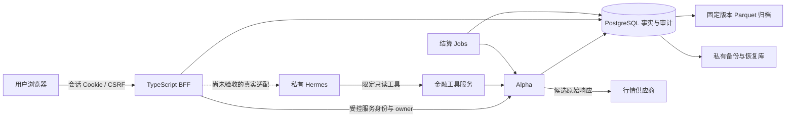

# YTA 威胁模型与月度预算检查

状态：TASK-008 `IN_PROGRESS`。范围依据架构任务书§1.2：MVP为单租户、NVDA日线、单Profile、用户确认冻结及版本化结算；Beta的外部新闻/财报、多Profile和训练制品扩大攻击面，不能继承MVP验证结论。本文记录现有代码和本机证据，不代表staging渗透测试、真实Provider或完整Hermes接入已通过。

## 数据流与信任边界



浏览器、用户输入、模型输出和供应商响应都不能授予数据库权限或用户确认。BFF从已认证会话取得owner和确认请求；Alpha执行金融校验及事实事务。迁移owner是单独的高权限身份，应用runtime仅追加事实。部署操作者、镜像构建链和持有服务凭证的进程属于高信任边界，仍须最小权限与可追溯操作。

需保护：Provider/模型/数据库凭证、会话与CSRF材料、owner归属、冻结事实与原始快照、结算版本/审计、数据可获知时间、模型配置/制品、请求身份及未知执行状态、可恢复备份、账单和资源额度。

## 风险登记册

严重度表示未控制时的影响；“局部验证”不等于风险关闭。任何高风险变更应保留相应负例和实际部署证据。

| ID / 严重度 | 攻击或故障入口 | 当前控制与证据 | 剩余工作 / 责任模块 |
|---|---|---|---|
| T01 高 | 猜测密码、账户枚举、并发登录耗尽资源 | 登录账户/peer共享限额、固定错误、密码计算并发上限；BFF登录与PG测试 | 实际代理IP边界、部署HTTPS、外部压测；BFF/运维 |
| T02 高 | Cookie窃取、CSRF、跨owner查询/冻结/取消 | 会话Cookie、Origin/CSRF、资源归属；鉴权/浏览器负例 | 上线域名/TLS、会话恢复与安全响应；BFF/Web |
| T03 高 | 模型或工具冒充用户确认；服务凭证被窃取后伪造owner | 只有BFF认证会话可触发公开冻结；工具token只读，Alpha事务校验；ADR-011及PG权限测试 | 服务token仍是高权限能力，需密钥隔离/轮换/部署访问控制；BFF/Alpha/运维 |
| T04 高 | 重复POST、响应丢失、进程重启造成重复执行 | 持久请求身份、幂等事务、未知状态不自动重发；真实PG提交故障和锁定Hermes探针 | 真实Adapter尚未验收；上游保留期过期后原键也不永久防重；BFF/Hermes |
| T05 高 | 篡改行情、伪造历史as_of、填补价格缺口、回放混入LIVE | Decimal、交易日历、时点/来源/hash校验、模式隔离、过期输入拒绝；Alpha/PG测试 | 授权真实行情、历史可用时间、供应商质量资格仍未完成；Alpha/数据 |
| T06 高 | 修改冻结事实、修订覆盖旧结果、owner凭证误用于运行服务 | 不可变触发器、SELECT/INSERT角色、单独迁移owner、版本化结算 | 部署凭证/备份恢复权限验证和迁移审查；数据库/运维 |
| T07 高 | 恶意提示诱导终端/文件/任意MCP调用，跨Profile泄漏 | 工具allowlist、只读金融工具、Profile认证；锁定镜像工具负例及Gateway上下文探针 | 同UID可读其他Profile文件，任意插件/完整工具配置未证明OS隔离；TASK-027仍受门槛约束；Hermes/工具 |
| T08 高 | 外部URL/重定向泄露凭证或访问内网 | 服务URL仅服务端配置、固定供应商origin/分页约束、拒绝重定向；真实HTTP故障测试 | 后续新闻/SEC抓取须独立限制目标和正文；数据接入 |
| T09 中高 | 错误消息、追踪、镜像上下文泄露token或用户内容 | 固定错误码、结构化有限字段日志、无凭证的Web、Docker构建排除本地env；追踪/镜像探针 | 第三方运行时日志、运维访问和留存策略部署审计；全服务/运维 |
| T10 高 | 无限研究、慢连接、失败重试、磁盘增长造成费用或资源耗尽 | 请求大小、按owner额度、有限并发/超时、SSE上限、采集总时限、退避；已有测试 | 没有全局金额拦截、跨实例并发上限和完整存储容量策略；BFF/Jobs/运维 |
| T11 高 | 损坏/恶意备份、还原错误版本、恢复后盲目重发 | 新库恢复、可信manifest、内容/权限/序列校验、原预测重现、Parquet重建；恢复演练 | 异地取回、Hermes一致备份、训练制品、真实RTO/RPO；运维 |
| T12 高 | 发布/停机竞态导致写入丢失，暂停被误认为事务撤销 | BFF写入入口暂停、Jobs停派/信号排空、未知执行保留；HTTP/PG/子进程验证 | 全实例入口/调度控制、在途对账、staging切换仍待验证；运维/BFF/Jobs |

核心证据入口：[实施状态](implementation-status.md)、[Hermes观察](../infra/hermes/runtime-observation.json)、[写入入口验证](../infra/verification/write-admission-observation.json)、[Jobs停派验证](../infra/verification/jobs-dispatch-observation.json)、[恢复Runbook](recovery-runbook.md)。这些记录必须结合对应源码哈希阅读，不能把旧镜像结果套到新版本。

## 高风险接口的审查要求

- `POST /auth/login`：额度与错误脱敏不能被账号是否存在、代理头或并发实例绕过；不得打印密码或Cookie。
- `POST /sessions/{id}/messages`：会话owner、模式、请求身份和额度先核对；结果未知时不能发起替代Run。模型输出只作为内容，不成为控制权限。
- `POST /predictions`、`POST /predictions/{id}/corrections`：认证用户确认、草稿归属/有效期、协议/模式和幂等一致；金融事务仍在Alpha。
- Run状态、SSE与取消：读取与控制都校验owner；SSE断线只续读，取消不撤销已发生的工具副作用。
- Alpha私有工具与供应商采集：不接受浏览器传入的owner授权、Provider URL或凭证；证据不可用应明确返回不可用。
- 模型/Skill/Memory提案和制品晋升：尚未具备完整审批链，不能把模型建议直接变成运行配置或新权限。
- 迁移、恢复、发布和路由切换：operator身份与环境范围必须明确；验证失败不允许修补原始事实来过关。

## 现有资源限制不等于金额预算

| 已实现限制 | 当前默认/范围 | 不能推出的结论 |
|---|---|---|
| 新研究请求额度 | 每owner/模式滚动24小时50条，可配置1–10000 | 不是全局月度token/金额预算；多owner会累加 |
| 研究执行 | 每BFF进程最多2个活跃Run | 横向扩容后不是全局最多2个 |
| 研究截止时间 | 默认120秒，可配置100–300000毫秒 | 不保证远端模型停止计费或工具副作用停止 |
| 浏览器JSON请求 | 解压后32KiB | 不等于LLM输入token上限 |
| SSE | 每BFF进程、每owner最多4条流 | 不等于跨实例总连接上限 |
| 密码计算 | 每进程最多4个并发 | 不等于整个部署容量规划 |
| Massive候选采集 | 有限页数/正文、总采集时限及固定目标 | 请求价格/授权和月账单仍未核验 |
| 结算重试 | 有上限退避和抖动，已有outcome不进入初始队列 | 失败重试仍可能消耗外部请求；没有金额预留账本 |
| 日志与Parquet | 本地容器日志轮转；DuckDB2线程/256MB、禁用自动扩展 | 备份/原始证据增长、云存储/出站费用不受此约束 |

## 月度金额预算与预警阈值

尚未取得用户确认的月度金额上限，也没有完整可信账单输入。示例文件的 `monthly_limit` 和各项费用均为null，不能据此宣称有剩余额度。真实模型继续使用用户指定的pi agent配置；本文不更换模型、不猜测供应商价目、不打开额外计费服务。

检查采用单币种、显式月份和信息截点：`known_total = 已发生费用 + 未结算剩余承诺`。剩余承诺不应重复计入已发生费用。基础设施、模型、行情数据、存储/备份四类都必须提供两个字段；未知使用null，明确为零才填字符串"0"。不同币种分别检查，不做隐式汇率换算。

在已确认上限B下，检查器使用80%×B作为预警阈值，100%×B作为达到上限阈值。这只是本地报告策略，不是账户侧已执行的硬额度：

| 状态 | 条件与动作 |
|---|---|
| UNCONFIGURED | B缺失；报告配置未完成，不声称预算内 |
| INCOMPLETE | 费用有缺项且已知金额尚未达到B；补齐费用证据，不能把缺项当零 |
| WITHIN_LIMIT | 所有费用完整且总额低于80%×B；仅表示本次输入的判断，不是未来花费保证 |
| WARNING | 完整总额达到80%×B但低于B；由负责人审查剩余任务和承诺 |
| LIMIT_REACHED | 已知金额已经达到B，即使仍有缺项也足以触发；人工核对并按运行手册控制新增派发，已发生费用不会因停止而撤销 |

检查器用Decimal计算并返回字符串金额；输入数据、来源真实性、税费覆盖及账期归属由调用方核对。自动Provider对账、每Run价格快照、预留/释放、跨实例硬拦截、通知和费用看板尚未实现，属于TASK-038/095/104后续工作。

```sh
uv run python scripts/check_cost_budget.py --input infra/budget/monthly.example.json
```

示例预期UNCONFIGURED并退出1，不代表工具故障。使用时复制到私有目录，填写经确认的币种/上限、账单截点及费用；不要放入token、用户消息或私有连接串。只读检查的退出码：0=WITHIN_LIMIT，1=需要处理的预算状态，2=无效输入。工具不访问网络、不改配置、不发送通知、不停止任何任务。来源标记始终为CALLER_SUPPLIED_NOT_VERIFIED。

## 发布前仍需证据

在全新克隆/远端CI和staging复现高风险接口负例；确认真实Provider授权、服务身份和公网/私网边界；实际审查Hermes工具与文件隔离；确认月度上限、可信计费来源和异常通知负责人；演练预算耗尽时的停止/核对路径。当前仓库没有完整这些证据，TASK-008以及相关发布门槛保持进行中。
